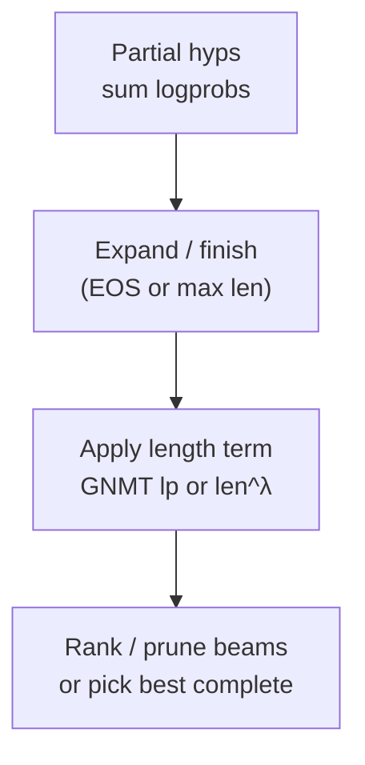

Length penalty (also called length normalization) is a rescoring rule that adjusts a sequence's cumulative log-probability by a function of its length before ranking candidates. It exists because autoregressive models score full strings as products of token probabilities: every extra token multiplies the joint probability by a value less than 1, so raw sequence log-prob trends more negative as length grows. Without a correction, [beam search](glossary://beam-search) and other multi-hypothesis rankers systematically prefer short, safe endings.

In libraries the same idea appears as a float hyperparameter (often `length_penalty` or $\alpha$). It does not change the model weights or next-token logits during expansion. It changes how finished (or compared) hypotheses are ordered after their log-probs have been summed.

## Intuition

Think of ranking two answers by total log-prob: one is "late" and one is "needs review." The longer string has more factors in the product $P(y_1)P(y_2)\cdots P(y_T)$, so it can lose on joint probability even when each token is reasonable. Length penalty divides (or otherwise scales) the cumulative score by a length term so candidates of different lengths compete on something closer to average quality, not raw product mass.

It corrects a *ranking* bias toward short outputs. If the model is poorly calibrated, or your task wants extreme brevity, a length term can overshoot and reward padding or force cutoffs; evaluate output length on the target task.

## Formula

### GNMT length normalization

Google's Neural Machine Translation (GNMT) system ranks a candidate $Y$ for source $X$ with a length-normalized score (coverage term omitted here):

$$
s(Y, X) = \frac{\log P(Y \mid X)}{lp(Y)}, \qquad
lp(Y) = \frac{(5 + |Y|)^\alpha}{(5 + 1)^\alpha}
$$

Here $|Y|$ is the hypothesis length in tokens, and $\alpha \ge 0$ controls strength. When $\alpha = 0$, $lp(Y) = 1$ and the score is pure log-prob. Larger $\alpha$ weakens the short-sequence bias. GNMT reported $\alpha$ near $0.6$ to $0.7$ as a strong range on some development sets, then often used milder values (for example $\alpha = 0.2$ with a coverage term) after further tuning. Tune $\alpha$ on held-out examples from the target task.

### Hugging Face / common library form

Hugging Face Transformers (and compatible beam scorers, including vLLM-style ports) apply an exponential length term to the summed log-likelihood:

$$
\mathrm{score}(Y) = \frac{\sum_{t=1}^{|Y|} \log P(y_t \mid y_{<t}, x)}{|Y|^{\lambda}}
$$

where $\lambda$ is `length_penalty`. Because the numerator is typically negative, $\lambda > 0$ makes longer sequences less harshly ranked (promotes length), $\lambda = 0$ recovers raw sum log-prob, and $\lambda < 0$ pushes the decoder toward shorter outputs. Default $\lambda$ is often $1.0$ (mean log-prob style normalization). This power form is *not* identical to GNMT's $(5+|Y|)/(5+1)$ offset; the qualitative role of the knob is the same. Check the implementation's length convention: current Transformers beam search excludes the decoder prompt from the denominator, and EOS handling can differ across stacks. Length normalization also enters stopping bounds, so it can change which continuations are explored even though it does not change their logits.

### Related but different: exponential decay length penalty

Some stacks also expose `exponential_decay_length_penalty` as a *logits processor*: after a start index, EOS is increasingly favored with an exponential schedule. That steers generation online toward stopping. Classic beam length penalty instead reweights completed (or comparable) hypotheses at ranking time. Do not confuse the two APIs.

## Worked numbers

Reuse a small beam ranking case with $\alpha = 0.6$ (GNMT-style $lp$):

| Hypothesis | $\log P$ | $\|Y\|$ | $lp = ((5+\|Y\|)/6)^{0.6}$ | Normalized $s = \log P / lp$ |
|---|---|---|---|---|
| short: `"late"` | $-1.00$ | 2 | $\approx 1.10$ | $\approx -0.91$ |
| full: `"needs review"` | $-1.08$ | 5 | $\approx 1.36$ | $\approx -0.79$ |

Raw log-prob prefers `"late"` ($-1.00 > -1.08$). After length normalization, the complete hypothesis ranks higher ($-0.79 > -0.91$). Same qualitative flip appears under HF-style scoring with $\lambda = 1$: mean log-prob is $-0.50$ vs $-0.216$, again favoring the longer string.

```python
def gnmt_score(log_probability: float, length: int, alpha: float = 0.6) -> float:
    penalty = ((5 + length) / 6) ** alpha
    return log_probability / penalty

def hf_score(log_probability: float, length: int, length_penalty: float = 1.0) -> float:
    if length <= 0:
        raise ValueError("scored hypothesis length must be positive")
    return log_probability / (length ** length_penalty)

assert gnmt_score(-1.00, 2) < gnmt_score(-1.08, 5)  # prefers full
assert hf_score(-1.00, 2, 1.0) < hf_score(-1.08, 5, 1.0)
```

## Diagram



## Example

In production decoding with Hugging Face beam search:

```python
outputs = model.generate(
    **inputs,
    num_beams=5,
    do_sample=False,
    early_stopping=True,
    length_penalty=0.6,  # HF λ; not identical to GNMT α, same role
    max_new_tokens=64,
)
```

Typical tuning:

| Setting | Effect |
|---|---|
| $\alpha$ or $\lambda = 0$ | Pure joint log-prob; short, clipped outputs common |
| moderate ($0.6$ to $1.0$) | Often better BLEU/ROUGE on MT or summarization beams |
| very large | Long, padded, or verbose winners; can hurt latency and quality |
| negative $\lambda$ (HF) | Explicit bias toward shorter strings |

On a held-out set of $N$ documents, sweep $\lambda$ (or $\alpha$) jointly with `num_beams` and `max_new_tokens`, and score the metric you ship (BLEU, ROUGE, factuality, human prefs). GNMT-style tables showed large BLEU lifts from turning length normalization on versus pure probability beam search, with a fairly wide plateau of good $\alpha$ values.

## Debug path

When beam outputs are systematically wrong-length:

1. Log raw cumulative log-prob **and** length-normalized score for the top beams. If raw ranking and normalized ranking disagree, length is load-bearing.
2. Confirm which formula your stack uses (GNMT $lp$ vs $L^\lambda$). Copying $\alpha = 0.6$ into HF as $\lambda = 0.6$ is common and often fine, but not algebraically the same.
3. Check hard length controls (`min_new_tokens`, `max_new_tokens`, EOS handling, `early_stopping`). Length penalty cannot override a tiny `max_new_tokens` or a model that never emits EOS.
4. For open-ended chat, prefer sampling (`temperature`, top-p) over fighting beam + length penalty. High-likelihood beams stay bland even with perfect $\alpha$.

## Trade-offs

Length penalty adjusts a mathematical bias in beam ranking, while beam search still optimizes (normalized) likelihood and may prefer generic phrasing. Encoder-decoder MT systems sometimes add a *coverage* penalty to encourage attention to use source tokens; decoder-only LLM APIs rarely expose that. On the training side, reward models and RLHF can learn a separate length bias ("longer looks better"); that data/reward issue requires its own fix even though both effects appear as length artifacts in production metrics.

## Why it matters here

The curriculum treats length scoring as part of decoding literacy: sequence likelihood is not average quality, and multi-hypothesis search without length handling fails in predictable ways (clipped summaries, premature EOS). When you ship beam or n-best decoding for translation, captioning, or structured generation, length penalty is one of the first knobs to inspect. When you ship open-ended assistants, you usually leave beam (and this knob) behind and control length with budgets, stop strings, and sampling instead.

## Related terms

- [Beam search](glossary://beam-search)
- [Logprob](glossary://logprob)
- [Autoregressive decoding](glossary://autoregressive-decoding)
- [Temperature](glossary://temperature)
- [Token budget](glossary://token-budget)
