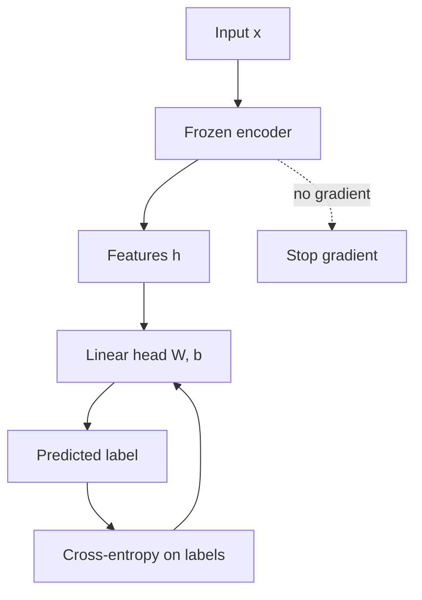

A **linear probe** is a linear classifier (or linear regression head) trained on **frozen** intermediate or final representations of a neural network. The backbone stays fixed; only a weight matrix $W$ and optional bias $b$ learn to map features $h$ to labels. High probe accuracy means the target property is **linearly readable** from those features. It does not by itself prove that the network *uses* that property for its original task.

Alain and Bengio (2016) introduced linear classifier probes as non-invasive diagnostics: treat each layer's activations as a fixed feature bank and measure how well a separate linear model can predict class labels. The same recipe is the standard **linear evaluation** protocol in self-supervised and transfer learning: freeze a pretrained encoder, train a linear head on labeled data, and report accuracy as a score of representation quality (for example the SimCLR linear evaluation protocol). In production LLM and vision stacks you also meet linear probing as a **cheap adaptation** path: keep the expensive encoder frozen and train only a small head for routing, safety, intent, or domain tags.

Three related uses share the math but differ in intent:

| Intent | Question answered | Typical freeze |
| --- | --- | --- |
| **Diagnostic probe** | "Does layer $\ell$ encode property $P$ in a linearly readable way?" | Entire model; only the probe trains |
| **Linear evaluation / transfer** | "How good are these features for task $T$ under a weak head?" | Encoder; only the classification head trains |
| **Last-layer adaptation** | "Can I ship a domain classifier without fine-tuning the backbone?" | Encoder; head is the product model |

A deep nonlinear probe can almost always fit labels if it has enough capacity, so probe strength confounds representation quality with probe power. Linear probes stay deliberately weak: if a linear map works, the geometry of $h$ already nearly separates the classes.

## Intuition

Think of the frozen encoder as a fixed coordinate system and the probe as drawing hyperplanes in that space. Training never moves the points; it only learns which directions separate labels. That is why linear probing is a fair comparison across encoders: every model is judged by how well *its* frozen space admits a simple decision boundary.

Deeper layers of a well-trained classifier usually become more linearly separable for the training task (Alain and Bengio observed near-monotonic improvement of probe accuracy with depth on ResNet-50 and Inception v3). The data processing inequality bounds mutual information through deterministic layers; the gain is **computational convenience** because later $h$ is reshaped so a linear head can read it.

For LLMs the same idea applies to [residual stream](glossary://residual-stream) states, last-token hidden vectors, or pooled embeddings. Probing for "true vs false," sentiment, syntax, or toxicity asks whether a linear direction in activation space predicts a human label. That is useful for interpretability and for building lightweight monitors. High probe accuracy supplies correlational evidence; causal circuit claims require additional interventions.

## Formula

Given frozen features $h \in \mathbb{R}^{d}$ for input $x$ and $C$ classes, a multi-class linear probe predicts

$$
\hat{p}(y \mid h) = \mathrm{softmax}(W h + b), \qquad W \in \mathbb{R}^{C \times d},\ b \in \mathbb{R}^{C}.
$$

Train only $(W, b)$ with [cross-entropy](glossary://cross-entropy) on labeled pairs $(h_i, y_i)$; gradients do **not** flow into the encoder that produced $h$. For binary labels the head is often logistic regression: $\sigma(w^\top h + b)$. For regression (for example probing a continuous score), use a linear map $w^\top h + b$ with squared or Huber loss.

**Parameter count.** Trainable size is $C \cdot d + C$ (or $d+1$ for binary). That is tiny next to a multi-billion-parameter backbone: for $d=4096$, $C=10$, you train about $41\mathrm{k}$ floats.

**Extract-then-fit recipe** (common in SSL eval and offline analysis):

1. Run the frozen encoder once; cache $H \in \mathbb{R}^{n \times d}$ and labels $y$.
2. Fit logistic regression / a linear layer on the train split of $H$.
3. Report accuracy, F1, or AUROC on a held-out split of $H$.

Sklearn-style logistic regression with L2 regularization is a valid linear probe; a one-layer `nn.Linear` trained with SGD is the same model class.

## Diagram

## How it works

1. **Choose a readout.** Final pooled embedding, `[CLS]` / last-token state, mean pool, or a specific layer $\ell$. For transformers, last-token residual stream is a frequent choice for sequence-level labels.
2. **Freeze the backbone.** Export features with `torch.no_grad()` or detach; never update encoder weights during probing. Use `eval()` for deterministic feature extraction and fixed BatchNorm running statistics; `no_grad()` alone does not disable dropout or BatchNorm state updates.
3. **Fit the head.** Train $(W,b)$ on a labeled train split until validation plateaus. Prefer early stopping on a validation split; L2 regularization helps when $d$ is large and $n$ is small.
4. **Score on held-out data.** Report probe metrics on data the head did not train on. For representation benchmarks, also fix the train/val protocol across models so differences are about features, not probe tuning.
5. **(Optional) Deploy.** If the head is the product classifier, version the encoder id, pooling rule, and head weights together. Training-serving skew on pooling or layer choice kills accuracy silently.

**LP vs full fine-tune vs LP-FT.** Full fine-tuning updates the encoder and often wins **in-distribution** accuracy. Kumar et al. (2022) show that when pretrained features are already strong and the distribution shift is large, full fine-tuning can **distort** features along the ID span and underperform linear probing **out-of-distribution**. Their practical fix is **LP-FT**: first train a linear head on frozen features, then fine-tune the whole model starting from that head. The head starts near a good solution so the encoder moves less aggressively. Empirically on their ten shift datasets, full FT was about +2% ID and −7% OOD vs LP on average; LP-FT improved both.

## Example

**A. Representation eval (vision SSL style).** You pretrain a ResNet on unlabeled images with a contrastive loss. To score the encoder:

- Cache train and test features $h = f_\theta(x)$ with $\theta$ frozen (projection head discarded; probe the representation before it).
- Fit multinomial logistic regression on the labeled train split of the eval task.
- Report top-1 test accuracy. As an uncited order-of-magnitude sketch (not a standard published STL-10 leaderboard result), PCA + linear can sit near the mid-30s percent while stronger contrastive features + linear land much higher: the probe class stayed weak; only $h$ improved.

**B. Hypothetical LLM intent router.** Suppose a 7B chat model already runs for generation. You need a 5-way intent tag (`billing`, `tech_support`, `cancel`, `abuse`, `other`) before the agent scaffold branches.

1. Collect $8\mathrm{k}$ labeled user messages; hold out $2\mathrm{k}$.
2. Embed each message as the last-token residual of layer $L$ (or a sentence embedding API with a fixed model id).
3. Train a linear probe; validation accuracy hits 91%, majority baseline 34%.
4. Ship the head as a sidecar: one matrix multiply on cached activations. Measure its latency on the target hardware; features must be available before the routing decision.

The head is cheap relative to the backbone, but extraction and fitting times depend on sequence lengths, hardware, and optimization. Full [supervised fine-tuning](glossary://supervised-fine-tuning) updates far more parameters and can alter pretrained behavior; compare measured costs and held-out quality for the actual workload.

**C. Layer diagnostic.** On a frozen BERT checkpoint, probe POS tags from each layer. Early layers often win for local syntax; later layers for some semantic labels. The curve tells you *where* the property becomes linearly readable, not that the model "thinks" in POS tags.

## Worked numbers

Feature dim $d = 768$, $C = 4$ classes, $n = 10{,}000$ labeled examples.

| Quantity | Value |
| --- | ---: |
| Probe parameters | $4 \times 768 + 4 = 3{,}076$ |
| Encoder parameters (illustrative 110M model) | $\sim 1.1 \times 10^8$ |
| Probe / encoder ratio | $\approx 0.003\%$ |
| Feature cache float32 | $10{,}000 \times 768 \times 4\,\mathrm{B} \approx 29.3\,\mathrm{MiB}$ |

If train accuracy is 99% but validation accuracy is 62%, investigate overfitting, label quality, and distribution differences; those numbers alone do not identify the cause. If both train and validation sit near chance, check optimization, regularization, class imbalance, and pooling before concluding that the property is not linearly available. Try another layer or a nonlinear adaptation when a well-controlled linear fit remains weak.

## Trade-offs

| Approach | Strength | Weakness |
| --- | --- | --- |
| **Linear probe only** | Cheap, preserves pretrained geometry, strong OOD when features are already good | Cannot fix a bad encoder; weak if classes need nonlinear features |
| **Full fine-tune** | Best ID fit when labels demand feature change | Can distort features; heavier compute; OOD risk (Kumar et al.) |
| **LP then FT (LP-FT)** | Often best of both on ID and OOD | Two stages; still not free of overfitting |
| **LoRA / adapters** | Middle ground: partial capacity without full FT | More knobs than a pure linear head |
| **Deep probe (MLP)** | Higher fit | Confounds "info present" with "probe can invent"; less selective |

**What fails in production**

- **Wrong freeze contract:** someone fine-tunes the encoder "a little" while reporting "linear probe" numbers; comparisons become meaningless.
- **Layer / pooling drift:** train on mean-pool layer 12, serve last-token layer 24.
- **Label leakage and tiny $n$:** with $d \gg n$, even a linear head overfits; use regularization, fewer features, or more labels.
- **Over-interpreting accuracy:** a probe can read a property the model never uses for generation. Control tasks and selectivity metrics (Hewitt and Liang-style analyses in the probing literature) exist for research rigor; for product heads, trust held-out and slice metrics more than the probe story.
- **Spurious linear directions:** the head latches onto length, template tokens, or class imbalance. Inspect slice-level errors alongside aggregate accuracy.

## Why it matters here

Linear probing is the default ruler for "are these embeddings useful?" in self-supervised learning, multimodal models, and encoder selection for RAG and classification. It is also the cheapest path from a foundation model to a domain tagger or safety score when you can tolerate a linear decision boundary. Understanding LP vs full fine-tune vs LP-FT keeps you from paying for full updates when a head would do, and from celebrating an ID fine-tune that quietly wrecked OOD behavior. For LLM engineers, probes connect representation geometry, [embedding](glossary://embedding) eval, lightweight production heads, and interpretability readouts on the residual stream.

## Related terms

- [Embedding](glossary://embedding)
- [Supervised fine-tuning](glossary://supervised-fine-tuning)
- [LoRA](glossary://lora)
- [Residual stream](glossary://residual-stream)
- [Cross-entropy](glossary://cross-entropy)
