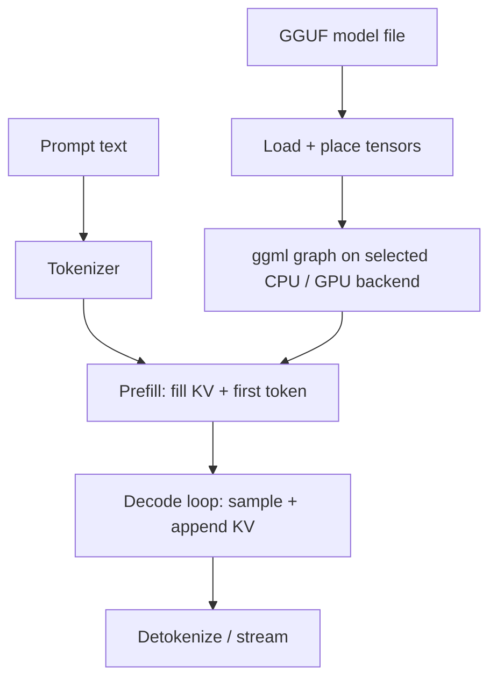

**llama.cpp** is a C/C++ inference engine for running large language models with minimal dependencies, strong CPU and edge performance, and optional GPU acceleration. It loads models in the [GGUF](glossary://gguf) format, builds a [ggml](https://github.com/ggml-org/ggml) compute graph for the architecture, and executes that graph on one or more backends (CPU SIMD, Metal, CUDA, HIP, Vulkan, and others). Georgi Gerganov and the ggml community created it so open-weight models can run on laptops, workstations, phones, and hybrid CPU+GPU machines without a full Python training stack.

Its main focus is **local, portable, quantized inference**: fit a model in RAM/VRAM you already have, measure prefill and decode speed, and ship offline or edge demos that still feel usable. `llama-server` also supports multi-user parallel decoding and continuous batching. Choose between it and [vLLM](glossary://vllm) by measuring the target hardware, model, concurrency, and latency requirements rather than assuming that batching exists only in dedicated GPU servers.

## Intuition

Python stacks (PyTorch, Transformers) optimize for flexibility and research. llama.cpp optimizes for **bytes moved per token** and **setup friction**. Decode on a single request is mostly memory-bound: each new token needs a weight matmul against a thin activation. If weights are 4-bit and kernels stay in SIMD or GPU without framework overhead, tokens per second rise even when FLOPs look modest.

Three pieces form the local stack:

| Piece | Role |
|-------|------|
| **ggml** | Tensor library: ops, graphs, backends, quantized matmul kernels |
| **GGUF** | Weights + architecture, tokenizer, and runtime metadata; large models can use split GGUF files |
| **llama.cpp** | LLM API around ggml: architectures, [KV cache](glossary://kv-cache), sampling, chat templates, CLI/server |

Apps such as Ollama, LM Studio, GPT4All, and KoboldCpp sit above this stack. When you "run a GGUF locally," you are usually exercising llama.cpp or a close fork of it.

## How it works

1. **Load GGUF.** Map or read the file; parse metadata (`general.architecture`, context length, tokenizer, optional chat template) and tensor table (name, shape, `ggml_type`, offset).
2. **Place weights.** Assign layers or tensors to devices. Current CLI builds let `-ngl` / `--n-gpu-layers` take an exact maximum, `auto`, or `all`; recent builds often default to `auto` (confirm on your release), and `--fit on` can adjust unset memory-related arguments to fit available devices. An explicit integer caps how many layers stay in VRAM, while the remaining work stays on host backends. Exact tensor placement depends on model architecture, backend, split mode, and release, so verify the startup log instead of inferring placement from one flag.
3. **Build a compute graph.** Each forward step is a graph of ops (embeddings, attention, FFN, norms, logits). The planner splits work across backends and allocates scratch and KV memory.
4. **Tokenize the prompt** with the tokenizer embedded in the GGUF (or an override when tools allow).
5. **Prefill.** Process the full prompt (often batched as a multi-token batch). Fill the KV cache and produce the first output distribution. Prefill is more compute-heavy (GEMM-like) than single-token decode.
6. **Decode.** For each next token: run one position, append $K$/$V$ to the cache, sample (temperature, top-$k$, top-$p$, grammars, penalties), and repeat until stop or length limit.
7. **Detokenize** streamed tokens for the user or for the OpenAI-style HTTP API.

Autoregressive cost without a cache would recompute the whole prefix every step. With a KV cache of length $t$ at a given layer, the new step only projects the new token and attends $q_t$ to cached $K_{1:t}, V_{1:t}$:

$$
\mathrm{Attention}(q_t, K_{1:t}, V_{1:t})
= \mathrm{softmax}\!\left(\frac{q_t K_{1:t}^\top}{\sqrt{d}}\right) V_{1:t}.
$$

Memory for the cache still scales with layers, KV heads, head dim, sequence length, and concurrent slots. Quantized **weights** do not automatically quantize the **KV cache**; long context can OOM after the file "fits."

## Diagram



## Example

You want an 8B instruct model on a 16 GB laptop with a 6 GB GPU.

Approximate weight sizes (order of magnitude; real files add metadata and unquantized special tensors):

| Representation | Rough weight footprint |
|----------------|------------------------|
| FP16 | $\sim 8 \times 10^9 \times 2$ B $\approx$ **16 GB** (tight or too large alone) |
| Q4_K_M GGUF | $\sim$ **4.5 to 5 GB** on disk |

Build or install llama.cpp, obtain a compatible GGUF, then run these illustrative commands. Verify the 28-layer setting against the target 6 GB GPU; KV cache, compute buffers, drivers, and other applications also consume memory.

```bash
# CLI: chat with partial GPU offload and 8k context
llama-cli -m Llama-3.1-8B-Instruct-Q4_K_M.gguf \
  -ngl 28 -c 8192 -n 256 \
  -p "Explain llama.cpp in two sentences."

# OpenAI-compatible HTTP API on port 8080
llama-server -m Llama-3.1-8B-Instruct-Q4_K_M.gguf \
  -ngl 28 -c 8192 --port 8080
# POST http://localhost:8080/v1/chat/completions
```

What to record for a fair comparison against a hosted or Transformers baseline:

- Quant type (`Q4_K_M` vs `Q5_K_M` vs `Q8_0`)
- Backend (CPU-only vs Metal vs CUDA) and `-ngl`
- Context length and prompt/output token counts
- Prompt processing tokens/s (prefill) vs generation tokens/s (decode)
- Chat template and sampling settings (temperature, top-$p$, stop tokens)
- Peak RSS and VRAM at the **real** max context; record model-file size as a separate planning metric

```bash
# Built-in microbenchmark (pp = prompt processing, tg = token generation)
llama-bench -m Llama-3.1-8B-Instruct-Q4_K_M.gguf
```

## Trade-offs

| Strength | Limit |
|----------|--------|
| Minimal deps; ships as native binaries | Not the default choice for huge multi-GPU continuous-batching fleets |
| Excellent quantized CPU and hybrid CPU/GPU paths | Peak GPU throughput for large concurrent load often favors vLLM / TGI / TensorRT-LLM |
| GGUF packages model tensors and metadata portably (sometimes in split files) | Quality depends on quant type, converter revision, and provenance |
| Wide backends (Metal, CUDA, HIP, Vulkan, …) | Build flags and driver stacks still matter; wrong backend = silent CPU fallback or crashes |
| `llama-server` is OpenAI-API compatible enough for many clients | Feature parity with full OpenAI (tools, multimodal details, reasoning fields) is partial and version-dependent |
| Grammars (GBNF), embeddings, rerank, speculative decoding available | API and CLI flags move quickly; pin a release for production |

Use llama.cpp when the product constraint is **fit and local latency** on commodity hardware. Compare dedicated GPU serving engines when the constraint is **high concurrent tokens/s**, memory management across many requests, and distributed serving. Continuous batching alone does not distinguish the options.

## Debug path

**Wrong or garbled text**

1. Confirm GGUF provenance and quant type (third-party ultra-low-bit quants can collapse quality).
2. Match runtime build age to the file (new tensor types need new llama.cpp).
3. Fix [chat template](glossary://chat-template), special tokens, and system prompt; instruct models without the right template look "dumb," not "quantized."
4. Check context length and RoPE scaling metadata for long-context checkpoints.
5. Reset sampling (greedy or mild temperature) before blaming weights.

**Slow or OOM**

1. Split prefill vs decode [tokens per second](glossary://tokens-per-second); long prompts hurt TTFT, generation hurts interactive feel.
2. Tune threads (`-t`), batch/ubatch, and `-ngl`; too many GPU layers thrash or OOM, too few leave VRAM idle.
3. Shrink context (`-c`) or parallel slots (`-np` on server); KV cache often fails after weights load.
4. Verify the binary was built with the intended backend (CUDA/Metal/Vulkan), not a CPU-only build.
5. Compare against `llama-bench` on the same machine so app overhead is not confused with engine speed.

## Why it matters here

LeetLLM treats local inference as a first-class engineering skill: [quantization](glossary://quantization), memory bandwidth, KV growth, and deployment tradeoffs show up as soon as you leave a cloud playground. llama.cpp is the concrete runtime for that path. Understanding it clarifies why a 5 GB GGUF can still thrash under long context, why CPU decode can beat a poorly configured GPU path, and when to graduate from a laptop GGUF to a production GPU server.

## Related terms

- [GGUF](glossary://gguf)
- [Quantization](glossary://quantization)
- [KV cache](glossary://kv-cache)
- [Tokens per second](glossary://tokens-per-second)
- [vLLM](glossary://vllm)
