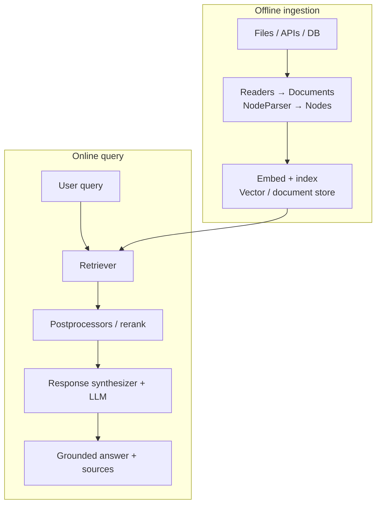

LlamaIndex is an open-source **data framework** for building context-augmented LLM apps over your own sources: connectors and parsers turn files and APIs into `Document`s, node parsers cut them into `Node`s (chunks with metadata), indexes and vector stores make those nodes searchable, and query/chat engines (or agent [workflows](glossary://agent-scaffold)) retrieve evidence and call a model. The company product line also includes managed document infrastructure (LlamaParse, LlamaCloud) that sits beside the OSS library.

Jerry Liu released the project in late 2022 (originally **GPT Index**) as a thin toolkit for [RAG](glossary://rag) over private data. It grew into a large integration surface (LlamaHub readers/stores, Python and TypeScript packages) and later into event-driven **Workflows** for multi-step agents that treat a RAG pipeline as one tool among many. In product terms the company has narrowed toward agentic document processing (OCR, extraction, index/retrieve as a managed path); the OSS framework remains the common developer entry point for load → index → query composition.

## Diagram



## How it works

Official docs break the classic path into five stages: **loading**, **indexing**, **storing**, **querying**, and **evaluation**. The library maps those stages to named objects you can swap without rewriting the whole app.

1. **Documents and Nodes.** A `Document` wraps a source unit (PDF page set, HTML page, SQL row dump, API payload). A `Node` is the atomic index/retrieve unit: text (or multimodal payload), metadata (source id, page, heading path, ACL tags), and links to parent/child or prev/next nodes. Quality is decided here: bad parse or bad [chunking](glossary://chunking) cannot be fixed by a better prompt.
2. **Connectors (Readers).** LlamaHub and built-in readers ingest native formats into `Document`s. Production stacks often put a dedicated [document parser](glossary://document-parser) (layout-aware PDF, OCR, table extraction) in front of the reader so Nodes see clean reading order, not scrambled columns.
3. **Ingestion and indexes.** An `IngestionPipeline` can chain splitters, metadata extractors, and embedding models, optionally writing straight into a vector store with caching of hashed node+transform pairs. The common index type is `VectorStoreIndex` (dense ANN over embeddings). Other index shapes exist for summary trees, keyword tables, and knowledge-graph style paths, but vector + metadata is the default enterprise shape.
4. **Retrievers and engines.** A **retriever** returns ranked `NodeWithScore` objects for a query. A **query engine** is retrieve → (optional postprocess/rerank) → **response synthesizer** → one or more LLM calls for a single Q&A. A **chat engine** wraps multi-turn history. **Routers** pick among retrievers or engines from the query; **node postprocessors** filter, dedupe, or rerank before synthesis.
5. **Agents and Workflows.** Beyond fixed RAG, LlamaIndex agents use tools (including a query engine as a tool) in a decide/act loop. **Workflows** are event-driven multi-step programs that compose connectors, retrieval, tools, and reflection steps and can be deployed as services.

High-level API (about five lines) hides defaults for splitter, embed model, top-$k$, and synthesizer. Lower-level APIs expose each module so you can pin chunk size, filters, rerankers, and store backends.

What the framework **gives**: a shared vocabulary for document RAG, hundreds of loaders/stores, composable retrievers and engines, and a path from folder-of-files demos to multi-index routing.

What it **hides if you let it**: which bytes actually entered the index, whether ACL was enforced at retrieve time, how many tokens the synthesizer packed, whether citations map to real node text, and whether eval scores measure retrieval or fluent guessing.

## Example

Support corpus: policy PDFs and HTML help pages. Goal: answer "What is the password-reset link TTL?" with cited nodes only from the caller's tenant.

Package APIs, `Settings` wiring, and provider model ids churn across LlamaIndex releases. Treat the sketch below as the ownership shape (documents → nodes → index → engine), and verify current package APIs and model ids before shipping.

```python
from llama_index.core import (
    Settings,
    VectorStoreIndex,
    SimpleDirectoryReader,
)
from llama_index.core.node_parser import SentenceSplitter
from llama_index.core.vector_stores import MetadataFilter, MetadataFilters, FilterOperator
from llama_index.embeddings.openai import OpenAIEmbedding
from llama_index.llms.openai import OpenAI

Settings.llm = OpenAI(model="gpt-4.1-mini")
Settings.embed_model = OpenAIEmbedding(model="text-embedding-3-small")
Settings.node_parser = SentenceSplitter(chunk_size=512, chunk_overlap=64)

documents = SimpleDirectoryReader("data/policies").load_data()
# Attach tenant and source metadata before indexing (simplified).
for d in documents:
    d.metadata["tenant_id"] = "acme"
    d.metadata["source"] = d.metadata.get("file_name", "unknown")

index = VectorStoreIndex.from_documents(documents)

# Trusted constant for this single-tenant demo. In an application, obtain
# this value from authenticated server-side identity, never model arguments.
caller_tenant = "acme"
query_engine = index.as_query_engine(
    similarity_top_k=3,
    filters=MetadataFilters(filters=[
        MetadataFilter(key="tenant_id", value=caller_tenant, operator=FilterOperator.EQ)
    ]),
)

response = query_engine.query(
    "What is the password-reset link TTL?"
)
print(response)
for n in response.source_nodes:
    print(n.score, n.node.metadata.get("source"), n.node.get_content()[:120])
```

That path is a few framework calls. Production still needs: parser fidelity on the PDFs, stable chunk ids for citations, trusted tenant assignment at ingestion, and [metadata filters](glossary://metadata-filter) or store-side ACL enforced by every retrieval path before content reaches synthesis. Verify that the chosen vector-store adapter supports and enforces the filters; checking `source_nodes` after generation is too late. Add freshness/reindex jobs when policies change and an eval set that scores **node hit rate**, citation match, and answer quality.

## Trade-offs

| Wins | Costs |
|------|--------|
| Document-centric RAG vocabulary (Document, Node, index, retriever, synthesizer) | Default `from_documents` can hide bad chunks and defaults that fail at scale |
| LlamaHub + vector-store integrations for many sources | Large surface area; pin versions and own critical adapters |
| Easy swap of embed model, store, top-$k$, postprocessors | Abstraction can obscure the real request path and cost drivers |
| Query engine as a tool inside agents/workflows | Agent loops multiply latency and failure modes unless budgets and allowlists are explicit |
| Managed LlamaParse/Cloud for hard PDFs and OCR | Product path and OSS path are related but not the same runtime contract |

Compared with [LangChain](glossary://langchain): LlamaIndex historically optimized for **data in → structured index → retrieve → synthesize**, while LangChain optimized for **chains/agents/tools** with broader app glue (and now a LangGraph-backed agent harness). Many teams use both, or neither once the pipeline is stable thin code. Custom code wins when authz, latency, or eval traces must be fully explicit; the framework wins when connector and index composition is the bottleneck and you keep ownership of policy and measurement.

## Debug path

When answers are wrong or leaky, expand one query into:

1. Raw source bytes and parser output (tables, order, OCR errors).
2. Node text, metadata, chunk ids, and embed model/version.
3. Query (and any rewrite), retriever type, filters applied, candidates with scores.
4. Postprocessor/reranker output and packed context token count.
5. Prompt, model response, and whether each citation substring appears in a returned node.

If you cannot see those five layers, instrument before adding another index or agent hop. Check parsing, chunk boundaries, access control, and freshness to locate the failure before changing the query engine.

## Why it matters here

LlamaIndex provides a concrete example of **document-centric RAG composition**: Nodes as the evidence unit, indexes as storage strategy, engines as the query path, and agents/workflows as optional control around that path. You still need to evaluate parse quality, chunk boundaries, embeddings, permissions, and citations. Understanding which responsibilities the library handles helps when you replace it with custom services.

## Related terms

- [RAG](glossary://rag)
- [LangChain](glossary://langchain)
- [Chunking](glossary://chunking)
- [Document parser](glossary://document-parser)
- [Metadata filter](glossary://metadata-filter)
