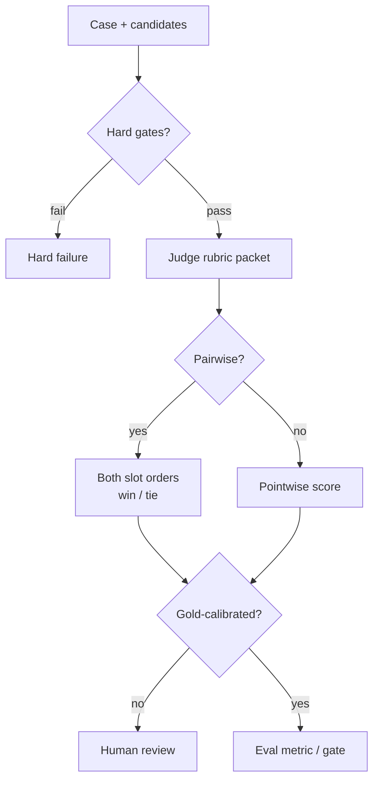

**LLM-as-a-judge** (also *LLM-as-a-Judge*) is the evaluation method of using a strong language model to grade another model's output on open-ended quality: helpfulness, clarity, instruction following, grounded tone, or preference between candidates. The judge receives a fixed rubric (and often the user prompt, candidate answers, and optional reference), then returns a score, a pairwise winner, or a structured form, usually with a short rationale.

Zheng et al. (2023) popularized the name while studying GPT-4 and peers as surrogates for human preference on MT-Bench and Chatbot Arena. Strong judges reached roughly the same agreement level with humans as humans reached with each other (over $80\%$ on non-tie comparisons in their setups). The method scales open-ended evaluation; interpret its scores in light of position bias, verbosity bias, self-preference risk, rubric sensitivity, and weak math/reasoning grading.

A [model judge](glossary://model-judge) is the concrete grader instance (model id, prompt, rubric version) inside an [eval harness](glossary://eval-harness). LLM-as-a-judge is the method and its failure modes. Deterministic evidence, safety, and schema checks decide eligibility before a judge ranks or scores outputs.

## Intuition

Exact match, unit tests, citation id match, and schema validation answer closed questions. They fail when two answers are both "allowed" but one is clearer, more actionable, or better aligned with a product tone guide. Human raters can decide those soft cases; they do not scale to every offline regression run.

An LLM judge applies a rubric and produces scores that require calibration against reviewers and deterministic checks:

| Soft quality | Hard quality |
| --- | --- |
| Clarity, tone, actionability, multi-turn helpfulness | Citation correctness, policy compliance, schema validity, tool allowlists |
| Judge or human after gates pass | Code, retrieval, and policy verifiers first |

If the judge can invent a win for an answer that hard gates already blocked, the pipeline is wrong: hard gates decide eligibility; the judge only ranks or scores eligible outputs.

## How it works

Three common judge shapes (from Zheng et al., used alone or mixed):

1. **Pairwise comparison.** Prompt + answer $A$ + answer $B$ $\rightarrow$ prefer $A$, prefer $B$, or tie. Best for A/B of two candidates on the same case. Sensitive to [position bias](glossary://position-bias).
2. **Pointwise (single-answer) grading.** Prompt + one answer $\rightarrow$ rubric score or category (for example $1$–$5$ or pass/fail). Scales better as candidates grow; absolute scores drift more across judge models and prompt rewrites.
3. **Reference-guided grading.** Same as above, but the packet includes a reference solution or validated facts. Helps on math, coding, and factual tasks where the judge can be misled by a fluent wrong answer.

Production loops usually look like:

1. Run available hard checks (citation identifiers, required abstention rules, JSON schema, and policy restrictions). Safety classifiers and semantic citation checks can miss unsafe or unsupported answers. Evaluate their errors on labeled examples and enforce authorization through trusted code.
2. Build an anonymized judge packet: case id, rubric version, validated context, candidate text in neutral slots (not "GPT-4's answer").
3. Call the judge with pinned model, temperature (often $0$ for labels; sampling if you need score distributions), and structured output. Provider or backend changes can alter results even at temperature zero, so measure repeatability across the versions you use. Treat candidate text as untrusted data: it can contain instructions designed to manipulate the grader.
4. For pairwise, **swap slots** and re-judge; keep a win only if the same candidate wins both orders (or average with explicit ties).
5. Aggregate win rates or mean scores by [evaluation slice](glossary://evaluation-slice); store rationale, rubric version, and judge model id on each [eval row](glossary://eval-row).
6. Calibrate on a human [golden dataset](glossary://golden-dataset) before the metric can power an [eval gate](glossary://eval-gate).

G-Eval (Liu et al., 2023) is a structured pointwise variant: the judge gets task intro + criteria, auto-generates chain-of-thought evaluation steps, fills a form score, and optionally turns discrete score tokens into a continuous score via probability weighting.

## Formula

**Pairwise agreement** (meta-eval against humans). On a set of rated pairs, agreement is the fraction of cases where two judges pick the same non-tie winner (definitions vary on whether ties count). Zheng et al. report strong LLM judges matching human-human agreement on the order of $80\%$+ under their MT-Bench / Arena protocols.

**Order-swap consistency.** For $N$ pairs judged in both orders $(A,B)$ and $(B,A)$:

$$
\mathrm{consistency} = \frac{1}{N}\sum_{i=1}^{N}
\mathbf{1}\{\text{decision}_i(A,B)\ \text{agrees with}\ \text{decision}_i(B,A)\}
$$

Inconsistent pairs are ties (conservative) or random (aggressive). Require a more stable rubric or judge before using a high-flip-rate evaluator for release gates.

**G-Eval continuous score.** If the form allows scores $S = \{s_1,\ldots,s_n\}$ (for example $\{1,2,3,4,5\}$) and the judge assigns probability $p(s_i)$ to token $s_i$:

$$
\mathrm{score} = \sum_{i=1}^{n} p(s_i)\, s_i
$$

Here $p(s_i)$ must be normalized over the allowed score values (divide their token probabilities by their sum). A truncated top-logprob list may omit valid scores, so it is insufficient unless that missing mass is handled. This reduces ties from pure integer scoring and can raise rank correlation with humans. G-Eval with GPT-4 reported Spearman $\rho \approx 0.514$ with human ratings on SummEval, above prior automatic metrics on that suite.

**Human calibration.** On a gold set with human labels $y$ and judge labels $\hat{y}$, report accuracy/agreement, Cohen's $\kappa$ (chance-corrected agreement), and rank correlation (Spearman $\rho$) when scores are ordinal. Promote a judge metric only after agreement, consistency, and bias probes clear fixed floors on held-out gold.

## Diagram

After hard gates pass, the host builds an anonymized rubric packet. Pairwise judgments use both candidate slot orders and aggregate wins or ties.



## Example

A support bot has two *already-grounded* replies to the same ticket. Hard gates already checked citation ids and policy action; only soft quality remains.

| Slot | Reply (shortened) | Hard gate |
| --- | --- | --- |
| $A$ | "Rollback crossed the threshold; run DEP-27." | Pass |
| $B$ | "Rollback crossed the threshold; run DEP-27, open an incident note, and page the release lead." | Pass |
| $C$ | "Keep deploying while you monitor the graph." | **Fail** (policy) |

Only $A$ and $B$ enter the judge. Rubric criteria: actionability, clarity, concision. Pairwise packet uses anonymous slots; validated policy context is stamped as already verified so the judge cannot re-litigate DEP-27.

In this illustrative example, you run both orders on an $80$-pair golden set with human winners:

| Probe | Result | Decision |
| --- | --- | --- |
| Human–judge agreement (non-tie) | $0.84$ | Acceptable for screening |
| Order-swap consistency | $0.78$ ($22\%$ flips) | Borderline; keep conservative dual-order rule |
| Verbosity stress (pad $A$ with empty lists) | Judge still prefers padded $A$ on $18\%$ of pairs | Tighten concision anchor; retest |
| Self-preference (same family as candidate $B$) | Win rate for $B$ $+0.09$ vs neutral judge | Prefer a different judge family for release metrics |

With dual-order aggregation, suppose $B$ wins $50$ pairs, $A$ wins $12$, and $18$ are ties. Those $18$ inconsistent pairs explain the approximately $22\%$ flip rate; a rule that turns every inconsistency into a tie could not produce only seven ties. The preference is a soft-quality screening signal. After tuning the rubric on this set, confirm it on separate held-out human-rated cases before using it for promotion; $C$ remains blocked regardless of any soft score.

Operational sketch (request and response structure):

```python
def pairwise_verdict(judge, case, a, b) -> str:
    first = judge.compare(case, first=a, second=b)   # "A" | "B" | "tie"
    second = judge.compare(case, first=b, second=a)
    # Map slots back to identity after swap
    first_id = {"A": "a", "B": "b", "tie": "tie"}[first]
    second_id = {"A": "b", "B": "a", "tie": "tie"}[second]
    if first_id == second_id and first_id != "tie":
        return first_id
    return "tie"
```

## Trade-offs

- **Coverage vs stability.** Judges score qualities unit tests miss; they add variance, cost, and prompt sensitivity. Pin judge model, rubric, and temperature like any other grader.
- **Pairwise vs pointwise.** Pairwise is better for head-to-head ranking of two systems; position bias forces dual-order cost. Pointwise scales to large candidate sets but needs stronger anchors and human calibration of absolute scores.
- **Strong frontier judge vs smaller specialized judge.** Frontier judges track human preference better on open chat (Zheng et al.) but are expensive, rate-limited, and may self-prefer their own style. Smaller or fine-tuned judges can be cheaper once validated on your gold set.
- **Soft metric vs release authority.** Use judges behind hard gates for screening and regression signals. Escalate ambiguous, high-severity, or low-confidence cases to [human-in-the-loop](glossary://human-in-the-loop). A trained [reward model](glossary://reward-model) scores preferences for RLHF; a versioned eval rubric defines repeatable per-case release measurements.

## Why it matters here

LeetLLM's evaluation track treats LLM-as-a-judge as a soft measurement tool for qualities that lack an exact oracle, always after evidence and policy gates. In interview and production systems, calibrate scores, swap pairwise order, and pin judge prompts before using results in a release decision. Knowing the method, its three scoring shapes, the Zheng/G-Eval results, and the bias probes makes offline dashboards and eval gates defensible.

## Related terms

- [Model judge](glossary://model-judge)
- [Position bias](glossary://position-bias)
- [Golden dataset](glossary://golden-dataset)
- [Eval harness](glossary://eval-harness)
- [Reward model](glossary://reward-model)
