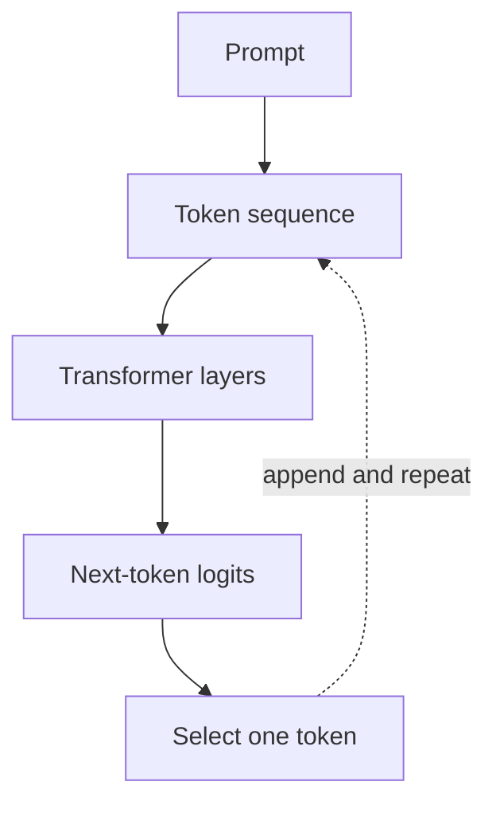

A **large language model (LLM)** is a neural network trained on large text corpora to model sequences of tokens. Most current LLMs use a decoder-only [transformer](glossary://transformer): given a prompt and previously generated tokens, the model produces [logits](glossary://logits) for the next token. Repeating that prediction step turns one learned probability model into chat, code completion, extraction, summarization, and tool-use behavior.

"Large" has no fixed parameter threshold. It describes the scale of model capacity, training data, and compute relative to earlier language models. An LLM is a statistical model. Surrounding systems provide retrieval, search, tools, memory, permissions, retries, and user experience.

## Intuition

Think of an LLM as a very large conditional next-token predictor. It reads the token sequence so far, builds contextual representations through many transformer layers, and assigns a probability to every possible next token. Training adjusts billions of parameters so observed continuations receive higher probability. Generation samples or selects one token, appends it, and runs the same process again.

That simple interface supports broad behavior because text can represent questions, programs, plans, tool calls, tables, and explanations. Capability comes from patterns compressed into weights plus context supplied at request time. Reliability still depends on evidence, validation, and application controls outside those weights.

## Diagram



## Example

Suppose a prompt ends with:

```text
The deployment failed because the container image
```

The LLM might assign high next-token probability to `was`, `could`, or `tag`. After one token is chosen, it scores the next position using the prompt plus that choice. A chat response is hundreds of these autoregressive decisions, not one atomic lookup.

At product level, same base LLM can sit behind different systems:

- a support assistant adds retrieved policy documents;
- a coding agent adds repository tools and a sandbox;
- an incident assistant adds telemetry tools and an RCA submission schema.

Model supplies language and learned reasoning patterns. Surrounding system supplies current facts, authority, and execution.

## Why it matters here

Nearly every LeetLLM topic separates model behavior from system behavior. Architecture, tokenization, pretraining, fine-tuning, quantization, serving, evaluation, retrieval, and agents all change a different part of LLM lifecycle. Keeping term precise prevents a common category error: attributing scheduler, database, authentication, or tool-runtime behavior to model itself.

## Related terms

- [Transformer](glossary://transformer)
- [Token](glossary://token)
- [Logits](glossary://logits)
- [Pretraining](glossary://pretraining)
- [Context window](glossary://context-window)
