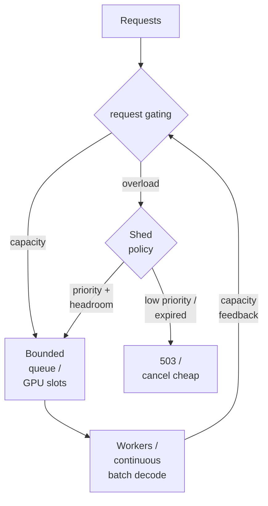

**Load shedding** is the deliberate rejection, drop, or early cancellation of some work when a service is near overload, so the work that *is* allowed still finishes with useful latency and without melting the process. Google SRE defines it as dropping some proportion of load as a server approaches overload: keep the process from running out of RAM, failing health checks, or serving extreme latency, while still doing as much useful work as it can.

Load shedding acts at overload time: when capacity is exhausted, it chooses which requests to reject or cancel so allowed work can finish. Backpressure slows a producer, rate limits and quotas cap an identity's budget, and circuit breakers short-circuit a sick dependency. These controls often sit around the same gate.

## Intuition

Power grids shed noncritical load so hospitals stay up. Serving systems do the same with request classes: interactive chat over bulk embeddings, user clicks over prefetch, paid over free, fresh deadlines over abandoned streams.

| Control | Question | Typical action when hot |
|---|---|---|
| **[Rate limit](glossary://rate-limit) / [quota](glossary://quota)** | Did this *identity* spend its budget? | Reject by policy even if GPUs are idle |
| **[Backpressure](glossary://backpressure)** | Is *this path* full? | Bound queues; await or `429`/`503` |
| **[Circuit breaker](glossary://circuit-breaker)** | Is *this dependency* unhealthy? | Fail fast or use a [fallback lane](glossary://fallback-lane) |
| **Load shedding** | Must we *discard* work to protect goodput? | Drop low priority, stale, or excess arrivals |

An unbounded queue postpones failure while consuming capacity on work clients may have abandoned. Goodput (work that meets the [SLO](glossary://slo)) often falls *before* throughput peaks, so pair bounded buffering with a shedding policy.

Little's law still applies. In steady state, average in-flight work $L$, arrival rate of *allowed* work $\lambda$, and mean time in system $W$ satisfy

$$
L = \lambda W.
$$

If service capacity is fixed and you allow unbounded arrivals, $L$ and $W$ grow together. Shedding caps the allowed $\lambda$ (or evicts low-value $L$) so $W$ for survivors stays near the SLO.

## Diagram



## How it works

### Signals

Trigger shedding from *local capacity* signals as well as global RPS:

- Concurrent in-flight requests or decode sequences above a hard cap
- Queue depth or **queue age** (often more honest for long LLM jobs)
- KV-cache free blocks near zero
- CPU / GPU utilization or end-to-end latency vs target
- Adaptive concurrency limits that raise or lower the allow cap from measured latency (Netflix-style delay/gradient limiters such as Vegas or Gradient2; some client stacks use AIMD on timeouts or rejections)

Static caps are easy to reason about. Adaptive limits track shifting cost (longer prompts, colder caches) but need floors, ceilings, and hysteresis so they do not thrash.

### What to drop (priority)

Google SRE and production gateways favor *selective* shed over random drop when request classes differ:

1. **Expired or doomed work.** Drop or cancel when the client deadline has already passed, or when queue age plus expected service time exceeds the remaining deadline (deadline-aware / CoDel-style "don't finish work nobody will wait for").
2. **Low criticality.** Prefetch, offline eval, bulk embedding, background summarize before interactive user turns (Netflix partitions user-initiated vs prefetch on a shared concurrency limiter).
3. **Cheap to refuse.** Reject *before* prefill allocates KV and GPU time. Never pay a full generation only to discard the answer at the gateway.
4. **Random / percentage drop** only as a last resort when you lack class labels; prefer fair per-tenant caps so one noisy client does not force everyone into shed mode.

### response formats

Return a clear overload signal: HTTP `503 Service Unavailable` or `429` with `Retry-After`, or an application error code clients treat as retriable *with* backoff. Distinguish "you exceeded your quota" from "fleet is overloaded." Mislabeling overload as permanent client error trains callers to hammer harder or give up incorrectly.

Shedding without client backoff can still cascade: rejected work retries immediately, multiplies load, and re-overloads the gate. Pair shed with [retry backoff](glossary://retry-backoff) budgets and jitter.

### Graceful degradation vs shedding

**Graceful degradation** does *less work per request* (smaller retrieval set, shorter max tokens, skip tools). **Load shedding** refuses *some requests entirely*. Use both: degrade first while headroom remains; shed when even the cheap path would collapse latency or stability.

## Example

In an illustrative saturated workload, a chat fleet has mean in-service concurrency $L = 64$ and mean service time $W \approx 8\,\mathrm{s}$, so allowed completion throughput is about

$$
\lambda \approx \frac{L}{W} = \frac{64}{8} = 8\ \mathrm{req/s}.
$$

A marketing campaign spikes arrivals to $25\,\mathrm{req/s}$ for two minutes. Traffic mix: $40\%$ interactive chat (priority 0), $40\%$ bulk document embedding (priority 2), $20\%$ offline eval (priority 3). For the queue arithmetic only, assume all jobs consume the same average capacity and completion rate stays $8\,\mathrm{req/s}$; real embedding and generation costs differ.

**No shedding (unbounded queue).** Excess rate is $25 - 8 = 17\,\mathrm{req/s}$. In $120\,\mathrm{s}$ the pending queue grows by roughly $17 \times 120 = 2040$ requests. Queue wait alone approaches minutes; clients time out and retry; TTFT and end-to-end p95 collapse for *everyone*, including chat.

**With priority load shedding.** Cap waiting work at $32$ (about $4\,\mathrm{s}$ of queue at $8\,\mathrm{req/s}$). When `in_flight + queued >= 96` or KV free blocks fall under a floor:

- allow priority 0 while slots remain
- Reject priority $2$ and $3$ with `503` + `Retry-After: 5`
- Evict queued eval jobs whose deadline already expired

With sufficient reserved capacity, interactive completion throughput can approach $8\,\mathrm{req/s}$ with mean time in system near $8$ to $12\,\mathrm{s}$. Interactive arrivals alone are $10\,\mathrm{req/s}$, so at least $2\,\mathrm{req/s}$ must also be refused after buffers fill. Count those completions as goodput only if they meet the specified SLO; these means do not establish a p95 bound. Embeddings and evals fail fast and can rerun later.

```python title="priority-load-shed.py"
from __future__ import annotations

import time
from dataclasses import dataclass, field


@dataclass(order=True)
class Job:
    priority: int
    deadline: float
    job_id: str = field(compare=False)


@dataclass
class LoadShedGate:
    max_in_flight: int = 64
    max_queued: int = 32
    in_flight: int = 0
    queue: list[Job] = field(default_factory=list)
    dropped_queued: list[Job] = field(default_factory=list)

    def __post_init__(self) -> None:
        if self.max_in_flight <= 0 or self.max_queued < 0:
            raise ValueError("need positive running capacity and nonnegative queue capacity")

    def prune(self, now: float) -> None:
        self.dropped_queued.extend(j for j in self.queue if j.deadline <= now)
        self.queue = [j for j in self.queue if j.deadline > now]

    def allow(self, job: Job, now: float | None = None) -> str:
        """Return 'run', 'queue', or 'shed'."""
        now = time.monotonic() if now is None else now
        if job.deadline <= now:
            return "shed"  # already past deadline: free reject

        # Drop doomed queued work before measuring headroom.
        self.prune(now)

        if self.in_flight < self.max_in_flight:
            self.in_flight += 1
            return "run"

        if len(self.queue) >= self.max_queued:
            if not self.queue:
                return "shed"  # zero waiting capacity
            # Prefer shedding lower priority than starving interactive.
            if job.priority > 0:
                return "shed"
            # Interactive: try to displace a worse queued job.
            worst_i = max(range(len(self.queue)), key=lambda i: self.queue[i].priority)
            if self.queue[worst_i].priority > job.priority:
                self.dropped_queued.append(self.queue.pop(worst_i))
                self.queue.append(job)
                return "queue"
            return "shed"

        self.queue.append(job)
        return "queue"

    def release(self, now: float | None = None) -> Job | None:
        """Complete one running job and return the next job to dispatch."""
        if self.in_flight <= 0:
            raise ValueError("no running job to release")
        self.in_flight -= 1
        self.prune(time.monotonic() if now is None else now)
        if not self.queue:
            return None
        next_i = min(range(len(self.queue)), key=lambda i: self.queue[i])
        job = self.queue.pop(next_i)
        self.in_flight += 1
        return job
```

This single-threaded sketch requires serialized calls; it does not measure KV headroom or reserve capacity for priority 0. The caller must dispatch the job returned by `release`, notify and clear `dropped_queued` after expiration/displacement, and release exactly once per completed or cancelled running job. Map `"shed"` to `503` (or a typed application error), include `Retry-After`, and log priority, queue age, in-flight, KV free, and the signal that fired. Without those fields, "random 5xx under load" is hard to distinguish from a model bug.

## Trade-offs

| Choice | Upside | Cost |
|---|---|---|
| Aggressive early shed | Protects p95 for survivors | Higher reject rate under normal jitter |
| Deep queues before shed | Absorbs short bursts | Turns spikes into multi-minute latency and retry storms |
| Priority / tenant-aware shed | Protects interactive and paying paths | Needs labels, fairness rules, and starvation guards |
| Adaptive concurrency only | Tracks shifting cost | Harder to explain; can thrash without floors/ceilings |
| Shed at the edge only | Cheap rejects, less backend waste | Edge may lack true GPU/KV signals |
| Shed only at the engine | Accurate capacity | Overload work may already hold connections and memory |

Autoscaling helps *after* lag and cold start; shedding protects *during* the lag. Google SRE workbook guidance: set thresholds so scale-out usually fires *before* shed, but keep shed armed for when scale cannot arrive in time.

## Why it matters here

LLM requests are long, expensive, and uneven: prefill spikes compute, decode holds a slot and KV memory for seconds to minutes. Continuous batching raises utilization but does not create free capacity. Without shedding, a burst of bulk jobs or abandoned retries fills queues, TTFT balloons, healthy interactive traffic misses its [SLO](glossary://slo), and the fleet can enter a death spiral of timeouts and restarts.

With shedding, overload becomes a controlled product decision: fail cheap low-value work early, keep decode slots for live users, signal clients to back off, and preserve goodput until capacity or a [fallback lane](glossary://fallback-lane) catches up.

## Related terms

- [Backpressure](glossary://backpressure)
- [Rate limit](glossary://rate-limit)
- [Priority scheduling](glossary://priority-scheduling)
- [Circuit breaker](glossary://circuit-breaker)
- [SLO](glossary://slo)
