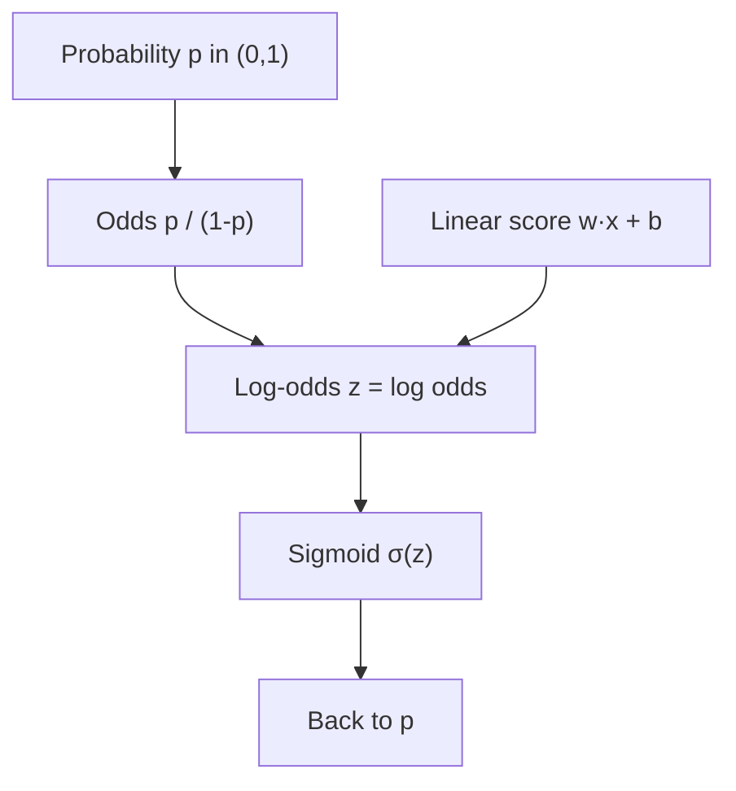

**Log-odds** (also called the **logit** of a probability) is the natural log of the odds of an event. For probability $p \in (0,1)$, odds are $p/(1-p)$ and

$$
\operatorname{logit}(p) = \log\frac{p}{1-p} = \log p - \log(1-p).
$$

That map sends probabilities in $(0,1)$ to the full real line $(-\infty,+\infty)$. The inverse is the logistic (sigmoid) function: a real score $z$ becomes a probability $p = 1/(1+e^{-z})$. In binary logistic regression the linear predictor $z = w^\top x + b$ is exactly this log-odds: the model is linear on the log-odds scale, not on the probability scale.

In modern neural-net code the word [logits](glossary://logits) usually means *unnormalized class scores before softmax*. For a two-class problem those scores still encode log-odds: if $z_1$ and $z_0$ are the two class logits, then $z_1 - z_0 = \log(p_1/p_0)$ is the log-odds of class 1 vs class 0. A single-output binary head with a sigmoid is the same idea with one free score treated as log-odds of the positive class.

## Intuition

Probability lives in a squeezed interval. Odds stretch "how many times as likely yes as no." Log-odds stretch that ratio onto a symmetric real line:

| Probability $p$ | Odds $p/(1-p)$ | Log-odds $\log\frac{p}{1-p}$ |
|----------------:|---------------:|-----------------------------:|
| $0.10$ | $1:9$ ($0.111$) | $\approx -2.20$ |
| $0.25$ | $1:3$ ($0.333$) | $\approx -1.10$ |
| $0.50$ | $1:1$ ($1$) | $0$ |
| $0.75$ | $3:1$ ($3$) | $\approx +1.10$ |
| $0.90$ | $9:1$ ($9$) | $\approx +2.20$ |

Notice the symmetry: $\operatorname{logit}(1-p) = -\operatorname{logit}(p)$. A coin-flip sits at zero. Each unit increase of log-odds multiplies the odds by $e \approx 2.718$, which is a constant *multiplicative* move on odds and a *non-linear* move on probability (large near $0.5$, tiny in the tails after sigmoid).

That is why logistic and sigmoid heads train in score / log-odds space and only convert to probability for reporting or for a [decision threshold](glossary://decision-threshold). Modeling features as linear on log-odds is the defining link of logistic regression (Berkson named the *logit* as the logistic unit; "log-odds" is the usual statistics name for the same quantity).

## Formula

**Definitions**

$$
\mathrm{odds}(p) = \frac{p}{1-p}, \qquad
\operatorname{logit}(p) = \log\frac{p}{1-p}.
$$

**Inverse (sigmoid / logistic)**

$$
p = \sigma(z) = \frac{1}{1+e^{-z}} = \frac{e^{z}}{1+e^{z}},
\qquad z = \operatorname{logit}(p).
$$

**Binary logistic model.** Features $x$, weights $w$, bias $b$:

$$
z = w^\top x + b = \log\frac{P(y=1\mid x)}{P(y=0\mid x)},
\qquad
P(y=1\mid x) = \sigma(z).
$$

A one-unit change in feature $x_j$ (holding other features fixed) shifts log-odds by $w_j$ and multiplies odds by $e^{w_j}$ (the odds ratio for that coefficient).

**Two-class softmax identity.** With logits $z_1, z_0$,

$$
p_1 = \frac{e^{z_1}}{e^{z_1}+e^{z_0}} = \sigma(z_1 - z_0),
\qquad
\log\frac{p_1}{p_0} = z_1 - z_0.
$$

Only the *difference* of logits is identified as log-odds; adding the same constant to both logits leaves probabilities unchanged.

**Binary cross-entropy from scores.** For label $y\in\{0,1\}$ and log-odds $z$,

$$
\mathcal{L} = -y\log\sigma(z) - (1-y)\log(1-\sigma(z))
= \log(1+e^{z}) - y\,z
$$

(the softplus form; compute with `logaddexp(0, z) - y*z` so extreme $z$ stay finite).

Natural log is the usual choice in ML stacks (same base as `torch.log` / `math.log`). Base $2$ only rescales the unit of the score; the probability after the matching inverse stays the same.

## Diagram



## Worked numbers

Take $p = 0.75$. Odds are $0.75/0.25 = 3$. Log-odds are $\log 3 \approx 1.099$. Sigmoid recovers $\sigma(1.099) \approx 0.75$.

A support-routing head with intercept and two features (ambiguity $x_1$, auto-policy support $x_2$) produces

$$
z = -4.9 + 3.4\,x_1 - 0.96\,x_2.
$$

For $(x_1, x_2) = (3.0, 5.0)$:

$$
z = -4.9 + 10.2 - 4.8 = 0.5,
\qquad
p = \sigma(0.5) \approx 0.622.
$$

Odds of "needs human review" are about $1.65:1$. At a threshold of $0.5$ on probability (equivalently $z \ge 0$ on log-odds), the system routes to review. Raising the threshold to $0.8$ requires $z \ge \operatorname{logit}(0.8) \approx 1.39$ and changes the routing policy while leaving model scores fixed.

```python
import math

def logit(p: float) -> float:
    return math.log(p / (1.0 - p))

def sigmoid(z: float) -> float:
    # stable for large |z|
    if z >= 0:
        return 1.0 / (1.0 + math.exp(-z))
    e = math.exp(z)
    return e / (1.0 + e)

z = -4.9 + 3.4 * 3.0 - 0.96 * 5.0
p = sigmoid(z)
print(round(z, 3), round(p, 3), round(logit(p), 3))
# 0.5 0.622 0.5
```

## Example

A spam filter emits one score $z$ per message and $p = \sigma(z)$. Three messages:

| Message | $z$ (log-odds) | $p=\sigma(z)$ | Odds spam:ham |
|---------|---------------:|--------------:|--------------:|
| A | $+2.2$ | $\approx 0.90$ | $\approx 9:1$ |
| B | $0$ | $0.50$ | $1:1$ |
| C | $-2.2$ | $\approx 0.10$ | $\approx 1:9$ |

If product policy only auto-quarantines when $p \ge 0.95$, you need $z \ge \operatorname{logit}(0.95) \approx 2.94$. Message A is strong but still below that bar; raising the bar cuts false quarantines and lets more spam through. Logging $z$ (or both class logits) is more useful for debugging than logging only a rounded probability: a jump from $z=2$ to $z=4$ barely moves displayed $p$ (both look "very high") but multiplies odds by $e^{2}\approx 7.4$.

**Production failure modes tied to log-odds**

- Treating raw $p$ as a true frequency without [probability calibration](glossary://probability-calibration): test whether cases with $p\approx 0.9$ are positive about 90% of the time on representative held-out data.
- Mixing scales: averaging probabilities from two models is not the same as averaging log-odds; late fusion needs a declared space (logits, calibrated probs, or ranks).
- Numerical overflow: `exp(z)` or `log(sigmoid(z))` for large $|z|$ blows up; use stable sigmoid / softplus / [log-sum-exp](glossary://log-sum-exp) forms.
- Confusing multi-class logits with binary log-odds: only differences (or a dedicated binary head) are log-odds of one class vs another.

## Why it matters here

Binary and "is this safe / spam / needs review / tool allowed" heads show up constantly next to LLMs. Log-odds are the native language of those heads: training losses, coefficient interpretation, threshold placement, and the link between a single score and a probability all pass through $\operatorname{logit}$ and $\sigma$. Reading model dumps, reward models, safety classifiers, and routing gates without this map leads to wrong threshold moves and false confidence in displayed percentages.

## Related terms

- [Logits](glossary://logits)
- [Softmax](glossary://softmax)
- [Decision threshold](glossary://decision-threshold)
- [Probability calibration](glossary://probability-calibration)
- [Cross-entropy](glossary://cross-entropy)
