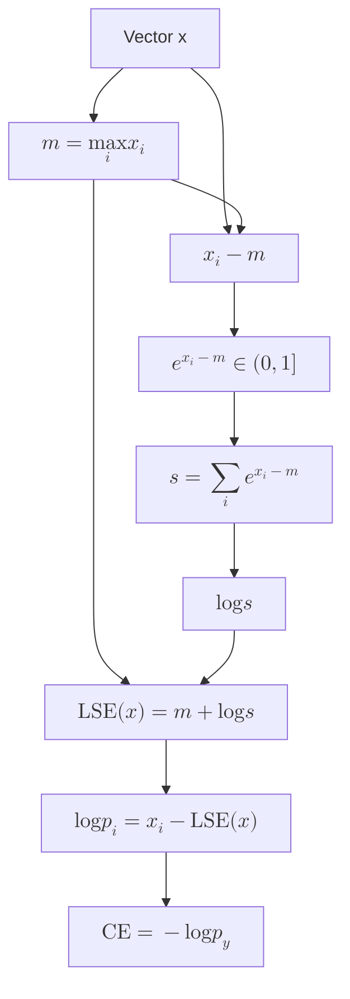

Log-sum-exp (LSE) is the scalar $\mathrm{LSE}(x)=\log\sum_i\exp(x_i)$. In ML it is both a smooth stand-in for $\max_i x_i$ and the numerically stable building block behind log-softmax, cross-entropy, and any sum of terms held in log space.

The **log-sum-exp trick** rewrites the same value so floating-point `exp` never sees huge positive arguments. Subtract the maximum first, then restore it outside the log:

$$
\mathrm{LSE}(x) = m + \log\sum_i \exp(x_i - m), \qquad m = \max_i x_i.
$$

After the shift, every exponent is $\le 0$, so $\exp(x_i-m)\in(0,1]$ and the largest term is exactly $1$. The mathematical result is unchanged for any finite $m$; choosing $m=\max_i x_i$ is the usual safe choice.

## Intuition

Work in log space when you need products of tiny probabilities: multiplications become additions, and underflow is rarer. Addition of probabilities is the awkward case. If $a_i=\log p_i$, then

$$
\log\sum_i p_i = \log\sum_i e^{a_i} = \mathrm{LSE}(a).
$$

Naive `log(sum(exp(a)))` still overflows when any $a_i$ is large (float32 `exp` overflows near $x\approx 88.7$). It leaves the normal range near $-87.3$ and rounds to zero near $-104$ with gradual underflow; kernels that flush subnormals to zero can underflow sooner. When every term vanishes, the naive sum is zero. Shifting by the max preserves the dominant term for finite inputs, though negligible shifted terms can still underflow.

LSE is also a **smooth maximum**:

$$
\max_i x_i \le \mathrm{LSE}(x) \le \max_i x_i + \log n.
$$

The lower bound is tight only for $n=1$; the upper bound is tight when all $x_i$ are equal. Scaling arguments as $\frac{1}{t}\mathrm{LSE}(t x)$ squeezes the gap toward the true max as $t\to\infty$. The gradient of LSE is softmax: $\partial\mathrm{LSE}/\partial x_i = \mathrm{softmax}(x)_i$.

## Formula

**Definition**

$$
\mathrm{LSE}(x_1,\ldots,x_n)=\log\sum_{i=1}^{n} e^{x_i}
$$

(natural log in NumPy, SciPy, PyTorch, and typical ML code).

**Stable evaluation (the trick)**

$$
\mathrm{LSE}(x)=m+\log\sum_{i=1}^{n} e^{x_i-m},\qquad m=\max_i x_i.
$$

**Translation invariance**

$$
\mathrm{LSE}(x_1+c,\ldots,x_n+c)=\mathrm{LSE}(x)+c.
$$

That is why shifting by $m$ is exact, not approximate.

**Log-softmax and cross-entropy.** Softmax probabilities and their logs are

$$
p_i=\frac{e^{x_i}}{\sum_j e^{x_j}},\qquad
\log p_i = x_i - \mathrm{LSE}(x).
$$

Hard-label cross-entropy is therefore $-\log p_y=-x_y+\mathrm{LSE}(x)$. Frameworks implement fused log-softmax / NLL so they never form $p_y$ then take `log` of a near-zero float.

**Weighted form** (SciPy `logsumexp(..., b=...)`): $\log\sum_i b_i e^{a_i}$, used when mixing log-space terms with coefficients. Signed weights can produce a negative sum, whose real logarithm is undefined. With `return_sign=True`, SciPy returns the log of the absolute sum and its sign; otherwise a negative result yields `nan`.

## Diagram



## Worked numbers

**Overflow without the shift.** Take logits $x=[1000,999,998]$. Array-library float32/float64 `exp(1000)` is `inf`, so naive `log(sum(exp(x)))` becomes `inf`; subtracting that value in log-softmax produces invalid results. Python's scalar `math.exp(1000)` instead raises `OverflowError`. With $m=1000$:

$$
\begin{aligned}
\mathrm{LSE}(x)
&= 1000 + \log\bigl(e^{0}+e^{-1}+e^{-2}\bigr)\\
&= 1000 + \log(1 + e^{-1} + e^{-2})\\
&\approx 1000 + \log(1.5032)\\
&\approx 1000.4076.
\end{aligned}
$$

Stable log-softmax:

$$
\log p = x - \mathrm{LSE}(x) \approx [-0.408,-1.408,-2.408],
$$

and probabilities $\approx [0.665,0.245,0.090]$.

**Underflow without the shift.** For $x=[-1000,-1000,-1000]$, naive `exp` yields all zeros and a division by zero on normalize. The same shift gives $m=-1000$ and $\mathrm{LSE}=-1000+\log 3$, so each probability is exactly $1/3$.

**Bounds check.** For equal values $x=[2,2,2]$: $\mathrm{LSE}=2+\log 3\approx 3.099$, which saturates the upper bound $\max+\log n$. For a sharp peak $x=[5,0,0]$: $\mathrm{LSE}\approx 5.013$, close to the max.

## Example

Stable softmax and NLL from scratch (prefer library ops in real code):

```python
import math

def logsumexp(xs):
    if not xs:
        return -math.inf  # log of an empty sum, log(0)
    m = max(xs)
    if m == -math.inf or m == math.inf:
        return m  # all -inf, or at least one +inf (NaNs excluded)
    return m + math.log(sum(math.exp(x - m) for x in xs))

logits = [2.0, 1.0, 0.1]
lse = logsumexp(logits)          # ≈ 2.4170
log_probs = [z - lse for z in logits]
probs = [math.exp(lp) for lp in log_probs]
# probs ≈ [0.659, 0.242, 0.099]; sum ≈ 1.0

y = 0  # correct class index
nll = -log_probs[y]              # = -logits[y] + lse
```

In production stacks use the fused, axis-aware kernels:

- PyTorch: `torch.logsumexp(x, dim=...)` (documented as numerically stabilized)
- SciPy / NumPy path: `scipy.special.logsumexp`
- Two-argument add in log space: `numpy.logaddexp` / `torch.logaddexp`

The scalar sketch assumes a sequence with no NaNs. An all-masked row of $-\infty$ logits has LSE $-\infty$, but its normalized log probabilities are undefined ($-\infty-(-\infty)$). Define an explicit empty-row policy rather than expecting the shift to repair it. Prefer `F.cross_entropy(logits, y)` or `log_softmax` over hand-rolled `log(softmax(...))`. Hand-rolling often reintroduces overflow on the softmax step even when the later log would have been fine.

## How it fails in production

| Symptom | Likely cause | Fix |
|--------|--------------|-----|
| `inf` / `nan` in loss early | `exp` of large logits without max shift | `logsumexp` / fused CE |
| All-zero probs, divide-by-zero | All logits large and negative | Same shift; do not normalize zero sums |
| Loss is `nan` only in fp16/bf16 | FP16 has narrower exponent range; BF16 has roughly FP32 range but less precision, and inputs may already be invalid | Inspect inputs and reduction dtype; use stable FP32 reductions when appropriate |
| Custom CRF / mixture / InfoNCE blows up | Manual `log(sum(exp(...)))` in a loss | Route every log-space sum through LSE |
| Tile-wise attention disagrees with full softmax | Running max not rescaled when a later tile wins | [Online softmax](glossary://online-softmax) / FlashAttention-style updates |

Streaming attention is the multi-block form of the same idea: maintain a running max and rescale the partial sum of exponentials when a new block raises the max, so the final row matches full stable softmax without materializing the whole score vector.

## Why it matters here

LLM training and decoding live on extreme logits over large vocabularies. Cross-entropy, token logprobs, sequence likelihoods, KL terms, CRFs, and energy-based scores all reduce to "sum of exponentials in log space." One stable LSE (or a fused log-softmax/CE kernel that embeds it) is what keeps those paths finite in float32 and mixed precision. Online variants of the same shift power memory-efficient attention. Knowing the identity $ \log p_i = z_i - \mathrm{LSE}(z) $ lets you read API logprobs, custom losses, and NaN traces as the same operation.

## Related terms

- [Softmax](glossary://softmax)
- [Logits](glossary://logits)
- [Cross-entropy](glossary://cross-entropy)
- [Logprob](glossary://logprob)
- [Online softmax](glossary://online-softmax)
