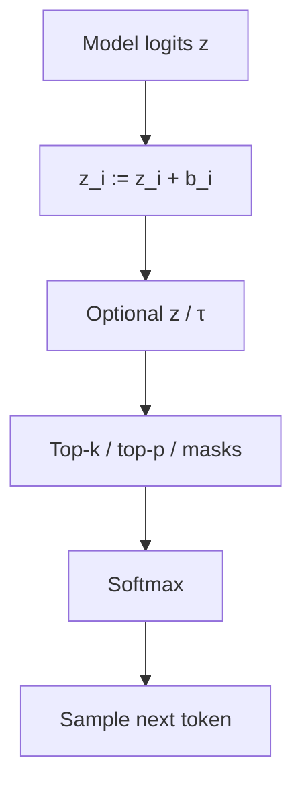

Logit bias is an additive adjustment applied to selected next-token scores before those scores become sampling probabilities. You map vocabulary **token IDs** to bias values; the decoder adds each value to that token's logit every generation step, then continues with the usual temperature, filters, softmax, and sample path.

It is a **token-level** control: the same English word can map to several token IDs (with and without a leading space, capitalized, or split into subword pieces). Banning or boosting the wrong IDs is a common production miss. Extreme biases approximate hard masks; moderate biases gently reweight the distribution.

## Formula

Let $z \in \mathbb{R}^{|V|}$ be the model logits over vocabulary $V$, and let $b_i$ be the bias for token $i$ (default $b_i = 0$ when unset). Biased logits are

$$
z'_i = z_i + b_i.
$$

Softmax then yields

$$
p_i = \frac{e^{z_i + b_i}}{\sum_{j \in V} e^{z_j + b_j}} = \frac{e^{z_i}\,e^{b_i}}{\sum_{j \in V} e^{z_j}\,e^{b_j}}.
$$

Adding $b_i$ multiplies the unnormalized weight of token $i$ by $e^{b_i}$. A bias of $+1$ multiplies that weight by $e \approx 2.72$; $+5$ multiplies by about $148$; $-100$ multiplies by a number so small that the token is effectively removed unless the rest of the vocabulary is even more suppressed.

OpenAI-style APIs document $b_i \in [-100, 100]$ and state that the bias is **added to model logits prior to sampling**. Values near $\pm 1$ nudge likelihood; values near $\pm 100$ act as ban or near-exclusive selection for that ID. The exact probability shift still depends on the other logits at that step.

With temperature $\tau > 0$, a common decode order is bias first, then scale:

$$
p_i = \frac{\exp\bigl((z_i + b_i)/\tau\bigr)}{\sum_j \exp\bigl((z_j + b_j)/\tau\bigr)}.
$$

Top-$k$ and top-$p$ then restrict the support of $p$ before sampling. Order of operations is engine-defined; treat bias as a logits-space edit that competes with temperature and nucleus filters, not as a post-hoc string rewrite.

## Diagram



## Worked numbers

Three-token toy vocabulary at one step, $\tau = 1$, no other filters:

| Token | $z_i$ | $b_i$ | $z'_i$ | $e^{z'_i}$ | $p_i$ |
|---|---:|---:|---:|---:|---:|
| `yes` | 2.0 | 0 | 2.0 | 7.39 | 0.66 |
| `no` | 1.0 | 0 | 1.0 | 2.72 | 0.24 |
| `maybe` | 0.1 | 0 | 0.1 | 1.11 | 0.10 |

After $b_{\text{no}} = +2$ only ($e^{3.0} \approx 20.09$; renormalized mass $\approx 28.58$):

| Token | $z'_i$ | $e^{z'_i}$ | $p_i$ (approx.) |
|---|---:|---:|---:|
| `yes` | 2.0 | 7.39 | 0.26 |
| `no` | 3.0 | 20.09 | 0.70 |
| `maybe` | 0.1 | 1.11 | 0.04 |

The same $+2$ on a token that already dominated barely moves mass; on a mid-ranked competitor it can flip the mode ($0.24 \to 0.70$ here). Moderate biases need evals because their effect is **context-dependent**: the bias multiplies an unnormalized weight, then all choices renormalize.

## Example

OpenAI Chat Completions and compatible HTTP servers take a JSON map from **stringified token IDs** to bias. Native Python APIs can use integer keys (for example vLLM `SamplingParams`); verify the endpoint's contract.

```python
# Ban common surface forms of "time" after "Once upon a"
# IDs are tokenizer-specific; always encode with the model tokenizer.
import tiktoken

model_id = "gpt-4o-mini"
encoding = tiktoken.encoding_for_model(model_id)
token_ids = {token for text in ("time", " time") for token in encoding.encode(text)}
completion = client.chat.completions.create(
    model=model_id,
    messages=[
        {"role": "system", "content": "You finish the user's sentence."},
        {"role": "user", "content": "Once upon a"},
    ],
    logit_bias={str(token): -100 for token in token_ids},
)
```

OpenAI's help article uses this pattern: prompt `"Once upon a"` usually continues with `" time"`; banning the relevant IDs with $-100$ forces another continuation (for example a Poe-like `" midnight dreary..."` path in their demo). Positive bias works the other way: a moderate boost such as `+5` on the ID for `" microwave"` can raise the chance that a recipe mentions a microwave without hard-forcing every token.

Self-hosted stacks implement the same idea as a **logits processor**: each step, for each request that set a bias map, add $b_i$ into the row of the $(N_{\text{req}} \times |V|)$ logits tensor, then sample. Hugging Face Transformers exposes custom `LogitsProcessor` hooks for the same pattern (static bias maps, bad-word bans, watermark green lists).

## How it works in products

**Ban / soft ban.** $b_i = -100$ (or a large negative) suppresses a selected ID, which can block a brand fragment, a forbidden classification label, or a repetitive token. Semantic safety needs policy checks that cover synonyms, paraphrases, and alternate tokenizations.

**Boost.** Small positive $b_i$ steers surface form (product name spelling, preferred delimiter, a format token like `{`). Large positive values can trap the model in loops that re-emit the same ID.

**Soft constraints vs hard masks.** Static logit bias is a fixed vector $b$. Stronger tools set $b_i = -\infty$ (or a huge negative) for **illegal** tokens under a grammar or finite-state machine at each step (structured decoding / constrained generation). Bias is useful for soft preferences; schema validity needs step-wise masking.

**Watermarking.** Kirchenbauer et al. (2023) partition $V$ into a pseudorandom "green" set each step and add a positive bias $\delta$ to green logits so generated text has elevated green counts under that seeding rule. The detector must reproduce the rule; some deployments use a secret key. Detection is a statistical hypothesis test with false positives and robustness limits, so interpret it as evidence under a tested setup. That is the same mathematical operation as API logit bias, applied to a large changing subset of $V$.

## Debug path

When bias "does nothing" or does the wrong thing:

1. **Encode with the same tokenizer as the model.** IDs from another family (or from a web tokenizer for a different encoding) map to unrelated tokens.
2. **Cover surface forms.** Encode `"word"`, `" word"`, `"Word"`, and common suffixes separately. Banning every component ID of a multi-token phrase also bans unrelated uses of those pieces; use a sequence-aware processor to forbid the phrase while allowing its components elsewhere. Test semantic suppression across tokenizations and paraphrases with policy-level evaluation.
3. **Check model support.** Some reasoning or specialized endpoints reject or ignore `logit_bias`.
4. **Inspect logprobs carefully.** APIs may return probabilities from pre-bias or post-filter distributions depending on product version; use generation behavior and offline A/B text metrics as ground truth.
5. **Watch interactions.** High temperature flattens differences after bias; tight top-$p$ can drop a boosted token if its post-bias mass still sits outside the nucleus; greedy decode only cares whether bias changes the argmax.

## Trade-offs

| Control | Strength | Weakness |
|---|---|---|
| Logit bias | Cheap, per-request, no fine-tune | Token IDs only; soft; tokenizer-fragile |
| Prompt instructions | Easy to author | Unreliable compliance |
| Constrained decoding | Schema-hard guarantees | Heavier infra; less free-form prose |
| Fine-tuning / preference training | Deep style and policy | Costly; slower to change denylists |

Use bias for **local, known token IDs**. Use structured output for **legal shapes**. Use training and policy layers for **semantic** behavior you cannot list as IDs.

## Why it matters here

Decoding is a policy over logits. Logit bias is the explicit "nudge these IDs" dial in that policy: ban lists, brand tokens, soft format hints, and research watermarking all sit on $z_i + b_i$. Engineers who treat it as "ban this English word" ship silent holes; engineers who map IDs correctly, measure surface-form coverage, and know when to graduate to constrained decoding get predictable control without retraining.

## Related terms

- [Logits](glossary://logits)
- [Softmax](glossary://softmax)
- [Temperature](glossary://temperature)
- [Token](glossary://token)
- [Top-p sampling](glossary://top-p)
