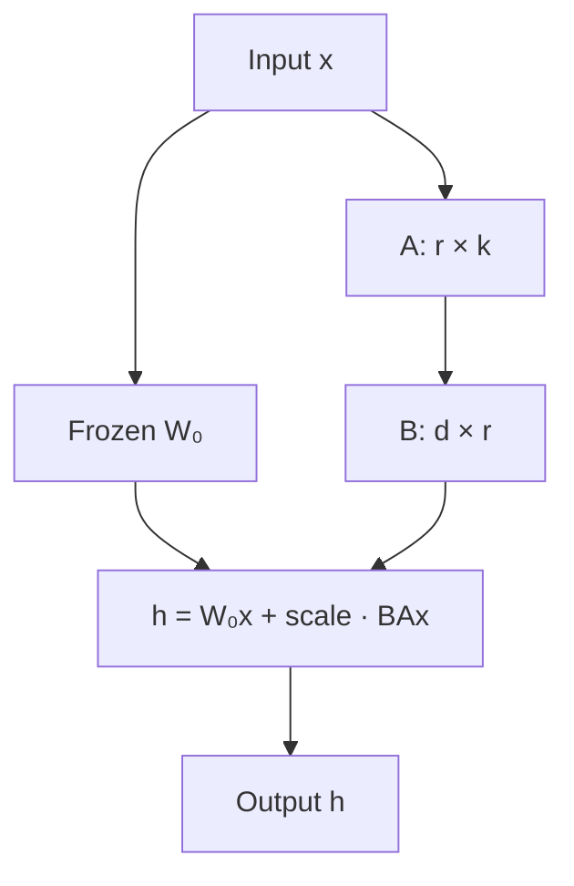

**Low-rank adaptation (LoRA)** fine-tunes a model by freezing the pretrained weights $W_0$ and learning a thin residual update proportional to $BA$ of rank at most $r \ll \min(d,k)$ (Hu et al., 2021). In classic adapter-only LoRA, only the factors $A$ and $B$ train; recipes can additionally train biases or other saved modules. At serve time you can either keep adapters separate (multi-tenant routing) or merge the scaled update into $W_0$ so the forward pass matches a full model with no extra depth, up to numerical rounding.

LoRA is a form of parameter-efficient fine-tuning (PEFT) that retains the pretrained architecture while constraining update rank and selected modules. The motivating hypothesis is that the *update* needed for a downstream task has low intrinsic rank, even when $W_0$ itself is full-rank.

## Diagram



## Intuition

Full fine-tuning optimizes every selected base weight and keeps optimizer state for those parameters; training can update the base in place. Keeping the original base and a separately deployable fine-tune requires separate artifacts. LoRA freezes $W_0$ and learns a low-rank "steering" update that sits in parallel with each chosen linear map. One base model can serve many small adapter artifacts for domains, tenants, product surfaces, or safety policies.

Because $\Delta W$ is a matrix product, you can absorb it into $W_0$ after training ($W \leftarrow W_0 + \frac{\alpha}{r}BA$). Merged inference has the same matmul path as a normal dense layer. Unmerged inference keeps $A$ and $B$ separate so engines can load different adapters per request against one shared base.

## Formula

For a frozen weight $W_0 \in \mathbb{R}^{d \times k}$, LoRA parameterizes the update as

$$
W = W_0 + \Delta W, \qquad \Delta W = BA
$$

with $B \in \mathbb{R}^{d \times r}$, $A \in \mathbb{R}^{r \times k}$, and rank $r \ll \min(d,k)$. The forward pass for input $x$ is

$$
h = W_0 x + \frac{\alpha}{r} B A x
$$

where $\alpha$ (often called `lora_alpha` in libraries) is a fixed scaling hyperparameter. The effective weight update in this forward equation is $(\alpha/r)BA$. Classic LoRA and default PEFT use the scale $\alpha/r$. Rank-stabilized LoRA (rsLoRA; PEFT `use_rslora`) instead uses $\alpha/\sqrt{r}$, so a published $\alpha$ is not portable across scale rules. Trainable parameter count for that layer is $r(d+k)$ instead of $dk$. The original paper initializes $A$ from a random Gaussian and $B$ to zero. Current PEFT's default linear-layer initialization uses Kaiming-uniform $A$ and zero $B$; both start with a zero update. Other initialization modes can have different contracts.

**Where it attaches.** Any dense linear map can take a LoRA path. The original paper focused on attention projections ($W_q$, $W_v$, sometimes $W_k$, $W_o$) and left MLP modules frozen for simplicity. Production recipes often also target feed-forward projections (`gate_proj`, `up_proj`, `down_proj` or equivalent). Target-module choice usually moves quality more than increasing $r$ alone once $r$ is past a small regime.

**Relation to full fine-tuning.** For any matrix, $r=\min(d,k)$ permits an arbitrary matrix update. To reproduce the update class of unrestricted fine-tuning for a whole model, other trainable vectors such as biases and normalization scales must also be included. Equal expressivity does not imply the same optimization dynamics. In practice $r$ stays small, trading update expressivity for lower storage and memory costs on the target domain.

## Worked numbers

Take one attention projection with $d = k = 4096$ and rank $r = 16$:

| Quantity | Value |
|----------|--------|
| Full matrix params | $dk = 4096^2 \approx 16.8$M |
| LoRA params | $r(d+k) = 16 \times 8192 = 131{,}072$ |
| Compression for this layer | $\approx 128\times$ fewer trainable params |
| Scale factor if $\alpha = 32$ | $\alpha / r = 2$ |

Optimizer state multiplies the savings: Adam keeps two moments per trainable parameter, so freezing $W_0$ removes moments for nearly the whole model. Hu et al. report that for GPT-3 175B with Adam, LoRA cut trainable parameters by up to about $10{,}000\times$ and training VRAM by about $3\times$ versus full fine-tuning when only low-rank factors are optimized.

For a multi-layer sketch, each square $d \times d$ projection costs $2dr$ trainable params ($A$ and $B$ each contribute $dr$). Adapting $W_q$ and $W_v$ across $L$ layers therefore costs

$$
|\Theta| = 2L \cdot 2dr = 4 L d r
$$

(same form as the paper: $|\Theta| = 2 \hat{L}_{\mathrm{LoRA}} d r$ with $\hat{L}_{\mathrm{LoRA}} = 2L$ target matrices). That is the order of magnitude PEFT's `print_trainable_parameters` should report before a long run; if the printed count is far higher, you likely targeted more modules (for example all MLP projections) than you thought.

## Example

You ship one 70B base model and need specialized support tone per enterprise tenant without storing seventy full fine-tunes.

1. Freeze the base. Attach LoRA with $r=16$, $\alpha=32$ to attention and MLP projections used by your stack (for example `q_proj`, `k_proj`, `v_proj`, `o_proj`, `gate_proj`, `up_proj`, `down_proj`).
2. Train each tenant adapter with supervised instruction data (and optional preference steps later). Checkpoint only adapter weights. Size depends on all targeted shapes: an illustrative 80-layer model with hidden width 8192, MLP width 28672, and KV projection width 1024 (eight KV heads of width 128) has about 207M adapter parameters at rank 16 for this seven-module list, or 414MB in two-byte precision. This is still far smaller than a 140GB two-byte 70B base.
3. At serve time, keep the base resident and route `adapter_id` per request (see [adapter cache](glossary://adapter-cache)). Hot tenants stay GPU-resident; cold tenants load from store. For single-tenant latency-critical paths, merge the adapter into $W_0$ once and serve a dense model with no adapter math.

```python
# Conceptual PEFT-style setup (shapes and names vary by model)
from peft import LoraConfig, get_peft_model

config = LoraConfig(
    r=16,
    lora_alpha=32,          # scale = alpha / r
    lora_dropout=0.05,
    bias="none",
    task_type="CAUSAL_LM",
    target_modules=[
        "q_proj", "k_proj", "v_proj", "o_proj",
        "gate_proj", "up_proj", "down_proj",
    ],
)
model = get_peft_model(base_model, config)
model.print_trainable_parameters()  # expect << 1% of total params
```

After training, either save the adapter alone for multi-LoRA serving, or merge into the base for a single static checkpoint. Always score a held-out task set *and* a general capability / safety regression suite: a low training loss on tenant demos can still degrade tool format, refusals, or out-of-domain QA.

## How it works

1. **Select modules.** Choose which linear layers get $A$, $B$ pairs. Start with attention (+ MLP for harder style/domain shifts). Log the exact module list in the training card.
2. **Pick rank and scale.** Common starting points are $r \in \{8, 16, 32, 64\}$ with $\alpha$ equal to $r$ or $2r$ so the effective scale $\alpha/r$ is order-1. Raising $r$ increases capacity and adapter size; with small datasets, test for overfitting as capacity grows.
3. **Train only adapters.** Base weights receive no gradients. Learning rate, warmup, and [weight decay](glossary://weight-decay) apply to the small parameter set; [optimizer](glossary://optimizer) state tracks $A$ and $B$ only.
4. **Export.** Store adapter tensors plus base revision, chat template, target modules, $r$, $\alpha$, and dtype. Version the triple `(base_id, adapter_id, data_rev)`.
5. **Serve.** Merge for one static model, or keep unmerged and swap adapters (with capacity limits such as `max_loras` / `max_lora_rank` in engines like vLLM).

## Trade-offs

| Choice | Gain | Cost / risk |
|--------|------|-------------|
| Higher $r$ | More update capacity | Larger adapters, more overfit risk, higher multi-LoRA VRAM |
| More target modules | Often better fit than rank alone | Bigger adapters; more surface to debug |
| Merge at deploy | Zero adapter overhead, simpler graph | One frozen behavior; no cheap per-request swap |
| Keep unmerged | Multi-tenant / multi-task routing | Engine buffers, cache thrash, batching limits |
| Very small data | Cheap specialization | Easy to memorize templates; regress general skill |

LoRA reduces *trainable* memory. Activation memory, KV cache, and sequence length still determine other memory demands. [QLoRA](glossary://qlora) pairs LoRA with a quantized frozen base when the base itself does not fit in full precision.

Common production failures include a chat template that differs from training, adapter/base revision mismatch, thrashing when concurrent adapters exceed GPU slots, merged weights that mix an old adapter, and a rank/module setup that fits demos but collapses on long, tool-using, or multilingual traffic. Debug by freezing config and changing one of $\{r, \alpha, \text{targets}, \text{lr}\}$ at a time while watching task metrics and base-model regressions together.

## Why it matters here

LoRA is the default bridge between "use a strong base model" and "own product behavior in weights." It ties [supervised fine-tuning](glossary://supervised-fine-tuning), checkpoint storage, multi-tenant serving, eval gates, and later preference methods ([DPO](glossary://dpo), [RLHF](glossary://rlhf)) into one operational pattern: freeze the expensive base, train small updates, measure both specialization and regressions, then merge or route adapters on purpose.

## Related terms

- [QLoRA](glossary://qlora)
- [Supervised fine-tuning](glossary://supervised-fine-tuning)
- [Adapter cache](glossary://adapter-cache)
- [SVD](glossary://svd)
- [Model checkpoint](glossary://model-checkpoint)
