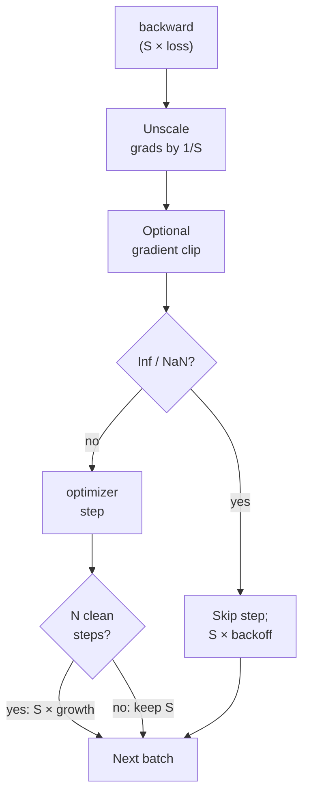

**Loss scaling** (also called gradient scaling) multiplies the training loss by a positive factor $S$ before the backward pass so small [gradients](glossary://gradient) stay representable in narrow formats such as [FP16](glossary://fp16), then divides those gradients by $S$ before [gradient clipping](glossary://gradient-clipping) and the optimizer step. Via the chain rule, scaling the scalar loss scales every gradient by the same $S$ without extra per-layer math.

It is one of the three core techniques from Micikevicius et al. (ICLR 2018) that made FP16 [mixed precision](glossary://mixed-precision) training match FP32 accuracy: FP32 master weights, loss scaling, and FP16 matmuls with FP32 accumulate. [BF16](glossary://bf16) usually skips loss scaling because its exponent range matches FP32.

## Intuition

FP16's positive finite magnitudes span roughly $[2^{-24},\, 65504]$ (including subnormals down to about $6 \times 10^{-8}$); it also represents zero and negative values. Activation gradients in deep nets often sit on the small end of that window, or below it. Multiply the loss by $S$ and the backward pass "shifts" gradient magnitudes up the exponent axis so fewer flush to zero. Divide by $S$ in adequate precision before the update so learning rates, clip thresholds, and weight decay still mean the same thing as in full precision. Unscaling into FP16 again would lose recovered tiny values.

Loss scaling temporarily amplifies the backward-pass signal, then unscales gradients before clipping or updating parameters. The optimizer therefore receives gradients in their original scale while FP16 arithmetic avoids losing small intermediate values.

Too small an $S$ still underflows. Too large an $S$ overflows intermediates or weight gradients to `Inf`/`NaN`, which can poison the step. **Dynamic** scalers try to sit near the largest $S$ that does not overflow.

## Formula

With scale $S > 0$ and unscaled loss $L$:

$$
L' = S \cdot L
$$

Backward on $L'$ yields scaled gradients. By the chain rule, for every parameter $w$:

$$
\frac{\partial L'}{\partial w} = S \cdot \frac{\partial L}{\partial w}
$$

Unscale before the optimizer (and before clipping) restores the intended magnitude:

$$
\frac{\partial L}{\partial w}
=
\frac{1}{S}\,\frac{\partial L'}{\partial w}
$$

With correct unscale, a plain SGD step is identical to the unscaled math:

$$
w \leftarrow w - \eta \cdot \frac{1}{S}\,\frac{\partial L'}{\partial w}
=
w - \eta \cdot \frac{\partial L}{\partial w}
$$

## Worked numbers

FP16 finite max is $65504$. Smallest positive normal is about $6.1 \times 10^{-5}$; smallest positive subnormal is about $6 \times 10^{-8}$.

| True $\partial L/\partial w$ | Without scaling (FP16) | With $S = 1024$ before unscale | After unscale |
|---|---|---|---|
| $1.2 \times 10^{-8}$ | underflows toward $0$ | $1.2288 \times 10^{-5}$ (finite) | $1.2 \times 10^{-8}$ |
| $2 \times 10^{-2}$ | fine | $20.48$ | $2 \times 10^{-2}$ |
| $1 \times 10^{2}$ | fine alone | $1.024 \times 10^{5}$ $\to$ overflow risk past $65504$ | step must skip / reduce $S$ |

The table shows ideal arithmetic; actual FP16 scaled values and recovered gradients are rounded. Micikevicius et al. reported that Multibox SSD needed only $S = 8$ to train, while bigLSTM language modeling needed $S = 128$ (without it, loss eventually diverged). Those fixed factors were chosen from gradient histograms: for SSD, values in roughly $[2^{-27},\, 2^{-24})$ mattered and would have been lost without scaling.

## How it works

**Static scale.** Pick a constant $S$ so that $S \cdot \max|\nabla|$ stays below $65504$ with headroom, yet tiny gradients clear the FP16 floor. Works when gradient magnitude is stable; brittle when it is not.

**Dynamic scale** (PyTorch `torch.amp.GradScaler`, TensorFlow `LossScaleOptimizer`). Typical control loop:

1. Start with a large $S$ (PyTorch default `init_scale=65536`).
2. Scale loss, run backward, unscale gradients.
3. If any optimizer-owned gradient is non-finite: skip the optimizer step and multiply $S$ by a backoff factor (default $0.5$).
4. If many consecutive steps are finite (default `growth_interval=2000`), multiply $S$ by a growth factor (default $2$).

That policy hunts for the largest safe scale. Early training often skips a few steps while $S$ backs off from an aggressive start; verify that the scale later stabilizes and updates proceed.

**Order that must not be rearranged.** Scale $\to$ backward $\to$ unscale $\to$ optional clip $\to$ step $\to$ update scale. Clipping scaled gradients at threshold $C$ *before* unscale effectively clips the true gradient at $C/S$, making the threshold too strict. PyTorch's `unscale_` also records non-finite gradients for `step` to decide whether to skip; custom gradient edits after that check need their own validation.

## Diagram



## Example

FP16 AMP loop in modern PyTorch. Autocast covers the forward/loss dtypes; `GradScaler` owns the scale factor and the skip-on-overflow path:

```python
scaler = torch.amp.GradScaler("cuda")  # init_scale=65536 by default
for batch in loader:
    optimizer.zero_grad(set_to_none=True)
    with torch.autocast(device_type="cuda", dtype=torch.float16):
        logits = model(batch["input_ids"])
        loss = criterion(logits.view(-1, V), batch["labels"].view(-1))
    scaler.scale(loss).backward()
    scaler.unscale_(optimizer)  # required before clipping or manual grad surgery
    torch.nn.utils.clip_grad_norm_(model.parameters(), max_norm=1.0)
    scaler.step(optimizer)      # no-op if grads were non-finite
    scaler.update()             # grow or back off S
```

With BF16 autocast on hardware that supports it, you typically omit `GradScaler` entirely: range is already FP32-like, so underflow of the FP16 kind is not the main failure mode.

## Trade-offs

| Choice | Benefit | Cost / risk |
|---|---|---|
| Static $S$ | Simple, no skip machinery | Wrong $S$ underflows or overflows; needs retuning when batch size or architecture changes |
| Dynamic $S$ | Tracks safe scale automatically | Occasional skipped steps; scale can collapse if the run is unstable for other reasons |
| FP16 + scaling | Faster/less memory on Tensor Core GPUs without BF16 | More moving parts than BF16; clip/unscale order bugs |
| BF16 (no scale) | Simpler training loop | Needs BF16 support; coarser mantissa than FP16 |

Loss scaling remaps backward gradient magnitudes into the FP16 window. Diagnose learning rates, data-driven exploding norms, and forward-pass activation overflow separately.

## Debug path

When FP16 training stalls, diverges, or logs constant scale backoff:

1. Log unscaled loss, pre-clip global grad norm, current $S$, and skipped-step count every $N$ steps.
2. Confirm unscale happens **before** `clip_grad_norm_` and any custom `.grad` edits.
3. Compare a short identical seed run in FP32, BF16 (if available), and FP16+scaler. If only FP16 fails, range is the suspect; if all fail, look at data, LR, or init.
4. If $S$ halves every few steps and never stabilizes, inspect overflowing activations, bad labels, and an excessive learning rate before adjusting the growth schedule.
5. Prefer BF16 on Ampere+ when quality matches: same memory win without the scaler control loop.

## Why it matters here

LLM fine-tuning and pretraining still hit FP16 paths on some GPUs, cloud SKUs, and older stacks. Loss scaling is the production detail that turns "cast to half for speed" into a stable update recipe: without it, tiny gradients become zeros and large models can quietly stop learning or diverge. Debug AMP NaNs by checking scale, unscale, and skip-on-overflow behavior before changing the learning rate.

## Related terms

- [Mixed precision](glossary://mixed-precision)
- [FP16](glossary://fp16)
- [BF16](glossary://bf16)
- [Gradient clipping](glossary://gradient-clipping)
- [Backpropagation](glossary://backpropagation)
