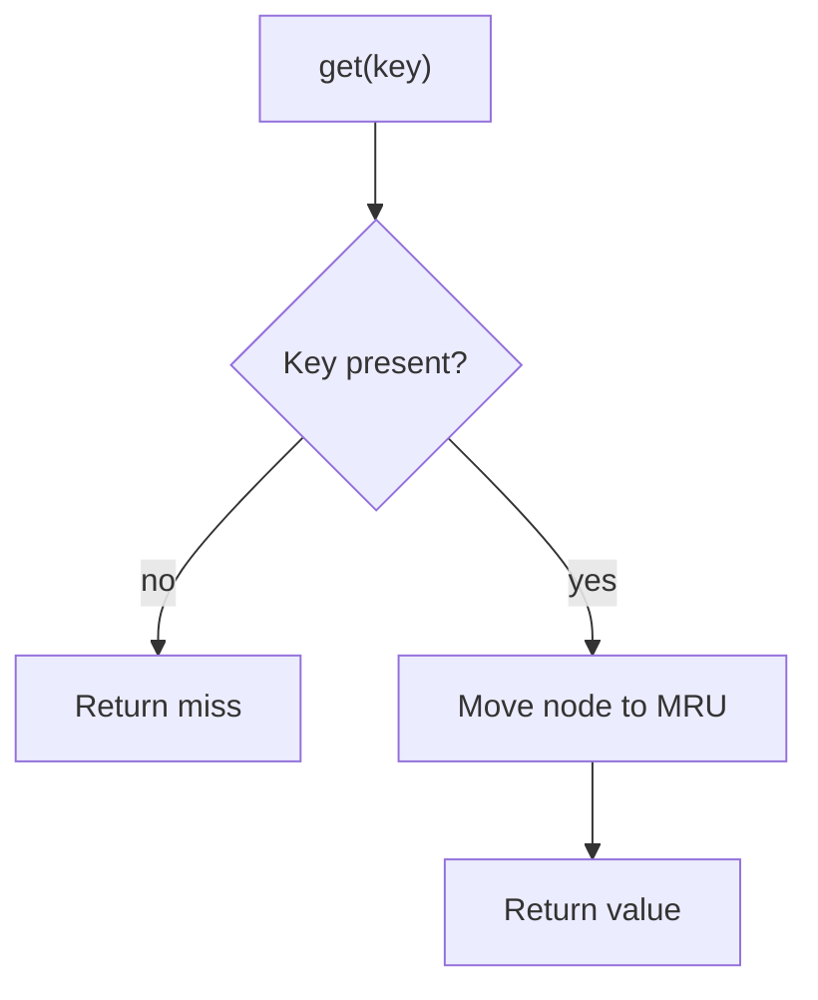
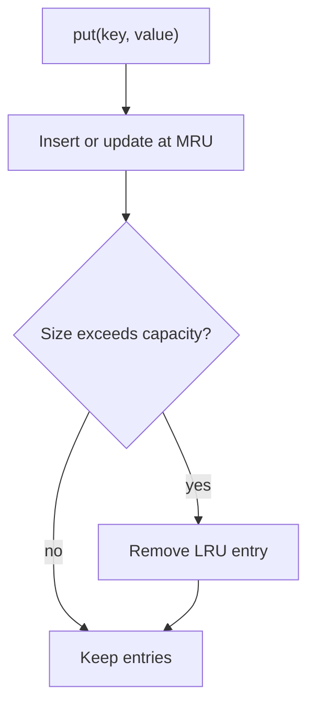

A **least-recently-used (LRU) cache** is a fixed-capacity key-value store that, when full, evicts the entry that has gone longest without a successful access. Recency is the policy signal: every hit or update promotes a key to "most recent," and the coldest key is the eviction victim. LRU provides a replacement *policy*; correct results still depend on keys, updates, and any expiration rules. It works when access shows **temporal locality** (recent keys tend to be used again soon). Scanning, one-shot traffic, and adversarial patterns can thrash it.

LRU shows up in LLM systems as process-local memoization (`functools.lru_cache`), in-memory response and embedding stores, [Redis](glossary://redis) `allkeys-lru` / `volatile-lru` eviction, [adapter cache](glossary://adapter-cache) CPU/GPU slots, and free-block eviction for [prefix](glossary://prefix-cache) / [KV](glossary://kv-cache) blocks in engines such as vLLM.

## Intuition

An LRU cache maintains recency order. Each read or write moves a key to the most-recently-used end; inserting beyond capacity removes the least-recently-used key. The policy assumes recently accessed values are more likely to be reused soon.

| Policy | Victim when full | Locality assumption |
|--------|------------------|---------------------|
| **LRU** | Longest time since last access | Temporal (recency) |
| **LFU** | Lowest access count | Frequency (popularity) |
| **FIFO** | Oldest insert time | Arrival order (no recency refresh) |
| **TTL-only** | Expired by wall or monotonic clock | Freshness, not popularity |
| **OPT / Belady** | Farthest next use (needs future) | Ideal offline benchmark |

OPT (Belady's MIN) is the theoretical lower bound on misses for a known reference string: always drop the page used furthest in the future. LRU is a practical online approximation that needs no future knowledge. It is not always optimal; a pure scan of $N+1$ distinct keys through a capacity-$N$ cache can miss almost every time under pure LRU.

## How it works

The classic $O(1)$ design pairs two structures:

1. **Hash map** `key → node` for constant-time lookup.
2. **Doubly linked list** of nodes ordered by recency (head = LRU / coldest, tail = MRU / hottest).

Operations:

- **`get(key)`:** miss → return empty; hit → move node to MRU end, return value.
- **`put(key, value)`:** if key exists, update value and move to MRU; else insert at MRU; if size $> C$, unlink and delete the LRU head.

Both read and write **refresh** recency. Treating `get` as read-only (no move) breaks LRU and becomes something closer to FIFO for hits.

Python's [`collections.OrderedDict`](glossary://ordered-dict) exposes the same idea with `move_to_end` and `popitem(last=False)`. The stdlib decorator `@functools.lru_cache(maxsize=...)` memoizes pure functions with an LRU of call argument tuples (default `maxsize=128`; `None` disables eviction and the cache can grow without bound). Arguments must be hashable; the cache is thread-safe for concurrent callers, but a concurrent first miss can still run the function more than once before a result is stored.

### Invariants to test

After every operation of capacity $C$:

1. $0 \le \text{size} \le C$.
2. A hit or put on an existing key moves it to MRU.
3. A put that exceeds $C$ evicts exactly the current LRU key.
4. Updating an existing key does not grow size beyond $C$.
5. The next victim is deterministic from the recency order (not from insertion order alone).

## Diagram



### Put and eviction



Recency order (left = cold / LRU, right = hot / MRU):

```text
[ LRU ........ MRU ]
  ^evict next    ^last access / insert
```

## Example

Capacity $C = 2$. Sequence: `put(A)`, `put(B)`, `get(A)`, `put(C)`.

| Step | Op | Order after (LRU → MRU) | Note |
|------|-----|-------------------------|------|
| 1 | `put(A)` | A | |
| 2 | `put(B)` | A, B | |
| 3 | `get(A)` | B, A | A promoted |
| 4 | `put(C)` | A, C | B evicted (coldest) |

```python title="lru-cache.py"
from collections import OrderedDict

class LRUCache:
    def __init__(self, capacity: int) -> None:
        if capacity < 1:
            raise ValueError("capacity must be >= 1")
        self.capacity = capacity
        self.items: OrderedDict[str, str] = OrderedDict()

    def get(self, key: str) -> str | None:
        if key not in self.items:
            return None
        self.items.move_to_end(key)  # refresh recency
        return self.items[key]

    def put(self, key: str, value: str) -> None:
        if key in self.items:
            self.items.move_to_end(key)
        self.items[key] = value
        if len(self.items) > self.capacity:
            self.items.popitem(last=False)  # evict LRU
```

Walk the same trace:

```python
c = LRUCache(2)
c.put("A", "1")
c.put("B", "2")
assert c.get("A") == "1"   # order: B, A
c.put("C", "3")            # evicts B; order: A, C
assert c.get("B") is None
assert c.get("A") == "1" and c.get("C") == "3"
```

For pure function memoization without a hand-rolled class:

```python
from functools import lru_cache

@lru_cache(maxsize=256)
def embed_fingerprint(text: str, model: str) -> bytes:
    # expensive embedding or hash of model output
    ...
```

Inspect with `embed_fingerprint.cache_info()` (`hits`, `misses`, `maxsize`, `currsize`) and clear with `cache_clear()` after model or prompt version changes.

## Worked numbers

Capacity $C = 3$, reference string $A,B,C,A,D$ (one miss forced by $D$):

| $t$ | Access | Cache after (LRU → MRU) | Hit? |
|-----|--------|-------------------------|------|
| 1 | A | A | miss |
| 2 | B | A B | miss |
| 3 | C | A B C | miss |
| 4 | A | B C A | **hit** (A promoted) |
| 5 | D | C A D | miss (evict B) |

Hit rate on this string: $1/5 = 0.20$. Contrast with $A,B,C,A,B$ at the same capacity: hits at $t=4$ (A promoted) and $t=5$ (B still resident after the promote), for hit rate $2/5 = 0.40$. The thrash case is a longer scan than capacity, for example $A,B,C,D$ with $C=3$: every step misses and the window slides.

Average memory access time for one layer of cache:

$$
\mathrm{AMAT} = T_{\mathrm{hit}} + (1 - HR)\, T_{\mathrm{miss}}
$$

with hit rate $HR$ as in [cache hit rate](glossary://cache-hit-rate), and $T_{\mathrm{miss}}$ defined as the additional miss penalty after lookup. If it instead means total miss-path time, use $HR\,T_{\mathrm{hit}}+(1-HR)T_{\mathrm{miss}}$. The latency benefit depends on the difference between hit and miss paths and the overhead of maintaining the cache.

## Sizing and production fit

**Capacity.** Pick $C$ from the working set you can keep resident, not from "as large as RAM." Too small → thrash and low $HR$. Too large → memory pressure on the process, GPU, or shared Redis node, plus longer scans if your implementation is not $O(1)$.

**Keys.** Include every input that must change the value: tenant / ACL scope, model id and version, prompt or template version, locale, tool schema version, corpus or feature version, and permissions. A missing tenant key creates a cross-tenant leak.

Run authorization checks on cache hits too. Permission revocation must invalidate entries or be rechecked against current policy before cached private content is returned. Entry-count capacity also does not bound bytes when values have unequal sizes; use a byte budget when memory is the constraint.

**TTL + LRU.** Size-based LRU alone never expires stale-but-hot keys. Pair LRU with a [TTL](glossary://ttl-deadline) (or versioned keys) when answers or embeddings can go stale while still being "recently used." Redis `volatile-lru` only considers keys that already have a TTL; `allkeys-lru` considers every key under `maxmemory`.

**Approximate LRU.** Large stores often sample candidates rather than maintain a perfect recency list (Redis documents an approximate LRU). Behavior is "usually drop cold keys," not a strict stack order you can unit-test like the textbook structure.

**Concurrency.** A single-threaded process-local `OrderedDict` is fine. Multi-threaded or multi-worker services need locks, a concurrent cache library, or an external store. Cache stampedes (many concurrent misses for one hot key) need single-flight coordination alongside LRU eviction.

**What fails in production**

| Symptom | Likely cause |
|---------|----------------|
| High traffic, low hit rate | Working set $\gg C$, or mostly unique keys |
| Hit rate OK, wrong answers | Incomplete keys (tenant, model, policy version) |
| Hit rate collapses after deploy | Key schema or model version changed; old entries never match |
| Latency spikes under load | Thrash: alternating tenants/adapters larger than GPU/CPU slots |
| Memory OOM with "bounded" cache | Unbounded `maxsize=None`, large values, or per-worker copies |
| Stale but frequently read data | Hot key never evicted; missing TTL / version invalidation |

## Trade-offs

| Choice | Wins | Costs |
|--------|------|-------|
| LRU | Simple, strong on temporal locality, $O(1)$ with map+list | Weak on pure scans and one-shot keys; ignores frequency |
| LFU | Keeps long-term popular items | Needs counters; cold start; can stick on formerly hot junk |
| LRU + TTL | Bounds staleness and size | Two knobs to tune; more invalidation logic |
| Exact process LRU | Deterministic, easy tests | Not shared across replicas; lost on restart |
| Shared Redis LRU | Multi-instance reuse | Network hop, approximate policy, serialization cost |

In serving engines, prefix/KV block reuse is often **reference-counted first** (never drop a block still used by an active request), then **LRU among free blocks**, sometimes with prefix-length tie-breaks so whole shared prefixes age together. That is still "least recently used," but the unit is a block of tokens, not a single string key.

## Why it matters here

Interview and production problems both hinge on the same invariants: refresh on access, capacity after insert, correct victim, and safe keys. In AI stacks the expensive miss path is often a model call, embedding, adapter load, or full prefill. LRU (or approximate LRU) is the default bounded-memory policy for response caches, embedding caches, LoRA slots, and free KV blocks. Measuring [cache hit rate](glossary://cache-hit-rate) without checking key design and thrash patterns will mislead you: a high hit rate on the wrong key is worse than a miss.

## Related terms

- [collections.OrderedDict](glossary://ordered-dict)
- [Cache hit rate](glossary://cache-hit-rate)
- [Semantic cache](glossary://semantic-cache)
- [Adapter cache](glossary://adapter-cache)
- [Prefix cache](glossary://prefix-cache)
