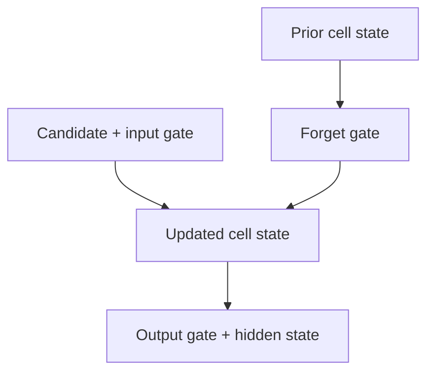

Long short-term memory (LSTM) is a gated recurrent architecture that carries both a hidden state $h_t$ and a separate cell state $c_t$. Learned gates control which old information is retained, which new candidate information enters memory, and which portion becomes the visible output.

## Three gates own different decisions

The forget gate $f_t$ decides how much previous cell state survives. The input gate $i_t$ controls how strongly a candidate $\tilde c_t$ is written. The output gate $o_t$ selects what becomes visible in the hidden state:

$$
c_t=f_t\odot c_{t-1}+i_t\odot\tilde c_t,\qquad h_t=o_t\odot\tanh(c_t)
$$

The gates generally use [sigmoid](glossary://sigmoid) values between zero and one. The candidate usually uses [tanh](glossary://tanh). A forget gate near one retains more cell state per step. Learned dynamics can still lose information, gradients can still vanish, and recurrence remains sequential across time.

## Diagram

## Example

If the previous scalar cell state is $10$, the forget gate is $0.8$, the input gate is $0.25$, and the candidate is $4$, the new state is $0.8(10)+0.25(4)=9$. With an output gate of $0.5$, the visible hidden state becomes $0.5\tanh(9)$, approximately $0.5$.

## Why it matters here

The preparation sequence lesson uses gate arithmetic to separate retained evidence from new evidence. That makes later attention-based memory, recurrent failure diagnosis, and GRU comparisons concrete.

## Related terms

- [Recurrent neural network](glossary://recurrent-neural-network)
- [GRU](glossary://gru)
- [Sigmoid](glossary://sigmoid)
- [Tanh](glossary://tanh)
