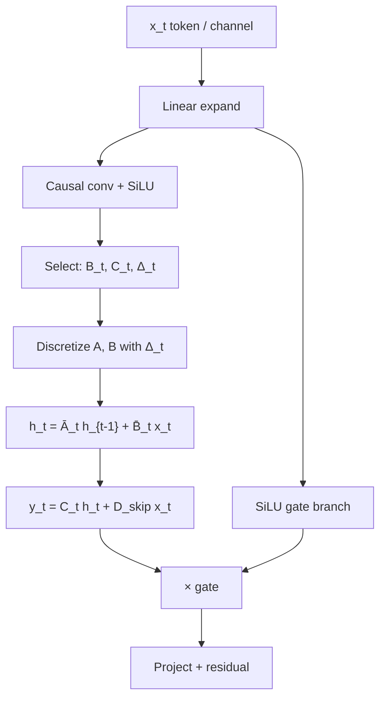

**Mamba** is a sequence-model architecture whose core mixer is a **selective state space model (SSM)**: a recurrent update with a fixed-size latent state whose dynamics depend on the current token. Gu and Dao (2023) introduced it to get content-aware memory with **linear** total work in sequence length at fixed model geometry. Full-sequence dense [self-attention](glossary://self-attention) instead has quadratic interactions; one cached Transformer decode step has linear attention work in the existing prefix, not quadratic work per new token.

The paper name for the selective layer is **S6** (SSM + selection). The original **Mamba** backbone stacks S6 blocks with projections, a short causal convolution, and a SiLU gate; it uses this sequence mixer without a separate attention or MLP block. Autoregressive decode carries a compact recurrent state per layer.

## Intuition

A [transformer](glossary://transformer) keeps history by **storing** it: every past position is still addressable through attention (and a KV cache at inference). Classical LTI SSMs (S4 and related models) keep history by **compressing** it into a fixed state, but their update rule does not change with token content, so they struggle at content-based tasks such as selective copying or induction heads.

Mamba keeps fixed-state efficiency and adds **selectivity**. For each token it predicts how strongly to write, read, and step the state. Important tokens can update the summary hard; filler can be mostly ignored; a large step size can wash out old state when a reset is useful. This provides content-aware recurrence with a compressed state whose size stays fixed as context grows.

## Formula

A continuous SSM maps scalar input $x(t)$ to output $y(t)$ through latent state $h(t) \in \mathbb{R}^{N}$:

$$
h'(t) = \mathbf{A}\, h(t) + \mathbf{B}\, x(t),\qquad
y(t) = \mathbf{C}\, h(t)
$$

Production Mamba applies this selective SSM **independently per expanded channel** at width $D_{\mathrm{inner}}$. The scalar form below is the per-channel recurrence; stack channels for full feature maps.

Zero-order hold (ZOH), presented in the [original paper](https://arxiv.org/html/2312.00752v2), turns continuous parameters into a token-step recurrence with step size $\Delta$:

$$
\overline{\mathbf{A}} = \exp(\Delta \mathbf{A}),\qquad
\overline{\mathbf{B}} = (\Delta \mathbf{A})^{-1}\bigl(\exp(\Delta \mathbf{A}) - \mathbf{I}\bigr)\,\Delta \mathbf{B}
$$

$$
h_t = \overline{\mathbf{A}}\, h_{t-1} + \overline{\mathbf{B}}\, x_t,\qquad
y_t = \mathbf{C}\, h_t
$$

**LTI S4** uses fixed $\Delta, \mathbf{B}, \mathbf{C}$ for every position (and can be written as a global convolution for training). **Selective S6** makes those parameters input-dependent (shapes grow a length axis $L$):

$$
\mathbf{B}_t = s_B(x_t),\quad
\mathbf{C}_t = s_C(x_t),\quad
\Delta_t = \tau_\Delta\!\bigl(\theta + s_\Delta(x_t)\bigr)
$$

with $s_B, s_C$ linear maps to state width $N$ and $\tau_\Delta = \mathrm{softplus}$ so $\Delta_t > 0$. The Mamba-1 reference code shares the input-dependent $B_t,C_t$ vectors across inner channels, while a low-rank projection produces a separate step size for each inner channel. After per-step discretization, the recurrence is **time-varying**, so one fixed global convolution kernel no longer applies and training uses a **scan**.

The scalar ZOH gating derivation below illustrates the paper's theorem. The [reference selective scan](https://github.com/state-spaces/mamba/blob/main/mamba_ssm/ops/selective_scan_interface.py) uses $\overline A_t=\exp(\Delta_t A)$ and the input-update approximation $\overline B_t=\Delta_t B_t$.

When $N=1$, $\mathbf{A}=-1$, $\mathbf{B}=1$, selectivity on $\Delta$ recovers classical RNN gating (paper Theorem 1):

$$
g_t = \sigma(\mathrm{Linear}(x_t)),\qquad
h_t = (1-g_t)\, h_{t-1} + g_t\, x_t
$$

Large $\Delta_t$ (with stable negative $\mathbf{A}$) shrinks $\overline{\mathbf{A}} = \exp(\Delta_t \mathbf{A})$ and favors the current input; small $\Delta_t$ preserves more of $h_{t-1}$.

## How it works

1. **Project and expand.** The Mamba block expands model width $D$ by factor $E$ (paper experiments fix $E=2$), then splits work into a main branch and a gate branch. Inner width is $D_{\mathrm{inner}} = E D$.
2. **Local mix.** A short causal convolution ($d_{\mathrm{conv}}=4$ in the reference implementation), followed by SiLU, mixes nearby tokens before the SSM.
3. **Select.** Linear maps of $x_t$ produce $\mathbf{B}_t$, $\mathbf{C}_t$, and $\Delta_t$; structured (usually diagonal) $\mathbf{A}$ is a learned parameter, so the update avoids materializing a dense $N \times N$ matrix per step. Reference code keeps $\mathbf{A}$ stable via $-\exp(a_{\log})$.
4. **Discretize and scan.** Fuse $\Delta_t, \mathbf{A}, \mathbf{B}_t$ into $\overline{\mathbf{A}}_t, \overline{\mathbf{B}}_t$ and run $h_t = \overline{\mathbf{A}}_t h_{t-1} + \overline{\mathbf{B}}_t x_t$ across the sequence. Training uses a **hardware-aware parallel scan**: load parameters into on-chip SRAM, avoid writing the full expanded state $(B,L,D_{\mathrm{inner}},N)$ to [HBM](glossary://hbm), and recompute intermediates in the backward pass (same IO spirit as [FlashAttention](glossary://flashattention)).
5. **Gate and project.** The reference mixer reads state with $C_t$ and adds a learned per-channel skip $D_{\mathrm{skip}}x_t$, then multiplies by the SiLU-gated branch and projects back to model width $D$. Residual connections and normalization wrap the mixer in the language-model backbone.

**Decode.** At generation time the same recurrence needs only the previous $h$ (plus the causal-conv buffer), so per-layer state size is $O(D_{\mathrm{inner}} N)$ for the SSM state plus $O(D_{\mathrm{inner}} d_{\mathrm{conv}})$ for conv state, independent of context length. Prefill still walks the whole prompt once, but cost scales as $O(L)$ in the sequence mixer rather than $O(L^2)$.

### Mamba-2 (lineage)

[Mamba-2](https://arxiv.org/abs/2405.21060) (Dao and Gu, 2024) develops **structured state space duality (SSD)** and a revised block/parameterization that uses efficient matrix multiplications. Its checkpoint layout and parameterization differ from Mamba-1, so conversion and kernel support must be checked for the exact model.

## Diagram



## Example

**Selective step size.** With scalar state, $\mathbf{A}=-1$, and $\overline{A}_t = e^{-\Delta_t}$, three tokens show how $\Delta$ trades retention vs update (ZOH with $\mathbf{B}=1$ collapses to the gated form):

| $t$ | $x_t$ | $\Delta_t$ | $\overline{A}_t$ | $h_t = \overline{A}_t h_{t-1} + (1-\overline{A}_t) x_t$ |
|---|---|---|---|---|
| 1 | 10 (key fact) | 1.0 | 0.37 | $h_1 \approx 6.3$ from $h_0=0$ |
| 2 | 0 (noise) | 0.1 | 0.90 | $h_2 \approx 5.7$ (mostly keeps the fact) |
| 3 | 0 (noise) | 2.0 | 0.14 | $h_3 \approx 0.8$ (large $\Delta$ mostly clears state) |

A learned selective model assigns small $\Delta$ (and weak $\mathbf{B}$) to filler and large write when a token should enter memory. Attention would instead keep both the fact and the noise as separate KV rows until softmax weights ignore them.

**Serving state vs KV cache.** Rough FP16 footprints for one sequence under this illustrative geometry: a 32-layer stack with residual width $D=4096$, full MHA (32 heads × 128 dim) on the Transformer side, and Mamba reference defaults $E=2$ so $D_{\mathrm{inner}}=8192$, $N=16$, $d_{\mathrm{conv}}=4$. Recompute with the deployed checkpoint's actual dimensions:

| Context $L$ | Transformer KV (32 heads × 128 dim) | Mamba-style recurrent state ($D_{\mathrm{inner}}(N + d_{\mathrm{conv}})$) |
|---|---|---|
| 512 | 256 MiB | 10 MiB (independent of $L$) |
| 8,192 | 4 GiB | 10 MiB |

The paper reports about **4-5×** higher generation throughput than similar-size Transformers in its setup, largely because constant state allows larger batches without a huge KV cache. Real speedups still depend on kernels, batch shape, and quality constraints.

```python
def ssm_state_bytes(layers, d_model, d_state=16, expand=2, d_conv=4, nbytes=2):
    # reference packing: ssm h is (d_inner, d_state); conv buffer is (d_inner, d_conv)
    d_inner = expand * d_model
    return layers * d_inner * (d_state + d_conv) * nbytes

def kv_cache_bytes(layers, n_kv_heads, head_dim, seq_len, nbytes=2):
    return 2 * layers * n_kv_heads * head_dim * seq_len * nbytes

print(ssm_state_bytes(32, 4096) / 1024**2)              # 10.0 MiB
print(kv_cache_bytes(32, 32, 128, 8192) / 1024**3)      # 4.0 GiB
```

## Trade-offs

- **Compression is lossy.** Fixed state size is the win and the risk: exact needle-in-haystack retrieval and some in-context patterns can lag full attention. Hybrid stacks (sparse attention layers among Mamba layers) reintroduce explicit token access where eval demands it.
- **Kernel dependency.** A Python recurrence can demonstrate the math, but throughput depends on the chosen scan/SSD implementation. In the [current Mamba-1 reference](https://github.com/state-spaces/mamba/blob/main/mamba_ssm/ops/selective_scan_interface.py), some optional convolution paths have fallbacks; a missing selective-scan CUDA extension is caught at import time, but calling the accelerated scan raises a runtime error rather than silently selecting the reference recurrence.
- **Linear sequence cost.** Work still grows with prompt length during prefill; only the **state** stays $O(1)$ in $L$ at decode. Projections and the FFN-like gate still dominate FLOPs at short context.
- **Serving integration.** Check support for recurrent-state caching, prefix reuse, scheduling, and speculative decoding in the actual engine and model combination. Measure TTFT, tokens/s, and long-context quality on the target stack; published speedups depend on their hardware, workloads, and implementation.
- **Numerics.** Unconstrained $\mathbf{A}$ or non-positive $\Delta$ can explode state; reference designs keep $\mathbf{A}$ stable (e.g. negative diagonal via $-\exp(a_{\log})$) and $\Delta$ through softplus.

## Why it matters here

Long-context LLM serving is often limited by attention memory: KV cache grows with $L$, concurrency, and layers, and [decode](glossary://decode-phase) becomes bandwidth-bound. Mamba is the curriculum's concrete alternative that attacks that bottleneck with selective recurrence and FlashAttention-style IO-aware scans. When you read hybrid production models, edge/long-document deployments, or "linear-time" papers, the checklist is the same: what is compressed into state, what remains explicitly addressable, and whether the fused kernels you will actually ship deliver the asymptotic story.

## Related terms

- [Transformer](glossary://transformer)
- [Self-attention](glossary://self-attention)
- [KV cache](glossary://kv-cache)
- [FlashAttention](glossary://flashattention)
- [Decode phase](glossary://decode-phase)
