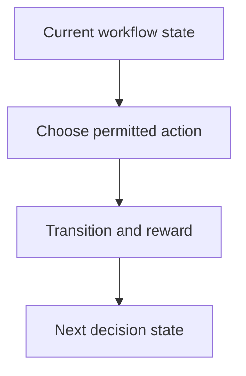

A Markov decision process (MDP) describes sequential decision-making through states, available actions, transition probabilities, rewards, and usually a discount factor. The Markov property says that once the current state and chosen action are known, the probability distribution of the next state and reward doesn't depend on additional earlier history.

## State must contain decision-relevant history

An MDP is commonly written $(S,A,P,R,\gamma)$. A policy chooses an action for each state, while a value function describes expected future return. The Markov property holds when the state captures information needed to predict transitions and rewards. If requester abandonment depends on waiting time but elapsed time isn't recorded, two apparently identical states can have different transition probabilities and the chosen representation isn't Markov.

## Example

An access request begins in `new_request`. The agent can approve immediately, request evidence, or send the case to human review. Requesting evidence costs four reward points and may transition to `evidence_ready` or `abandoned`. Human review costs eighteen points and transitions to `review_queue`. If abandonment risk depends on requester history, that history or an adequate summary belongs in the state before estimating transition probabilities.

## Why it matters here

Reinforcement-learning lessons use an MDP to separate one-shot classification from actions that change future possibilities. Later agent workflows inherit the same concerns: explicit state, permitted actions, stochastic outcomes, delayed rewards, and safe treatment of choices absent from historical logs.

## Related terms

- [Bellman equation](glossary://bellman-equation)
- [Q-learning](glossary://q-learning)
- [Reward function](glossary://reward-function)
