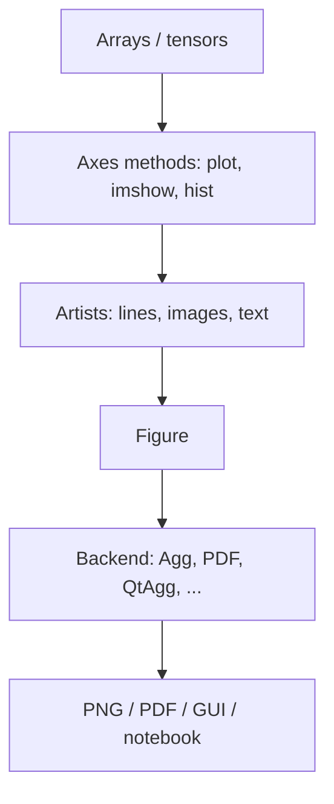

**Matplotlib** is the standard Python library for building 2D plots (and limited 3D) from arrays: line charts, histograms, heatmaps, scatter plots, and publication-quality figures. John D. Hunter created it as an open MATLAB-style plotting environment for scientific Python; the design paper frames it as a 2D graphics package for interactive scripting, application embedding, and hardcopy (PNG, PDF, SVG, and related formats).

For AI/ML work you rarely need every gallery demo. You need a reliable path from [NumPy arrays](glossary://numpy-array) or detached [tensors](glossary://tensor) to a file or notebook cell: training curves, [confusion matrices](glossary://confusion-matrix), attention heatmaps, embedding scatter plots, and slice comparisons that fit next to eval tables. The object model is simple once you name the parts: a **Figure** is the whole canvas; one or more **Axes** are the plot regions with data coordinates; every visible mark (line, text, image, tick) is an **Artist**. A **backend** turns that object tree into pixels or vector commands.

## Diagram



## How it works

Official docs and the Architecture of Open Source Applications chapter describe three stacked layers:

1. **Backend.** `FigureCanvas` is the surface; `Renderer` paints paths, images, and text onto it; interactive backends also map mouse and keyboard events. Static renderers write files (Agg → PNG, PDF, SVG, PS). Interactive ones open a GUI (QtAgg, TkAgg, and so on). Headless servers and agent sandboxes almost always want **Agg** (or another non-GUI backend), set via `MPLBACKEND=Agg` or `matplotlib.use("Agg")` *before* importing `pyplot`.
2. **Artist.** Everything drawn is an Artist. *Primitive* artists are marks (`Line2D`, `Rectangle`, `Text`, images). *Composite* artists group them (`Figure`, `Axes`, `Axis`). Plot methods on `Axes` create primitives and store them (for example `plot` → `Axes.lines`, `hist` → patches, `imshow` → image artists).
3. **Scripting (`pyplot`).** A thin stateful wrapper that tracks a "current" figure and axes so short scripts can call `plt.plot` without holding references. Fine for a notebook cell; fragile in libraries, multi-figure scripts, web workers, and generated agent code.

Two user-facing coding styles:

| Style | Pattern | Prefer when |
| --- | --- | --- |
| **Explicit (OO)** | `fig, ax = plt.subplots()` then `ax.plot(...)` | Reusable functions, multi-panel figures, tests, services |
| **Implicit (pyplot)** | `plt.plot(...)` on the current axes | Quick interactive exploration |

Docs recommend OO style for anything you will reuse. Inputs to plotting methods are [NumPy arrays](glossary://numpy-array) or array-likes that convert cleanly with `np.asarray`. Prefer converting tensors with `.detach().cpu().numpy()` before plotting so device and autograd state never leak into the figure path.

Coordinate systems chain through a transform graph: **data** → **axes** → **figure** → **display** (pixels or points). Affine pieces compose as $3\times 3$ matrices; non-affine maps (log scale, polar) sit in the same graph. You usually stay in data coordinates and let Matplotlib map them.

## Example

Plot synthetic training curves and a toy attention heatmap. The code generates all values below. It uses the object-oriented API, Agg-safe file output, and explicit close:

```python
import matplotlib
matplotlib.use("Agg")  # headless / CI / agent sandbox; before pyplot
import matplotlib.pyplot as plt
import numpy as np

# --- 1) Training curves (what "did it learn?" looks like) ---
steps = np.arange(0, 500, 10)
rng = np.random.default_rng(7)
train_loss = 2.4 * np.exp(-steps / 180) + 0.35 + 0.05 * rng.standard_normal(len(steps))
val_loss = 2.5 * np.exp(-steps / 200) + 0.42 + 0.06 * rng.standard_normal(len(steps))

fig, axes = plt.subplots(1, 2, figsize=(9, 3.5), layout="constrained")
axes[0].plot(steps, train_loss, label="train")
axes[0].plot(steps, val_loss, label="val")
axes[0].set_xlabel("step")
axes[0].set_ylabel("loss")
axes[0].set_title("Fine-tune loss")
axes[0].legend()
axes[0].grid(True, alpha=0.3)

# --- 2) Attention heatmap (tokens x tokens) ---
# Toy matrix: stronger diagonal + one "induction" off-diagonal band
n = 8
attn = np.eye(n) * 0.55
attn += np.eye(n, k=-1) * 0.25
attn[5, 2] = 0.45  # token 5 attends hard to token 2
attn = attn / attn.sum(axis=-1, keepdims=True)
tokens = ["The", "bank", "by", "the", "river", "was", "steep", "."]

im = axes[1].imshow(attn, cmap="viridis", vmin=0, vmax=1, aspect="equal")
axes[1].set_xticks(range(n), tokens, rotation=45, ha="right")
axes[1].set_yticks(range(n), tokens)
axes[1].set_xlabel("key")
axes[1].set_ylabel("query")
axes[1].set_title("Attention head (toy)")
fig.colorbar(im, ax=axes[1], fraction=0.046, pad=0.04)

fig.savefig("run_report.png", dpi=150)
plt.close(fig)  # free the figure; critical in loops and long jobs
```

What this teaches in practice:

- **Loss panel:** both synthetic curves trend downward and flatten; noise can make individual points cross. If measured validation loss rose while training loss fell, investigate the split and generalization gap.
- **Heatmap:** `imshow` shows a matrix as colors. Row $i$ is query token $i$, column $j$ is key token $j$, values are softmax weights (rows sum to $1$). Wrong `origin`, missing `aspect`, or plotting logits instead of probabilities makes the picture lie even when the model is fine.
- **`savefig` + `close`:** no GUI needed. [Closing](https://matplotlib.org/stable/api/_as_gen/matplotlib.pyplot.close.html) removes pyplot's retained figure reference; user-held references can still keep objects alive. Repeatedly retaining figures can consume memory, and process RSS may remain high because of live references or allocator behavior.

## Debug path

When a plot is blank, wrong, or the job hangs:

1. **Backend.** `print(matplotlib.get_backend())`. On a server without a display, expect Agg (or set it). `plt.show()` does not magically open a window under Agg.
2. **Array path.** Shape, dtype, finite values: `arr.shape`, `np.isnan(arr).any()`, min/max. Plotting a CUDA tensor without `.cpu().numpy()` fails; plotting an empty list draws nothing useful.
3. **Axes identity.** After `subplots(2, 2)`, call methods on the axes you mean. Implicit `plt.plot` after creating several figures often paints the wrong one.
4. **Heatmaps.** Check `vmin`/`vmax` (or `norm`), colormap, and whether color means probability, count, or log density. For classification tables, prefer an annotated [confusion matrix](glossary://confusion-matrix) over an unlabeled `imshow` alone.
5. **Resource hygiene.** After each `savefig` in a batch, `plt.close(fig)` or `plt.close("all")`. Prefer `with` patterns or a helper that owns the figure lifecycle.
6. **Concurrency.** [Matplotlib is not thread-safe](https://matplotlib.org/stable/users/faq.html). OO syntax does not remove Artist races. Serialize access with a lock or use isolated processes and noninteractive backends; GUI backends generally require the main thread.

## Trade-offs

Matplotlib supports many Python environments with noninteractive file backends, subject to compatible Python versions, dependencies, and installation permissions. For million-point interactive dashboards, evaluate higher-level tools such as Seaborn, Altair, or Plotly. For training diagnostics, paper figures, analysis plots, and CI artifacts, explicit axes and file backends provide a reusable path from notebook to headless job.

## Why it matters here

Use visualizations to investigate model behavior: plot loss vs [epoch](glossary://epoch) or step, inspect attention and feature maps, and render confusion and ROC-style diagnostics. Code-generation agents can emit analysis scripts that run under a [sandbox](glossary://sandbox) with Agg and `savefig`. Check axes, units, and data provenance so figures help reveal training bugs, bad splits, and evaluation skew.

## Related terms

- [NumPy array](glossary://numpy-array)
- [Tensor](glossary://tensor)
- [Confusion matrix](glossary://confusion-matrix)
- [Epoch](glossary://epoch)
- [Sandbox](glossary://sandbox)
