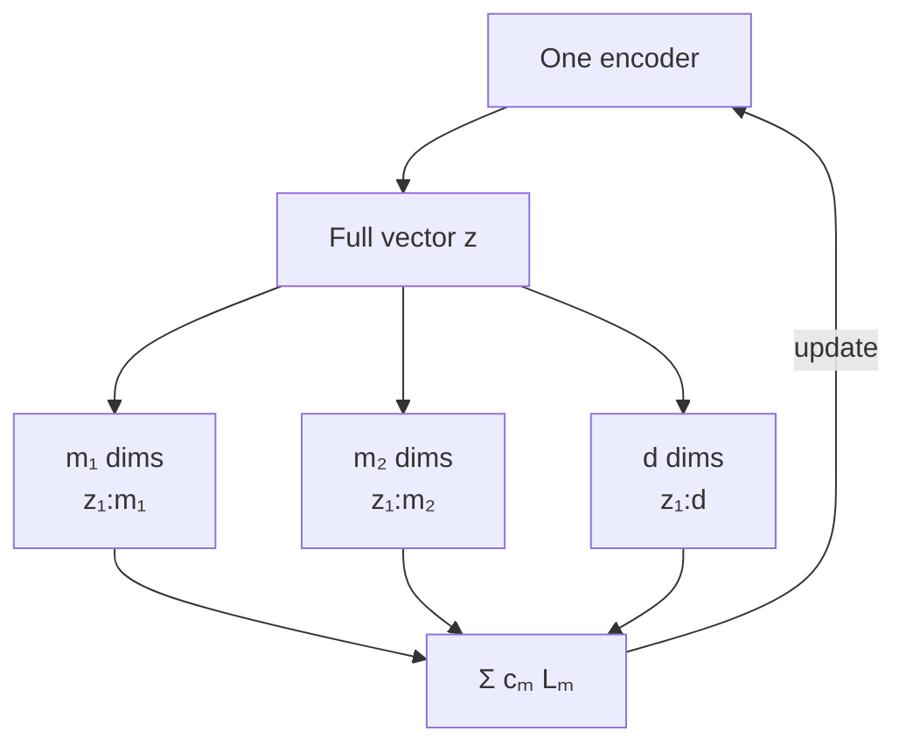

**Matryoshka representation learning (MRL)** trains one [embedding](glossary://embedding) so that selected *prefixes* of that vector are each usable on their own. Kusupati et al. (NeurIPS 2022) introduced the method so a single encoder can serve several dimensionality budgets without shipping separate models. The name comes from nested Russian dolls: the first $m$ coordinates form a smaller doll inside the full $d$-dimensional vector.

Full-width training optimizes the complete vector; a short prefix can lose useful signal when used on its own. MRL explicitly optimizes chosen widths $\mathcal{M}$ (often geometric sizes such as $\{8,16,32,\ldots,d\}$). Evaluate each prefix against separately trained representations on the target model and task.

## Intuition

Think of the MRL vector as a coarse-to-fine summary. Early dimensions must carry a usable global sketch; later dimensions can add detail. Training only at full width evaluates all coordinates together. MRL also evaluates the short prefixes: one forward pass produces $z \in \mathbb{R}^{d}$, and the loss scores several prefixes $z_{1:m}$.

At deploy time you store or score only the prefix you can afford. Edge devices keep 64-d; a central index keeps 768-d or 3072-d. Adaptive retrieval shortlists with a short prefix, then reranks with a longer one from the *same* stored vector. Complementary compressors such as [product quantization](glossary://product-quantization) still apply on top of any chosen width.

## How it works

1. **Pick nesting sizes** $\mathcal{M} \subset \{1,\ldots,d\}$ with $|\mathcal{M}| = O(\log d)$. Typical schedules use geometric growth (halving from $d$ down to a small bottleneck, e.g. $\{8,16,32,\ldots,d\}$).
2. **Encode once.** A shared network $F(\cdot;\theta_F)$ maps input $x$ to $z = F(x;\theta_F) \in \mathbb{R}^{d}$.
3. **Score each prefix.** For classification, each $m \in \mathcal{M}$ has its own linear head $W^{(m)} \in \mathbb{R}^{L \times m}$ on $z_{1:m}$. For dual-encoder retrieval, apply the same [contrastive](glossary://contrastive-learning) / [InfoNCE](glossary://infonce) loss to each prefix; L2-normalize every prefix and the full vector independently.
4. **Sum losses.** Weight each width by $c_m \geq 0$ (often all $c_m = 1$). Backprop updates $\theta_F$ so early coordinates must work without the later ones.
5. **Deploy by truncation.** Store the full $z$ once (or only the longest width you need). At query time take $z_{1:m}$, optionally re-normalize, and search under the same metric used at that width during training.

**MRL-E** (efficient MRL) ties classifier weights across widths ($W^{(m)} = W_{:,1:m}$) to cut head memory when $L$ is huge. Weight-tying alone does not train usable prefixes: the corresponding prefix losses still have to be optimized.

The [original paper](https://arxiv.org/abs/2205.13147) evaluates intermediate widths and alternatives such as post-hoc compression. Performance at an untrained width and comparison with PCA/SVD remain empirical questions for the deployed corpus.

## Formula

Supervised multi-class MRL (Kusupati et al., Eq. 1). Dataset $\mathcal{D}=\{(x_i,y_i)\}_{i=1}^{N}$, encoder $F$, nesting set $\mathcal{M}$, importance weights $c_m$:

$$
\min_{\{W^{(m)}\}_{m \in \mathcal{M}},\,\theta_F}
\frac{1}{N}\sum_{i=1}^{N}\sum_{m \in \mathcal{M}}
c_m \,\mathcal{L}\!\left(W^{(m)}\, F(x_i;\theta_F)_{1:m};\, y_i\right)
$$

Here $\mathcal{L}$ is softmax cross-entropy and $F(x)_{1:m}$ is the first $m$ coordinates of the embedding. For dual-encoder retrieval, replace $\mathcal{L}$ with a contrastive loss on prefix pairs $(q_{1:m},\, d_{1:m})$ at each $m \in \mathcal{M}$.

After truncation for cosine search, re-normalize a nonzero prefix:

$$
\hat{z}_{1:m} = \frac{z_{1:m}}{\lVert z_{1:m}\rVert_2}
$$

## Diagram



## Example

**OpenAI-style truncation (production).** Checked 2026-09-23: [OpenAI's embedding guide](https://developers.openai.com/api/docs/guides/embeddings) documents `text-embedding-3-large` with default $d=3072$ and a `dimensions` parameter for shortening third-generation embeddings. Its [January 2024 announcement](https://openai.com/index/new-embedding-models-and-api-updates/) links MRL and reports that a 256-dimensional shortened large embedding outperformed full 1536-dimensional `text-embedding-ada-002` on that MTEB evaluation. Those 2024 results describe that benchmark; check current ranks and evaluate the retrieval slices you plan to serve.

**RAG storage math.** Ten million chunks as float32:

| Width | Bytes / vector | Raw corpus size |
| --- | --- | --- |
| 3072 | $3072 \times 4 = 12288$ | $\approx 123$ GB |
| 1024 | 4096 | $\approx 41$ GB |
| 256 | 1024 | $\approx 10$ GB |

One MRL model can fill a cheap 256-d first-stage index and a 1024-d or full-width index from the same encode pass (store the long vector once and slice). Adaptive retrieval pattern: ANN shortlist with $m_{\mathrm{short}}$ (for example 64 or 256), then rescore the shortlist with $m_{\mathrm{long}}$ using the longer prefix of the *same* stored vectors. Kusupati et al. report up to $128\times$ fewer theoretical search FLOPs and about $14\times$ wall-clock speedup in their image-retrieval experiments, with comparable mAP@10 to the full-dimensional baseline. Measure RAG speedups on your corpus; those reported results depend on the shortlist, cascade widths, dataset, and search implementation.

**Operational truncate-and-search sketch:**

```python
import numpy as np

def prefix(z: np.ndarray, m: int, renorm: bool = True) -> np.ndarray:
    if z.ndim < 1 or not isinstance(m, int) or isinstance(m, bool) or not 1 <= m <= z.shape[-1]:
        raise ValueError("m must be an integer within the embedding width")
    p = z[..., :m].astype(np.float32, copy=False)
    if renorm:
        n = np.linalg.norm(p, axis=-1, keepdims=True)
        p = p / np.clip(n, 1e-12, None)
    return p

# Synthetic values let us check slicing; evaluate retrieval with relevance labels.
# In production, replace z with one compatible encoder output.
z = np.arange(1, 3073, dtype=np.float32)
q64 = prefix(z, 64)              # edge / first-stage ANN
q768 = prefix(z, 768)            # high-recall path
```

The clipped denominator leaves a zero prefix at zero; cosine similarity for a zero vector is undefined, so a retrieval service should reject or explicitly handle it. This sketch only demonstrates slicing and normalization.

## Trade-offs

| Benefit | Cost / risk |
| --- | --- |
| One model, many widths | Train-time cost scales with $\lvert\mathcal{M}\rvert$ losses per step |
| Prefix truncation is free at inference | Short prefixes often lag on hard, rare, or fine-grained cases |
| Adaptive shortlist + rerank cuts search FLOPs | Cascade thresholds and shortlist $K$ need tuning per corpus |
| Works with existing ANN / PQ stacks | Each width needs its own index eval; HNSW/IVF knobs do not transfer blindly |

**What fails in production**

- Evaluating only the full vector, then shipping a short prefix that was never measured on your slices (multilingual, long-tail entities, near-duplicates).
- Truncating a model that was *not* MRL-trained and expecting graceful quality; post-hoc PCA/SVD on a flat embedding is a different, usually weaker, path.
- Mixing cosine and unnormalized IP across widths, or forgetting to re-normalize after truncation when the training metric assumed unit prefixes.
- Building one ANN index geometry for 768-d and reusing it unchanged at 64-d without remeasuring recall@k and latency.
- Storing mixed widths in one collection without a clear contract (query dim must match document dim for that index).

## Why it matters here

LLM systems pay for [embeddings](glossary://embedding) in storage, ANN memory, and query latency long after training. MRL turns dimensionality into a deploy-time knob for [dense retrieval](glossary://dense-retrieval), tiered RAG indexes, edge search, and A/B tests across widths, without maintaining $O(|\mathcal{M}|)$ separate encoders. When you see an API "dimensions" parameter or a Sentence-Transformers Matryoshka loss, the underlying idea is this nested prefix training.

## Related terms

- [Embedding](glossary://embedding)
- [Dense retrieval](glossary://dense-retrieval)
- [ANN search](glossary://ann-search)
- [Contrastive learning](glossary://contrastive-learning)
- [Product quantization](glossary://product-quantization)
