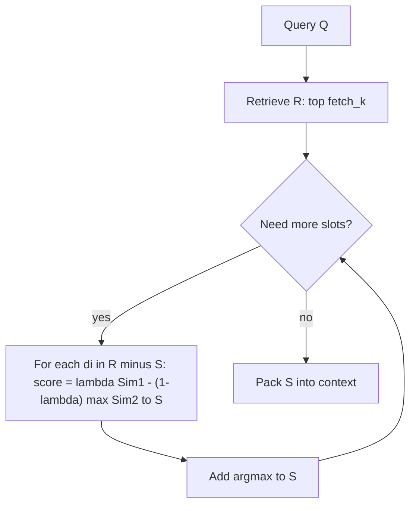

**Maximal marginal relevance (MMR)** is a greedy selection rule that balances *relevance to a query* with *novelty relative to items already chosen*. Carbonell and Goldstein introduced it for document reranking and query-focused summarization (SIGIR 1998). A candidate has high *marginal* relevance when it matches the query and is not too similar to the set already selected. Modern RAG stacks reuse the same idea: over-retrieve candidates, then pick a short, non-redundant evidence pack for a limited [token budget](glossary://token-budget).

MMR reranks a candidate set by balancing relevance and diversity. If the gold chunk never entered the candidate pool, no value of $\lambda$ can select it.

## Intuition

Pure top-$k$ by similarity rewards near-duplicates. Three chunks from the same runbook paragraph can all beat a slightly lower-scoring deploy note that actually answers a different facet of the question. MMR asks, at each step: "What is the next best item that still looks relevant *and* adds something new?"

MMR selects the strongest match first. Each later candidate must remain relevant while adding information not already covered by the selected set.

## Formula

Carbonell and Goldstein define iterative selection over a retrieved candidate set $R$ (often the top-$N$ from an IR or vector search stage). Let $Q$ be the query, $S$ the set already selected, and $R \setminus S$ the remaining candidates. At each step pick:

$$
\mathrm{MMR} =
\arg\max_{D_i \in R \setminus S}
\Big[
\lambda \cdot \mathrm{Sim}_1(D_i, Q)
-
(1-\lambda) \cdot \max_{D_j \in S} \mathrm{Sim}_2(D_i, D_j)
\Big]
$$

- $\mathrm{Sim}_1$: query-document similarity (retrieval score, cosine on embeddings, etc.).
- $\mathrm{Sim}_2$: document-document similarity (often the same embedding cosine; may differ from $\mathrm{Sim}_1$).
- $\lambda \in [0,1]$: trade-off. $\lambda=1$ reproduces pure relevance order; $\lambda=0$ maximizes diversity among items in $R$; intermediate values mix both.

For the first pick, $S$ is empty. With $\lambda>0$ and diversity penalty zero, the top $\mathrm{Sim}_1$ item wins; at $\lambda=0$ that formula ties all first candidates. This example explicitly seeds with the strongest query match even at zero, then applies MMR for subsequent picks. Ties use the smallest candidate index. $S$ grows until $k$ items are chosen or candidates run out.

**Parameter naming caution.** Some libraries rename or flip the knob. In Carbonell/Goldstein and most LangChain/LlamaIndex-style code, higher $\lambda$ means *more relevance*. OpenSearch's `diversity` parameter weights the novelty term the other way around: higher diversity means *more* penalty for similarity to selected docs. Read the local formula alongside the parameter name.

## How it works

Typical production pattern for vector RAG:

1. **Over-retrieve.** ANN / hybrid search returns `fetch_k` candidates (for example 20 to 100), larger than the final pack size $k$.
2. **Score once for relevance.** Keep each candidate's $\mathrm{Sim}_1(D_i, Q)$ (or the engine's distance converted to a similarity).
3. **Greedy MMR loop.** Until $|S|=k$: score remaining candidates with the formula above; append the argmax to $S$.
4. **Pack.** Pass $S$ (selection order or a re-sort) into the prompt under the evidence budget.

Naively recomputing $\max_{D_j \in S} \mathrm{Sim}_2$ each step costs $O(k^2 \cdot |R|)$ document-document similarity lookups. A running max-to-$S$ per candidate only needs similarities between each newly selected item and the remaining candidates, reducing this to $O(k \cdot |R|)$ similarities, or $O(k \cdot |R| \cdot d)$ arithmetic for $d$-dimensional embeddings. Materializing the full candidate-pair matrix costs $O(|R|^2)$ time and memory and is optional. For typical RAG packs ($k \le 20$, $|R| \le 100$) either form is often cheap compared with cross-encoder reranking.

```python
import numpy as np

def mmr_select(
    query_sims: np.ndarray,   # shape (n,), Sim1(di, Q)
    doc_embs: np.ndarray,     # shape (n, d), L2-normalized
    k: int,
    lambda_: float = 0.7,
) -> list[int]:
    """Greedy MMR over a pre-fetched candidate pool."""
    n = len(query_sims)
    if not isinstance(k, int) or isinstance(k, bool) or k < 0:
        raise ValueError("k must be a nonnegative integer")
    if not np.isfinite(lambda_) or not 0 <= lambda_ <= 1:
        raise ValueError("lambda_ must be finite and between zero and one")
    if query_sims.ndim != 1 or doc_embs.ndim != 2 or doc_embs.shape[0] != n:
        raise ValueError("candidate shapes must agree")
    if not np.isfinite(query_sims).all() or not np.isfinite(doc_embs).all():
        raise ValueError("scores and embeddings must be finite")
    selected: list[int] = []
    remaining = set(range(n))
    # Compact for small fetch_k. Large pools can update max redundancy
    # from only the newly selected vector instead of storing this n x n matrix.
    # Sim2 = cosine = dot for unit vectors.
    pair = doc_embs @ doc_embs.T

    while remaining and len(selected) < k:
        best_i, best_score = None, -np.inf
        for i in range(n):
            if i not in remaining:
                continue
            if not selected:
                red = 0.0
            else:
                red = max(pair[i, j] for j in selected)
            score = query_sims[i] if not selected else lambda_ * query_sims[i] - (1.0 - lambda_) * red
            if score > best_score:
                best_i, best_score = i, score
        selected.append(best_i)
        remaining.remove(best_i)
    return selected
```

## Diagram



## Worked numbers

Suppose three candidates after dense retrieval, with cosine as both $\mathrm{Sim}_1$ and $\mathrm{Sim}_2$, and $\lambda=0.7$:

| Doc | $\mathrm{Sim}_1(d,Q)$ | Notes |
|-----|----------------------|--------|
| A | 0.92 | Alert summary, near-duplicate of B |
| B | 0.90 | Same alert, reworded |
| C | 0.78 | Deploy note; complementary fact |

**Step 1.** $S=\emptyset$. Scores equal $\lambda \cdot \mathrm{Sim}_1$: A wins ($0.7 \times 0.92 = 0.644$). Select A.

**Step 2.** Assume $\mathrm{Sim}_2(B,A)=0.95$ and $\mathrm{Sim}_2(C,A)=0.40$:

- B: $0.7 \times 0.90 - 0.3 \times 0.95 = 0.63 - 0.285 = 0.345$
- C: $0.7 \times 0.78 - 0.3 \times 0.40 = 0.546 - 0.120 = 0.426$

C wins despite lower query similarity, because B is almost the same embedding as A. Pure top-2 would have returned A and B; MMR returns A and C.

## Example

Query: *"Why did inference requests time out after last night's deploy?"*

Dense retrieval's top-4 chunks (all high cosine):

1. Pager alert text (duplicate copy in two indexes)
2. Same alert from the mirrored channel export
3. Deploy changelog for the inference gateway
4. Runbook section on model-server queue saturation

With pure top-3 you often keep (1) through (3) or even two alert clones plus the changelog, and drop the runbook. With $\lambda \approx 0.6$ to $0.8$ and `fetch_k=20`, $k=3$, MMR tends to keep one alert, the deploy note, and the runbook: complementary evidence inside the same token budget.

That is the intended win for multi-document summarization in the original paper and for RAG context packing today: less repeated background, more facet coverage.

## Trade-offs

| Pressure | What happens |
|----------|----------------|
| $\lambda$ too high | Near-duplicates survive; context wastes tokens on the same fact. |
| $\lambda$ too low | Weakly related but novel chunks enter; grounding quality drops. |
| `fetch_k` too small | Diversity has nothing to choose from; MMR ≈ top-$k$. |
| `fetch_k` huge | More pairwise work; more chance of off-topic "novelty." |
| Bad $\mathrm{Sim}_2$ | Embedding cosine may treat paraphrases as identical (good) or miss lexical clones that embeddings underrate (bad). Lexical overlap or minhash can complement embeddings for near-dupe detection. |
| Wrong stage | MMR does not replace a [reranker](glossary://reranker) that judges fine-grained relevance; it only diversifies among candidates already scored. |

**What fails in production**

- **Missing recall.** MMR cannot surface a policy that never made the candidate set. Fix [candidate generation](glossary://candidate-generation) and hybrid recall first.
- **Over-diversification.** Lowering $\lambda$ until answers look varied while citation precision falls. Tune with retrieval nDCG, answer-grounding evals, and human review of context packs.
- **Score scale mismatch.** Mixing unnormalized BM25 scores with cosine in $\mathrm{Sim}_1$ without calibration warps the $\lambda$ trade-off. Prefer comparable similarities (or rank-based proxies) inside one MMR stage.
- **Order vs score.** Selection order is the MMR ranking; logging only original ANN scores hides why a lower-scoring chunk was kept.

## Why it matters here

RAG and agent context windows are scarce. MMR balances relevance with novelty so a shortlist can cover complementary evidence. Its formula exposes that tradeoff between retrieval and generation, and many vector stores and frameworks provide implementations.

## Related terms

- [RAG](glossary://rag)
- [Candidate generation](glossary://candidate-generation)
- [Dense retrieval](glossary://dense-retrieval)
- [Cosine similarity](glossary://cosine-similarity)
- [Reranker](glossary://reranker)
