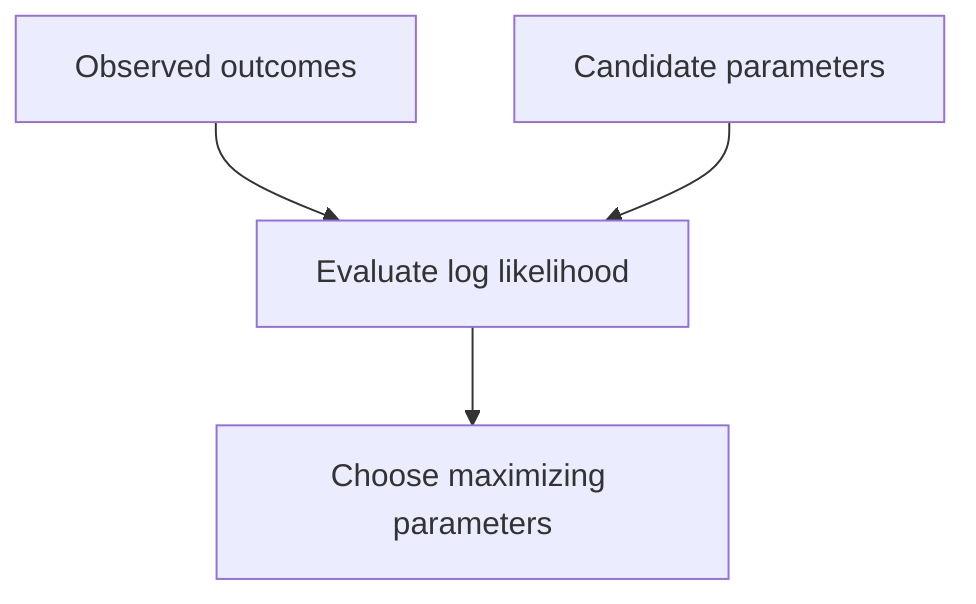

Maximum likelihood estimation selects parameters that maximize the likelihood of the observed data under a chosen statistical model. For discrete outcomes this uses probabilities; for continuous observations it uses probability densities, because an exact point usually has probability zero. The estimate depends on the chosen model and observed sample. Prior assumptions enter Bayesian or MAP variants, while misspecification and sampling bias require separate analysis. Independent observations give a sum of log likelihoods for numerical stability.

## Estimate parameters, then question the model

For independent Bernoulli outcomes with $k$ successes in $n$ trials, the likelihood is proportional to $p^k(1-p)^{n-k}$. Its interior maximizer is $\widehat p=k/n$. Taking logs turns products into sums: $k\log p+(n-k)\log(1-p)$. When $k=0$ or $k=n$, the estimate lies on a boundary, which can create zero-probability predictions for future outcomes unless smoothing or a prior is introduced.

## Example

Eight passes in ten independent agent trials give the Bernoulli maximum-likelihood estimate $\widehat p=0.8$, with substantial uncertainty from the small sample. Two different models can have identical maximum-likelihood means while their sample sizes, calibration quality, and uncertainty differ sharply. A Bayesian update with a Beta(2, 2) prior has posterior mean $10/14$, illustrating how prior assumptions change the estimate when evidence is limited.

## Why it matters here

Cross-entropy training, language modeling, Gaussian mixtures, and many statistical baselines optimize likelihood. Researchers must distinguish an optimization result from uncertainty quantification, generalization evidence, and a causal claim.

## Related terms

- [Likelihood](glossary://likelihood)
- [Cross-entropy](glossary://cross-entropy)
- [Bayesian inference](glossary://bayesian-inference)
