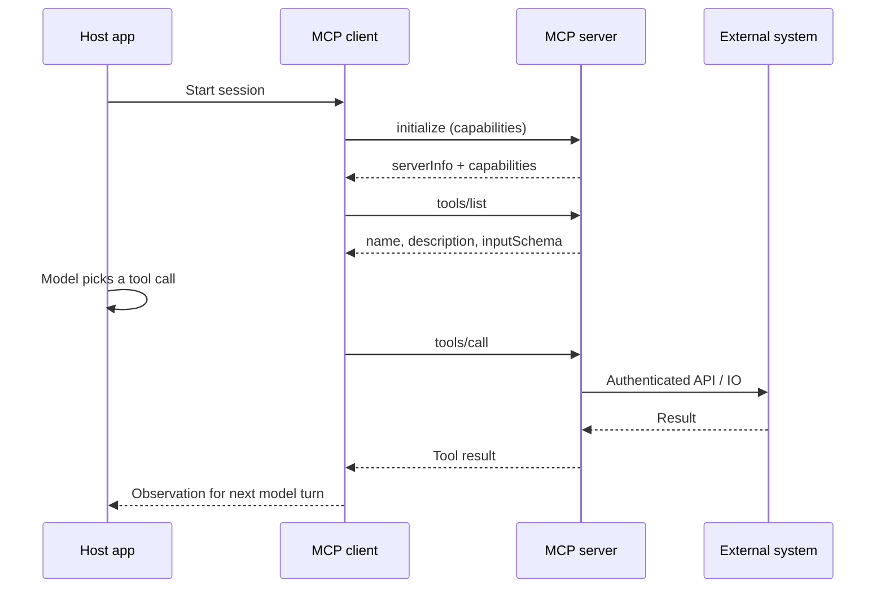

**Model Context Protocol (MCP)** is an open standard for connecting AI applications to external tools, data, and workflows through a shared client-server interface. Anthropic open-sourced it in November 2024. Clients discover capabilities over JSON-RPC 2.0; servers expose tools, resources, and prompt templates without each host inventing a private connector.

Checked 2026-09-23: the released [2026-07-28 specification](https://blog.modelcontextprotocol.io/posts/2026-07-28/) replaces the legacy initialization handshake with per-request version, identity, and capability metadata. Its [versioning contract](https://modelcontextprotocol.io/specification/2026-07-28/basic/versioning) distinguishes the modern and legacy eras. The worked messages below illustrate **2025-11-25 legacy initialization**; use that flow only with an SDK and server that support the same revision.

MCP standardizes discovery and message shape and provides an HTTP authorization framework. The application still sets resource permissions and product policy, while the host controls how results enter model context.

## Diagram: abbreviated legacy flow

In this legacy flow the client also sends `notifications/initialized` after the initialization response, before ordinary operations; that notification is omitted from this abbreviated diagram.



The tool result carries `content` and, when provided, `structuredContent`.

## Intuition

Without a shared protocol, every pairing of agent runtime and data system is a custom integration: one schema format for IDE A, another for chat product B, another for internal bot C. MCP standardizes the **wire and catalog**; the host still controls the agent loop.

Three roles matter:

| Role | What it is | Owns |
| --- | --- | --- |
| **Host** | AI app (IDE, chat, agent runtime) | UX, model calls, consent, which servers attach |
| **Client** | Connector inside the host | JSON-RPC, routing tool calls, revision-specific metadata or legacy session lifecycle |
| **Server** | Process or remote service | Tools, resources, prompts; maps calls to real systems |

Servers **expose** capabilities. Hosts **decide** what the model sees, when to call a tool, and whether a human must approve. That split is the whole point: write a server once, plug it into any MCP-capable host.

## Current revision versus legacy sessions

Under 2026-07-28, each request declares its revision in `_meta`; HTTP also carries `MCP-Protocol-Version`. `server/discover` exposes supported versions and capabilities, while an unsupported revision yields a version error. Persistent connection state, conversation state, and authenticated application sessions are separate concepts. Dual-era implementations can support legacy clients separately; keep the two contracts distinct.

The [current base protocol](https://modelcontextprotocol.io/specification/2026-07-28/basic) returns typed results such as `complete` or `input_required`; sampling, elicitation, and roots can use multi-round-trip requests. [Tasks](https://modelcontextprotocol.io/extensions/tasks/overview) are an optional extension advertised as `io.modelcontextprotocol/tasks`; check that capability before relying on task operations. Keep application authorization and durable task state explicit.

## How legacy initialization works

### Layers

1. **Transport:** how bytes move. Common choices are **stdio** (local child process, stdin/stdout) and **Streamable HTTP** (remote servers; HTTP POST with optional SSE; OAuth or other HTTP auth).
2. **Data layer:** JSON-RPC 2.0 requests, responses, and notifications. Lifecycle starts with `initialize` (protocol version + capability negotiation), then `notifications/initialized`.

### Server primitives

| Primitive | Control model | Typical use |
| --- | --- | --- |
| **Tools** | Model-driven actions (`tools/list`, `tools/call`) | Search tickets, run SQL, write a file |
| **Resources** | App/user-driven context (`resources/list`, `resources/read`) | Schemas, docs, config blobs by URI |
| **Prompts** | Templated workflows for users | Slash commands, few-shot packs |

Tools carry a **name**, **description**, and JSON Schema **`inputSchema`** (and optionally `outputSchema` / structured results). Descriptions and annotations are metadata for humans and models; treat annotations as **untrusted** unless the server itself is trusted.

### Client capabilities and utilities (optional)

Clients can advertise capabilities that let servers call back into the host:

- **Sampling:** request an LLM completion from the host (server stays model-agnostic).
- **Elicitation:** ask the user for input or confirmation.
- **Roots:** describe relevant URI roots. Enforce filesystem permissions through host and operating-system controls.
- **Tasks:** legacy 2025-11-25 experimental task support; current revisions use the extension described above.

Logging uses a separate protocol utility: the client can set a logging level, and a server that advertises logging can emit `notifications/message` diagnostics. This differs from a `ClientCapabilities.logging` primitive.

### Lifecycle in one pass

```text
connect → initialize / negotiate → list tools|resources|prompts
      → model or user selects → tools/call or resources/read
      → result back into host context → optional list_changed notifications
```

The host's mapping from MCP tool schemas into a provider's function-calling API lives in the [agent scaffold](glossary://agent-scaffold).

## Example

A coding host connects a local **issue-tracker** server over stdio using **2025-11-25**. After `initialize` and `notifications/initialized`, the client lists tools:

```json
{
  "jsonrpc": "2.0",
  "id": 2,
  "method": "tools/list"
}
```

Response (abbreviated):

```json
{
  "jsonrpc": "2.0",
  "id": 2,
  "result": {
    "tools": [
      {
        "name": "search_issues",
        "description": "Search issues by text query and optional status filter",
        "inputSchema": {
          "type": "object",
          "properties": {
            "query": { "type": "string" },
            "status": {
              "type": "string",
              "enum": ["open", "closed", "any"],
              "default": "open"
            },
            "limit": { "type": "integer", "minimum": 1, "maximum": 50 }
          },
          "required": ["query"]
        }
      },
      {
        "name": "create_issue",
        "description": "Create a new issue in the configured project",
        "inputSchema": {
          "type": "object",
          "properties": {
            "title": { "type": "string" },
            "body": { "type": "string" }
          },
          "required": ["title"]
        }
      }
    ]
  }
}
```

The host adapts those schemas to the model provider's supported format. JSON Schema `default` is an annotation; the server must insert `status="open"` when that default behavior is required. The model emits a call; the host validates arguments and applies its write policy, then:

```json
{
  "jsonrpc": "2.0",
  "id": 3,
  "method": "tools/call",
  "params": {
    "name": "search_issues",
    "arguments": { "query": "MCP timeout", "status": "open", "limit": 5 }
  }
}
```

The server uses **its** credentials (service token, user OAuth) to hit the tracker API, applies server-side ACL and rate limits, and returns text or structured content. Adding a second server for docs search is a config change on the host: same client machinery, new process or remote endpoint. No rewrite of the agent loop.

Pseudo-code for the host side:

```python
async def handle_model_tool_call(tool_id, args: dict, user):
    # tool_id identifies both server and tool; names may collide across servers.
    session, name, schema = resolve_tool(tool_id)
    if tool_id not in allowlist_for(user):
        raise PermissionError(tool_id)
    validate_arguments(args, schema)  # reject invalid arguments before execution
    authorize_resources(user, tool_id, args)
    if is_write_tool(tool_id) and not user.confirmed(tool_id, args):
        return await elicit_confirmation(tool_id, args)
    result = await session.call_tool(name, args)
    audit.log(user=user, tool=tool_id, result_meta=safe_result_metadata(result))
    return result  # become the next observation in the scaffold
```

## Security boundary

MCP standardizes **access shape**. Trust depends on the server code and the credentials it receives.

From the specification's trust principles:

1. **User consent** for data access and tool invocation (hosts should surface clear review UIs).
2. **Data privacy:** do not ship user data to servers without consent; protect with access controls.
3. **Tool safety:** tools are arbitrary execution paths; descriptions can lie; confirm sensitive ops.
4. **Sampling controls:** if a server requests sampling, the user/host must control prompts and visibility.

Production checklist before attaching a server:

| Check | Question |
| --- | --- |
| Credentials | Which identity does the server run as? Least privilege? |
| Network | Local stdio only, or remote HTTP on the public internet? |
| Side effects | Which tools mutate state? Which need human approval? |
| Tenancy | Can server A see tenant B's data? |
| Audit | Are `tools/call` name, args, actor, and outcome logged? |
| Injection | Are tool results treated as untrusted text that can try [prompt injection](glossary://prompt-injection)? |

Use `description` fields to explain tools. Enforce permissions with host-side [action allowlists](glossary://action-allowlist), schema validation, and policy gates.

## Trade-offs

**Build once, plug many.** Servers become an ecosystem asset; hosts (Claude, ChatGPT, VS Code, Cursor, custom agents) can share them.

**Context cost scales with catalog size.** Typical hosts inject full tool definitions into the model context. Dozens of servers $\times$ tens of tools each can spend large fractions of the window on schemas before the user message. Intermediate tool results also re-enter context on every hop; large blobs (transcripts, sheets) burn tokens twice if the model shuttles them between tools.

[Anthropic's engineering note on code execution with MCP](https://www.anthropic.com/engineering/code-execution-with-mcp) illustrates presenting servers as code APIs and processing data outside model context. Its example cuts roughly 150,000 tokens to 2,000 (about 98.7%) through combined loading and context-processing choices; the result describes that setup and cannot be attributed to schema alone.

**Operational load.** Local stdio servers are easy to start and hard to multi-tenant. Remote HTTP servers need auth, versioning, timeouts, and ops. Dynamic `tools/list_changed` notifications force hosts to refresh model-facing catalogs mid-session.

**Protocol scope and ACI design.** The protocol ships names and schemas. Whether `read_file` returns line-numbered windows or a 50k-token dump is [agent-computer interface](glossary://agent-computer-interface) quality, which still decides task success.

## Debug path

When an MCP integration misbehaves, isolate the layer:

1. **Transport:** process exit, stdio hang, HTTP 401/403, TLS, wrong base URL.
2. **Version contract:** missing modern per-request metadata or unsupported revision; for legacy sessions, an incomplete initialization handshake or missing capability.
3. **Schema:** model args fail `inputSchema`; tool name casing or namespacing wrong across servers.
4. **AuthZ:** server identity lacks scope; host allowlist blocks the call; user never confirmed a write.
5. **Semantics:** tool description misleads the model; result is huge or unstructured; `isError: true` with recoverable text vs JSON-RPC protocol error.
6. **Host packing:** schemas or results blow the [context window](glossary://context-window); wrong observation ordering confuses the next step.

Log correlation ids across host turn, `tools/call` id, and downstream API request. Prefer tool **execution** errors (`isError: true` with actionable text) over opaque protocol failures when the model can retry with better args.

## Why it matters here

Agent quality depends on model weights, reliable external context, and tools. MCP provides a shared protocol for discovering and invoking those capabilities across products. Curriculum work on tool calling, scaffolds, coding agents, and production security sits on this boundary: protocol support still needs ACI design, allowlists, consent UX, and context budgets. Treat every new server as a dependency with a threat model and a token cost.

## Related terms

- [Tool calling](glossary://tool-calling)
- [Agent-Computer Interface](glossary://agent-computer-interface)
- [Agent scaffold](glossary://agent-scaffold)
- [Action allowlist](glossary://action-allowlist)
- [Least privilege](glossary://least-privilege)
