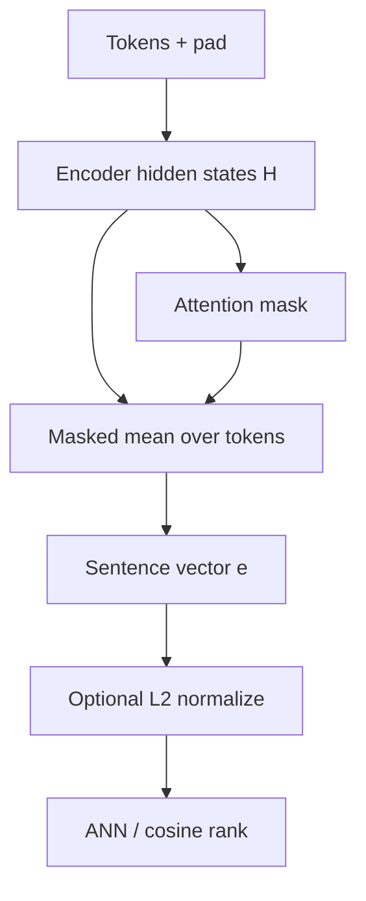

**Mean pooling** collapses a sequence of vectors into one fixed-size vector by taking the element-wise average. In transformer encoders used for retrieval and sentence similarity, that usually means averaging the last-layer token hidden states over non-padding positions, so a variable-length query or passage becomes a single [embedding](glossary://embedding) $e \in \mathbb{R}^{d}$ that can be stored in a vector index and scored with cosine or a dot product.

The same name covers older averages of static word vectors and spatial average pooling in CNNs. In modern LLM and RAG stacks, the important case is **masked mean pooling over contextual token states** after a [bi-encoder](glossary://bi-encoder) forward pass. Sentence-BERT showed that the encoder must be trained so the pooled vectors' nearest-neighbor geometry matches the retrieval task; naive BERT means (or raw `[CLS]`) score poorly under cosine.

## Intuition

A transformer returns one vector per token. Mean pooling gives selected token states equal weight. Averaging is invariant to permuting those already-computed states, but reordering the input text changes positional and contextual states, so the full encoder-plus-pooling pipeline can retain order information. Its fixed-size summary can still blur a small but important constraint.

## Formula

Let $H = (h_1,\ldots,h_n)$ be token states $h_i \in \mathbb{R}^{d}$, and let $\mathcal{P}$ be the set of non-padding positions (from the attention mask):

$$
e = \frac{1}{|\mathcal{P}|}\sum_{i \in \mathcal{P}} h_i
$$

After pooling, retrieval models often L2-normalize so cosine equals an inner product:

$$
\hat{e} = \frac{e}{\lVert e \rVert_2}
$$

With a binary mask $m_i \in \{0,1\}$ (1 = real token), the batch form used in production is

$$
e_b = \frac{\sum_{i=1}^{n} m_{b,i}\, h_{b,i}}{\max\!\left(\sum_{i=1}^{n} m_{b,i},\,\varepsilon\right)}
$$

with a small $\varepsilon$ (for example $10^{-9}$) so an all-masked sequence does not divide by zero. With finite hidden states it produces a zero vector, whose cosine similarity is undefined; reject or explicitly handle that case before indexing. Averaging over the full padded length without $m$ is a different operator: zero pad states dilute the mean, while nonzero pad states can also change its direction.

**Related operators.** Local average pooling on a 2D feature map with window $R$ is $y = \frac{1}{|R|}\sum_{(i,j)\in R} x_{ij}$. Global average pooling is the special case that averages an entire spatial map into one value per channel. CNN and sentence mean pooling share the averaging idea but use different tensor layouts and code paths.

## Diagram



## Example

Three real tokens and one pad, width $d=2$:

| Position | Token | $h_i$ | Mask |
| --- | --- | --- | --- |
| 1 | clip | $(1.0,\ 0.0)$ | 1 |
| 2 | after | $(0.0,\ 2.0)$ | 1 |
| 3 | unscale | $(2.0,\ 1.0)$ | 1 |
| 4 | `[PAD]` | $(9.0,\ 9.0)$ | 0 |

Masked mean:

$$
e = \frac{(1,0)+(0,2)+(2,1)}{3} = \left(\frac{3}{3},\frac{3}{3}\right) = (1,1)
$$

If you forget the mask and divide by 4:

$$
e_{\mathrm{bad}} = \frac{(1,0)+(0,2)+(2,1)+(9,9)}{4} = (3,3)
$$

Same underlying text, different raw vector. Here $(1,1)$ and $(3,3)$ happen to share direction, so L2-normalization gives identical vectors; padding does not always change cosine rankings. Other pad states can change direction as well as magnitude. Non-pad special tokens or prompt tokens are included only if the checkpoint's pooling contract selects them.

Operational form (matches the public [`all-MiniLM-L6-v2` recipe](https://huggingface.co/sentence-transformers/all-MiniLM-L6-v2), checked September 23, 2026). Inputs must have matching batch/sequence axes, finite hidden states, and a binary mask:

```python
import torch

def mean_pooling(token_embeddings: torch.Tensor, attention_mask: torch.Tensor) -> torch.Tensor:
    # token_embeddings: (batch, seq, dim), attention_mask: (batch, seq)
    mask = attention_mask.unsqueeze(-1).expand(token_embeddings.size()).float()
    summed = torch.sum(token_embeddings * mask, dim=1)
    counts = torch.clamp(mask.sum(dim=1), min=1e-9)
    return summed / counts
```

## How it works in sentence encoders

1. Tokenize the string; pad the batch to a shared length; build an attention mask.
2. Run the transformer; take last-layer states $H \in \mathbb{R}^{n \times d}$ (sometimes a weighted mix of layers).
3. Mean-pool over non-pad tokens to $e \in \mathbb{R}^{d}$.
4. Optionally project and L2-normalize; index documents offline; embed the query online the same way.

Sentence-BERT (Reimers and Gurevych, 2019) adds this pooling head on BERT/RoBERTa and fine-tunes with siamese or triplet objectives so cosine on the pooled vectors is meaningful. They tried **MEAN**, **MAX**, and **CLS**; **MEAN is the default**. On STS-style cosine ranking, untuned average BERT and raw CLS embeddings underperformed average GloVe; after SBERT fine-tuning, the pooled vectors became competitive for semantic search and clustering. Sentence-Transformers still defaults `pooling_mode` to `"mean"` and also supports `cls`, `max`, `lasttoken`, `weightedmean`, and `mean_sqrt_len_tokens`.

## Trade-offs

| Choice | Keeps | Risks |
| --- | --- | --- |
| Mean pool | Signal from every real token; stable default for many SBERT models | Dilutes rare terms and local constraints; order-blind |
| `[CLS]` / first token | One trained summary position | Needs an objective that actually trains that position for cosine retrieval (DPR-style CLS is fine; raw BERT CLS often is not) |
| Max pool | Peak activations per dim | Can be brittle; SBERT found MAX weaker under regression/cosine setups |
| Last token | Natural for causal LM embedding heads | Wrong for bidirectional mean-pool checkpoints |
| Late interaction (MaxSim) | Token-level matches | More storage and query cost than one vector |

Mean pooling is a **contract**: train, index, and query must use the same mask rule, the same hidden states, and the same normalization. Mixing mean-pooled index vectors with CLS-pooled queries (or re-embedding half the corpus after a pooling change) silently corrupts ranking.

## What fails in production

- **Pad leakage.** Batching without mask-aware pooling contaminates short docs; scores shift with max sequence length.
- **Train/serve skew.** Library A mean-pools last layer; library B returns CLS or includes the prompt tokens of an instruction-tuned embedder. Cosine looks "reasonable" but recall drops on gold chunks.
- **Boilerplate dilution.** Long legal headers, nav chrome, or repeated disclaimers pull the mean away from the one clause that answers the query. Fix chunking and cleaning before blaming ANN.
- **Order and negation.** "clip before unscale" and "clip after unscale" can land nearby if the differing token is a small fraction of the sequence. Use tighter chunks, hybrid BM25, or a reranker / late-interaction stage when constraints matter.
- **Untuned LM pooling.** Mean-pooling a base LM without a sentence or retrieval objective often yields anisotropic, poorly ranked neighborhoods. Pooling is necessary; contrastive or ranking training is what makes the geometry useful.

## Why it matters here

Almost every dense retrieval and sentence-similarity path you will ship either mean-pools token states or replaces that step with CLS / last-token pooling. Knowing the mask math, the SBERT default, and the failure modes (pad dilution, boilerplate, train/serve mismatch) is how you debug "embeddings look fine but RAG misses the gold chunk."

## Related terms

- [Embedding](glossary://embedding)
- [Bi-encoder](glossary://bi-encoder)
- [Max pooling](glossary://max-pooling)
- [Padding](glossary://padding)
- [Dense retrieval](glossary://dense-retrieval)
