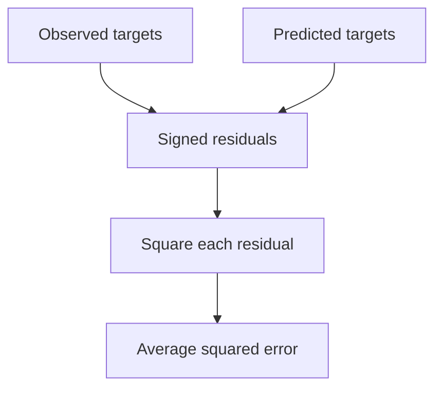

Mean squared error (MSE) is the average squared difference between numeric predictions and observed values. Squaring removes the sign and assigns disproportionately greater weight to larger misses. It is a common optimization objective for regression because its gradient is straightforward and ordinary least squares has a closed-form solution under suitable rank conditions.

## Formula and units

For $n>0$ examples with finite real targets and predictions, $\operatorname{MSE}=n^{-1}\sum_{i=1}^{n}(y_i-\hat y_i)^2$. If targets are milliseconds, MSE is measured in squared milliseconds. That makes raw MSE inconvenient to explain operationally; its square root returns the measurement to the target's original units. One extreme residual can dominate the average, so compare absolute-error and tail summaries when unusually large mistakes matter.

## Example

Three latency predictions miss their targets by $-2$, $1$, and $3$ milliseconds. Squared residuals are $4$, $1$, and $9$, giving $\operatorname{MSE}=14/3\approx4.67$ squared milliseconds. The three-millisecond mistake contributes nine units, more than the other two examples combined. A constant-mean baseline provides an essential reference before declaring that a fitted model learned something useful.

## Why it matters here

The first trainable regression lesson uses MSE to connect residual plots, derivatives, gradient descent, and held-out evaluation. The same squared-error intuition returns in forecasting, tree regression, representation reconstruction, and monitoring predictive systems.

## Related terms

- [Linear regression](glossary://linear-regression)
- [Root mean squared error](glossary://root-mean-squared-error)
- [Mean absolute error](glossary://mean-absolute-error)
