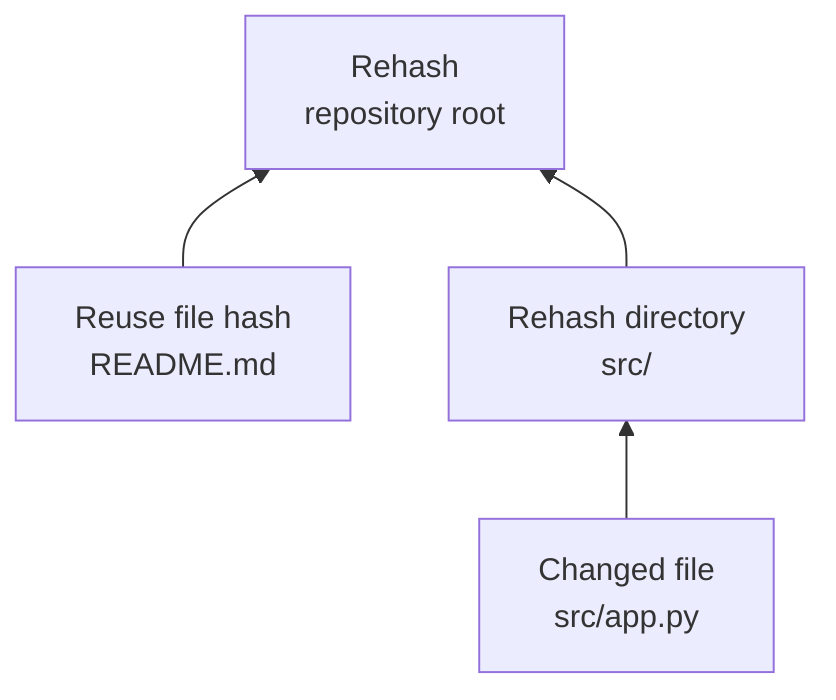

A **Merkle tree** is a tree of cryptographic hashes in which leaf nodes represent individual data items and each internal node hashes a deterministic encoding of its child nodes. Its root summarizes the entire structure. With an unambiguous encoding and a collision-resistant hash, changing an included item changes its ancestor hashes except in the exceptional case of a hash collision.

## Define the exact bytes being authenticated

A hash tree is only reproducible when implementations agree on leaf encoding, child ordering, path representation, node type, and the behavior of empty directories. Without an unambiguous encoding, different file trees can produce misleadingly similar inputs, and independently implemented clients may disagree about the same repository.

Prefixing file and directory encodings with distinct type markers prevents a file hash from being confused with a directory node. Sorting child names makes directory hashes independent of filesystem iteration order. Hashes detect content changes but don't prove authenticity unless the expected root comes from a trusted source.

After editing `src/app.py`, recompute its ancestor hashes and reuse the unchanged README hash:

## Example

A repository contains `src/app.py` and `README.md`. Compute each file's content hash, hash the sorted children of `src`, then hash the sorted root entries including both names and node hashes.

Changing `src/app.py` updates its file hash, the `src` directory hash, and the repository root. The unchanged README subtree can be reused. Renaming a file must also change the parent hash even when its content stays identical, because the authenticated encoding includes child names.

## Why it matters here

Repository-hash-tree and coding-agent exercises use Merkle structures to identify changed subtrees efficiently. Correct repository identity depends on deterministic ordering, file-versus-directory partitions, ignored-file policy, and root authenticity in addition to content digests.

## Related terms

- [Checksum](glossary://checksum)
- [Reproducible environment](glossary://reproducible-environment)
- [Parsing](glossary://parsing)
- [lineage](glossary://provenance)
