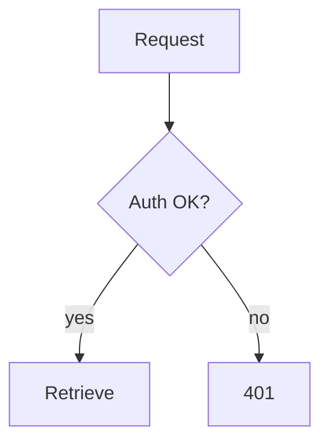
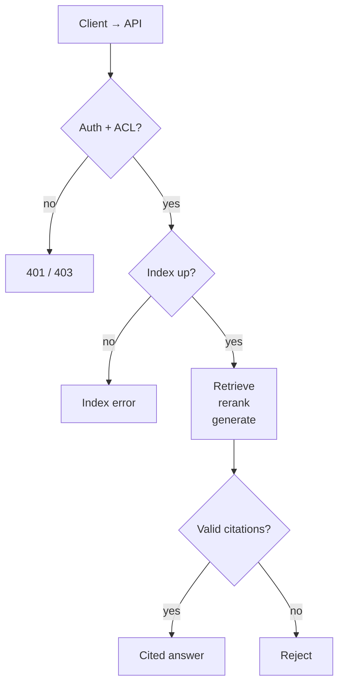
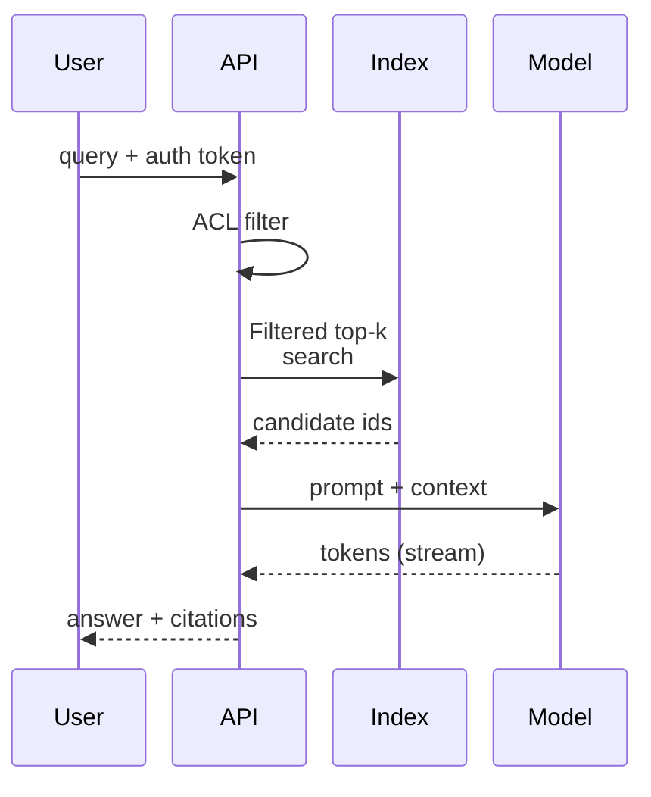
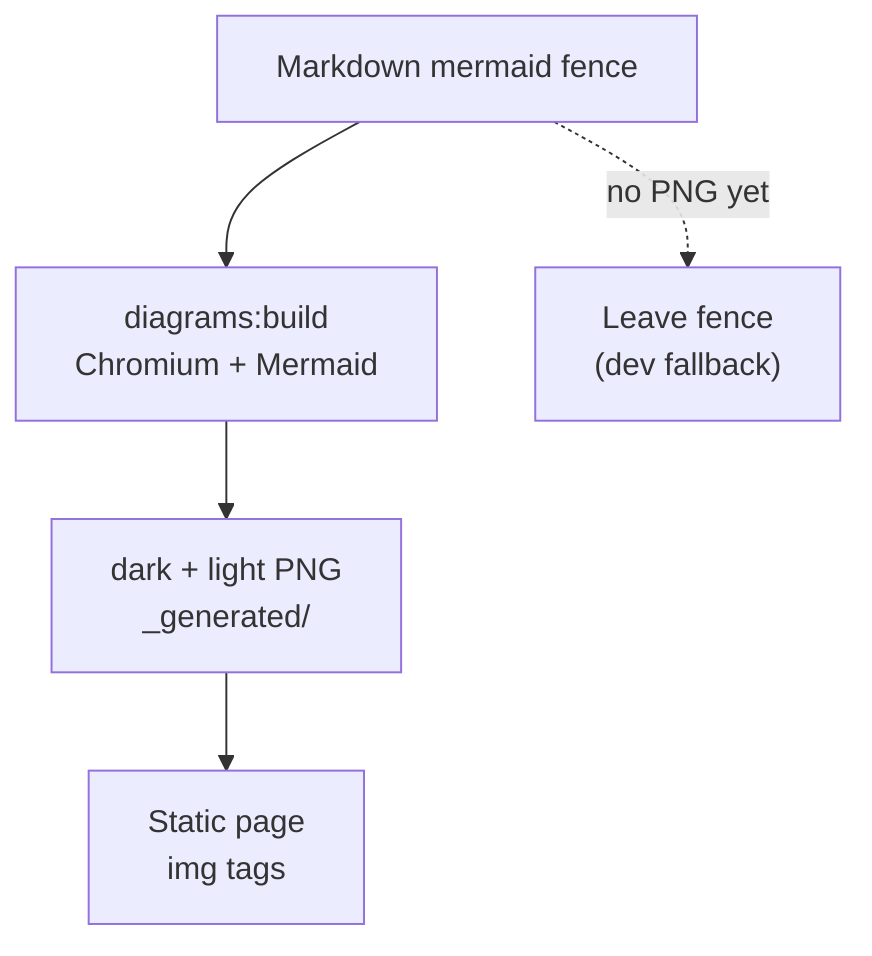

A Mermaid diagram is a diagram whose **source of truth is plain text**: a short, Markdown-like DSL that a renderer turns into a flowchart, sequence chart, state machine, ER sketch, or related figure. The open-source project (Mermaid.js) parses that text, lays out nodes and edges, and draws SVG (or a screenshot of that SVG as PNG). The goal, as the project states, is to help documentation catch up with development: diagrams live next to code and prose, so they can be reviewed, versioned, and rebuilt instead of rotting as screenshots in a slide deck.

Mermaid is strongest when the teaching load is *structure*: what happens next, who talks to whom, which states are legal, and where a failure branch goes. Use a custom drawing tool for pixel-perfect layout, custom geometry, or dense scientific figures.

## Intuition

Mermaid stores a diagram as code in a fenced `mermaid` block. The source stays reviewable and versioned with the surrounding Markdown, for example:

A human or CI runs a renderer to derive the visual. A source diff can show exactly which edge was added to an agent loop, making the visual change reviewable in text.

For AI/ML systems the usual high-value shapes are:

| Shape | Question it answers |
|:---|:---|
| Flowchart | What is the happy path and the failure branches? |
| Sequence diagram | Who calls whom, in what order, sync or async? |
| State diagram | Which states exist, and which transitions are legal? |
| Architecture / C4-style boxes | Where are trust and deployable boundaries? |

Weak fits include attention heatmaps, tensor reshape geometry, memory-layout maps, and UI chrome. Those need custom illustrations, tables, or plots because spacing, color scale, and annotation carry the lesson.

## How it works

At a high level the pipeline is fixed regardless of host (Live Editor, GitHub Markdown, or a site build step):

1. **Author** writes a fenced block with a diagram type keyword (`flowchart`, `sequenceDiagram`, `stateDiagram-v2`, and others) and nodes/edges in that type's grammar.
2. **Parse** turns the text into a graph (or sequence/state model). A layout engine assigns coordinates. Defaults depend on Mermaid's version and bundle: this repository pins 12.2.0. Match the installed renderer and its configuration when reproducing a layout.
3. **Render** draws SVG with themes, fonts, and optional class styles.
4. **Serve** either ships the SVG client-side, or (as many curriculum sites do) **pre-renders PNG** at build time so pages stay static and themeable.

On LeetLLM specifically, lessons and glossary pages put Mermaid in fenced blocks labeled `mermaid`. `pnpm diagrams:build` scans content, renders each block with headless Chromium + Mermaid into dark and light PNGs under `diagrams/_generated/`, and the content loader swaps fences for themed `` tags when those PNGs exist. Unchanged source is skipped via hash cache. Semantic node colors use Mermaid class markers such as `:::primary` / `:::danger`; the renderer injects matching `classDef` lines per theme so authors avoid hand-written `style` directives.

Syntax basics for the type you will use most (flowcharts):

- Direction: `flowchart TD` (top-down) or `flowchart LR` (left-right). Older `graph` is still accepted.
- Nodes: `id[Label]`, `id(Rounded)`, `id{Decision}`, `id[(Database)]`.
- Edges: `A --> B`, `A -->|label| B`, dashed `A -.-> B`.
- Subgraphs group related steps. Quote labels that contain special characters; avoid a bare node id of `end` (it collides with grammar).

Official docs also cover sequence, state, class, ER, Gantt, pie, journey, git graph, C4, and newer experimental types. Prefer one type per figure; mix only when the lesson truly needs two complementary views.

## Example

A retrieval QA path with an explicit fail-closed auth branch and a soft degrade when the vector index is down. Source stays short enough to review in a PR:

What this teaches that prose alone blurs:

- Apply ACL checks **before** retrieval and again at the UI boundary when needed.
- Return a controlled soft error during an index outage so the system does not generate from missing evidence.
- Citation check can reject after generation, so streaming product design must decide when the user sees text.

Budgets (top-$k$, p95 ms, TTFT) belong in a table next to the figure, not packed into node labels. Mermaid is for structure; numbers stay in prose where they stay editable.

A second common pattern is a **sequence** for one critical request:

## Diagram

How text becomes a page figure in a docs-as-code curriculum (conceptual):

## Trade-offs

**Strengths**

- Diffable and reviewable: structure changes show up as line edits.
- Cheap to maintain: updating a node id updates every future render.
- Portable: GitHub, many wikis, and IDE previews understand Mermaid fences.
- Fast iteration for flow, sequence, and state teaching.

**Limits and production failure modes**

| Failure | What goes wrong | Mitigation |
|:---|:---|:---|
| Layout thrash | Huge graphs become spaghetti; readers lose the main path | Cap nodes; split into phased figures; put detail in prose |
| Grammar edge cases | Bare `end`, unquoted special chars, nested shape text break parse | Quote labels; capitalize `End`; validate in CI or Live Editor |
| Stale assets | Prose changed, PNGs not rebuilt | Gate publish on `diagrams:build` + diagram ref checks |
| Theme / version skew | Local Mermaid version ≠ site renderer; colors differ | Pin renderer version in the build image; prefer semantic classes over ad-hoc colors |
| Client-side XSS | User-supplied Mermaid rendered in a browser can carry script if security level is loose | Do not render untrusted diagram text client-side without `sandbox` / strict security; prefer pre-render of trusted author content |
| Wrong medium | Attention map or tensor layout forced into Mermaid | Switch to a custom illustration or table |

Security note from the Mermaid project itself: diagrams can contain characters that defeat naive HTML sanitizers. Hosts that accept **untrusted** Mermaid should use sandboxed rendering (`securityLevel: 'sandbox'` or equivalent), not "render anything the user pastes into the page." Curriculum and internal docs that only ship **author-controlled** fences and build-time PNGs avoid most of that surface.

## Why it matters here

AI systems are graphs of control and data: prompt change → offline eval → canary → online metrics → rollback or full rollout; agent plan → tool → validate → state update; retrieval → rerank → generate → ground. Mermaid is the lowest-friction way to put those graphs next to the lesson so a reader can answer "what happens next?" and "who owns this edge?" without a separate design tool.

Text diagrams stay in Git with the [article bundle](glossary://article-bundle). That keeps [architecture diagrams](glossary://architecture-diagram) and [state machines](glossary://state-machine) honest under review, and it plugs into the same [content pipeline](glossary://content-pipeline) that validates illustrations and static routes. Use Mermaid when the figure is a flow, [request path](glossary://request-path), or contract; escalate to custom art when the figure is geometry, probability, or UI fidelity.

## Related terms

- [Architecture diagram](glossary://architecture-diagram)
- [State machine](glossary://state-machine)
- [Request path](glossary://request-path)
- [Article bundle](glossary://article-bundle)
- [Content pipeline](glossary://content-pipeline)
