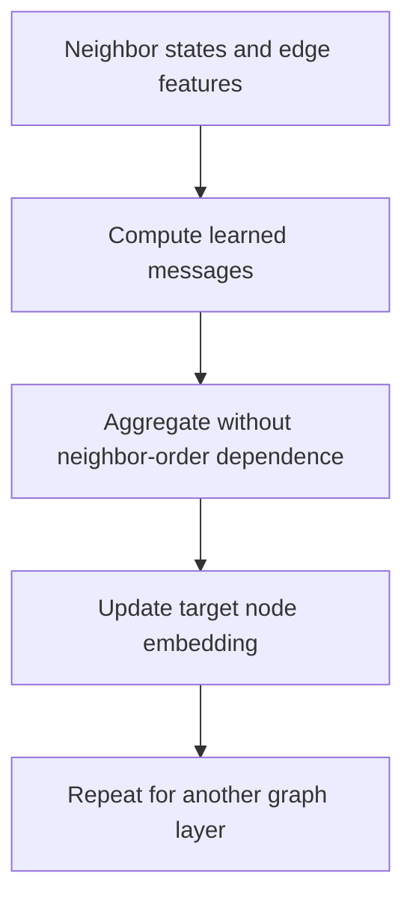

A **message-passing neural network (MPNN)** is a graph-neural-network architecture that updates each node by computing messages from its neighbors, aggregating those messages, and combining the result with the node's current representation. Its message and update functions have learned parameters. Repeating the process across layers expands the neighborhood that can influence each node embedding.

## Messages are learned feature updates

For node $v$ at layer $t$, a typical pattern computes messages from neighbors $u$, aggregates them into $m_v^{(t)}$, and writes a new state $h_v^{(t+1)}$. The aggregation often uses a permutation-insensitive operation such as sum, mean, or max, so reordering neighbors doesn't change the result by accident.

Edge attributes can also participate. A `depends_on` edge may contribute different information from an `owned_by` edge. Each additional layer expands the receptive field, but deep propagation can blur node-specific features or increase the cost of gathering large neighborhoods.

## Example

Start with a service node whose current state is `0.2`. Two dependency nodes contribute learned scalar messages of `0.4` and `0.8`. Mean aggregation produces `(0.4 + 0.8) / 2 = 0.6`. An illustrative update that averages the original state and aggregated message produces `(0.2 + 0.6) / 2 = 0.4`.

That arithmetic illustrates information flow; real MPNNs learn the message and state-combination functions during training. Walking `inference-api -> redis-cache -> maxmemory policy` in a property graph follows existing edges and returns stored evidence, while MPNN layers compute learned node updates.

## Why it matters here

Graph retrieval, incident reasoning, recommendation, and structured representation learning can all use neighborhood information. Naming the learned message, aggregation, and update stages makes it clear when a system is actually training a graph model versus simply retrieving connected documents.

## Related terms

- [Graph neural network](glossary://graph-neural-network)
- [Embedding](glossary://embedding)
- [GraphRAG](glossary://graphrag)
- [Breadth-first search](glossary://breadth-first-search)
- [Vector](glossary://vector)
