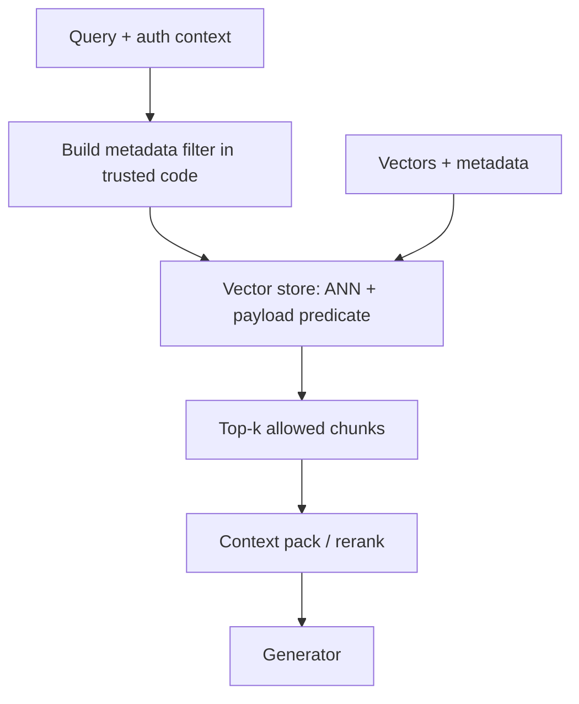

A **metadata filter** is a structured predicate applied with vector (or hybrid) search so only records whose payload fields match hard constraints are returned to the caller. Internal ANN candidates can include non-matches in a post-filtering implementation; denied text must never enter downstream evidence or the prompt. Each stored unit (chunk, document, product, memory) carries a dense or sparse vector *and* key-value metadata such as `tenant_id`, ACL principals, `is_deleted`, `region`, `doc_type`, `version`, or price. Similarity scores answer "what is near this embedding?"; the filter answers "which of those records am I allowed to see / care about right now?"

Embeddings rank semantic similarity; metadata predicates enforce discrete product rules. "Laptop under $1000 for tenant Acme, not deleted" defines boolean constraints. Production [RAG](glossary://rag) and semantic search run **filtered approximate nearest neighbor (ANN) search**: find nearest vectors *among* records that satisfy a metadata predicate built in trusted code from the authenticated caller.

## How it works

At ingest, attach a stable metadata schema to every vector. At query time, the app builds a filter expression from identity and product state, then the store returns top-$k$ neighbors that also match that expression.

Operators vary by product, but the family is familiar from databases: equality and inequality, ranges (`$gt` / `$lte` / date windows), set membership (`$in` / `$nin`), existence checks, and boolean composition (`$and` / `$or`, or `must` / `should` / `must_not`). Pinecone-style filters, Weaviate `where` clauses, Qdrant payload filters, and SQL `WHERE` over pgvector rows are the same idea with different syntax.

The hard part is **how the filter interacts with the ANN index**. Three classical strategies:

| Strategy | Order of work | Failure mode when the filter is selective |
| --- | --- | --- |
| **Post-filter** | ANN over the full index, then drop non-matches | Top-$k$ may shrink to $0$ even when matching neighbors exist deeper in the corpus |
| **Pre-filter** | Evaluate the predicate first, then search only the allow-list | Cheap on tiny allow-lists; can break HNSW connectivity or force a flat scan when the list is large but graph-fragmented |
| **In-filter / joint** | Apply eligibility during search, possibly traversing non-matching graph nodes as bridges while admitting only matches to results | Performance depends on connectivity, selectivity, payload indexes, and the query planner |

Selectivity of filter $f$ on corpus $D$ is the fraction that passes:

$$
\sigma(f) = \frac{|\{x \in D : f(x) = \text{true}\}|}{|D|}
$$

Low $\sigma$ (few rows match) makes naive post-filtering fragile: if you fetch $k=20$ global neighbors and only $1\%$ of the corpus is allowed, expected matches in that shortlist are about $0.2$ **under rank-filter independence**. Multi-tenant corpora often cluster similar vectors inside a tenant, so realized allowed hits can be higher or lower than $k\cdot\sigma$. High $\sigma$ (almost everything matches) makes an extra filter cheap; pure vector search would have been almost fine. Systems therefore switch strategy by estimated cardinality: flat scan on a small allow-list, filter-aware HNSW when the allow-list is large, iterative expansion when a fixed `ef_search` batch is not enough.

Concrete engine notes you will hit in production:

- **pgvector** applies filtering after an approximate index scan. *Iterative index scans* (0.8+; `hnsw.iterative_scan` / `ivfflat.iterative_scan`) continue scanning until enough rows pass or a scan limit is hit; they do not turn `WHERE` into pre-filtering. See the [official filtering and iterative-scan documentation](https://github.com/pgvector/pgvector#iterative-index-scans).
- **Weaviate** documents filtered search as pre-filtering with an inverted allow-list passed into HNSW traversal (strategies such as sweeping / ACORN), and can fall back to flat search when the filter is extremely restrictive.
- **Qdrant** combines payload indexes with *filterable HNSW* and a planner that can enumerate a small matching subset from the payload index and rescore its vectors. That still uses vector similarity, rather than returning payload matches without ranking.
- **Pinecone** exposes metadata filters on query (`$eq`, `$in`, ranges, `$and` / `$or`) so product and ACL constraints ride with the similarity call rather than an app-side second pass.

Metadata used for **authorization** must be written and updated by a trusted path, fail closed when fields are missing, and stay fresh when grants or deletes change. Filtering after the LLM has already seen chunk text is too late.

## Formula

Exact filtered nearest neighbor under distance $d$ (what ANN + filter approximates):

$$
j^\star = \arg\min_{i:\, f(x_i)=\mathrm{true}} d(q, x_i)
$$

Or for maximum inner product search (common with unit-normalized dual-encoder embeddings):

$$
j^\star = \arg\max_{i:\, f(x_i)=\mathrm{true}} \langle q, x_i \rangle
$$

**Filtered task recall@k** on a labeled query with gold set $G$ and returned set $R_k(f)$:

$$
\mathrm{recall@}k(f) = \frac{|G \cap R_k(f)|}{|G|}
$$

Here $G$ must contain the relevant records eligible under $f$, with $|G|>0$; define a separate convention for queries with no eligible gold evidence. Measure $\mathrm{recall@}k$ with the production filter, and use open-corpus ANN fidelity as a separate diagnostic. Unfiltered fidelity can look healthy while tenant- or ACL-sliced recall collapses. The engine notes above were checked September 23, 2026 against [Weaviate](https://docs.weaviate.io/weaviate/concepts/filtering), [Qdrant](https://qdrant.tech/documentation/manage-data/indexing/), and [Pinecone](https://sdk.pinecone.io/typescript/documents/data-operations_metadata-filtering.html).

## Diagram



## Example

Shared support index, $N = 2 \times 10^6$ chunks, HNSW, query embedding $q$. Caller is user `u_ops` in tenant `acme`, groups `{ops-team}`, asking about "incident budget escalation."

Trusted filter shape built server-side (adapt syntax to the selected vendor):

```python
filter = {
    "$and": [
        {"tenant_id": {"$eq": "acme"}},
        {"is_deleted": {"$eq": False}},
        {
            "$or": [
                {"access_level": {"$eq": "public"}},
                {"acl_groups": {"$in": ["ops-team"]}},
                {"owner_id": {"$eq": "u_ops"}},
            ]
        },
    ]
}
# then: index.query(vector=q, top_k=20, filter=filter)
```

What should happen:

1. Chunks from tenant `beta` never enter returned evidence (tenant isolation).
2. Soft-deleted policy drafts with high cosine scores are dropped by `is_deleted`.
3. Finance-only discount notes that are geometrically near "budget" stay out because they are not public, their `acl_groups` do not include `ops-team`, and their owner is not `u_ops`.
4. The ops runbook that *is* allowed can rank below a forbidden finance note in pure vector space; the filter must win so the forbidden text never reaches the prompt.

Worked failure without filter-aware search: post-filter over global top-$k=20$ when only $\sigma \approx 0.02$ of the corpus is visible to this user. Under rank-filter independence, expected allowed hits in that shortlist are $\approx 0.4$, so many queries return empty or thin context even though authorized neighbors exist. Fix by raising search effort / iterative scan, using pre- or in-filtering, or partitioning hot tenants into namespaces or partial indexes when $\sigma$ is systematically tiny.

A second, non-security use of the same mechanism: product search with `category = laptop` and `price <= 1000`. Semantic neighbors that are desktops or $1{,}299$ machines must not displace the under-budget laptops solely because embeddings are close.

## Debug path

When filtered retrieval looks "broken," separate four bugs:

1. **Wrong filter construction.** Log the resolved filter (tenant, principals, `now`, feature flags). Client-supplied filter fields without a server override are an auth hole.
2. **Stale or missing metadata.** Grant revoked in the IdP but payload still lists the group; or `acl_*` never written at ingest. Fail closed on null ACL for private corpora.
3. **ANN + filter interaction.** Unfiltered recall@k healthy, filtered recall@k poor, short result lists: raise `ef_search` / `nprobe`, enable iterative scans, add payload indexes, or switch strategy for low $\sigma$.
4. **Eval mismatch.** Offline golden sets measured without the live ACL/tenant predicate overstate production quality. Slice evals by tenant, role, and region.

Also check hybrid stacks: sparse and dense paths must apply the *same* hard filter before fusion, or one path can reintroduce denied IDs.

## Why it matters here

Metadata filters are where retrieval quality meets product and security boundaries. Curriculum topics on dense retrieval, HNSW, managed vector DBs, multi-tenant RAG, and ACL enforcement all depend on filtered search: vectors rank meaning; metadata enforces rules the embedding space cannot hold. If you only measure open-corpus ANN latency, you will ship systems that leak across tenants, drop authorized evidence under selective filters, or both.

## Related terms

- [Dense retrieval](glossary://dense-retrieval)
- [ANN search](glossary://ann-search)
- [ACL](glossary://acl)
- [Tenant isolation](glossary://tenant-isolation)
- [HNSW](glossary://hnsw)
