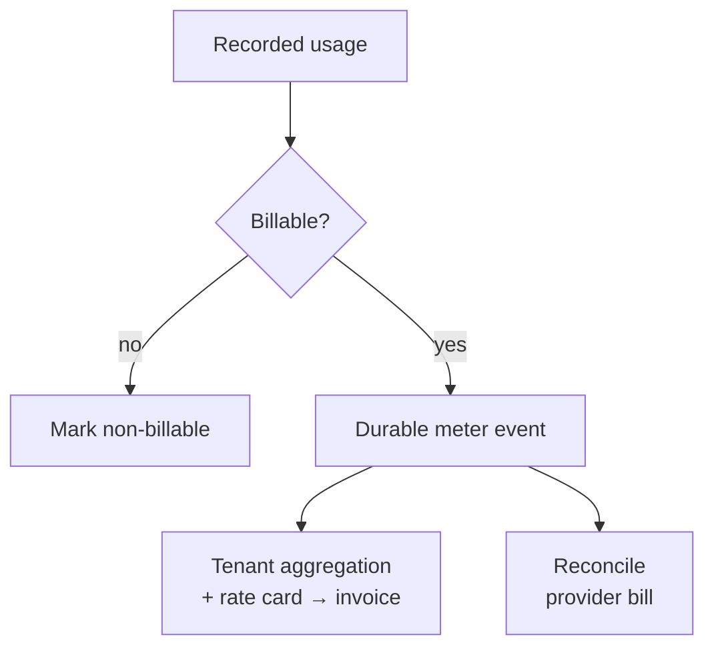

**Metered billing** (also called usage-based or consumption billing) charges or accounts for service use from measured units rather than a flat fee alone. Cloud and AI products may meter tokens, requests, seconds, storage, GPU time, or tool calls. A meter records consumption and applies a versioned rate card; [rate limits](glossary://rate-limit) and [quotas](glossary://quota) instead govern admission and remaining allowance.

For LLM products, metered billing is both **external pricing** (what you invoice a tenant) and **internal economics** (what a provider route costs you). The meter is a ledger: every billable event becomes a row you can sum, dispute, refund, or reprice later.

## How it differs from nearby controls

| Control | Question it answers | Typical unit | Failure if you only have this |
| --- | --- | --- | --- |
| [Rate limit](glossary://rate-limit) | How fast may this identity call *right now*? | RPM, TPM, concurrency | Protects the gateway, does not explain the invoice |
| [Quota](glossary://quota) | How much allowance remains in this plan window? | tokens/day, $ / month | Stops work; may not produce a dollar line item |
| [Fair use limit](glossary://fair-use-limit) | Is this still "ordinary" use of a fixed-price plan? | premium tokens, concurrent streams | Soft product contract, not always a charge |
| **Metered billing** | What is charged for each unit of consumption? | tokens, tool calls, GPU-s, GB-month | Surprise invoices if units and edge cases are unclear |

Rate limits and quotas gate admission. Metered billing turns admitted work into money (or internal chargeback). Many products combine them: a plan includes $N of usage, then metered overage; or interactive chat is fair-use capped while the API is fully metered.

## Intuition

The system has three layers:

1. **Event:** something happened (a completion finished, an embedding batch ran, a tool executed).
2. **Meter:** map that event to one or more billable dimensions with quantities (for example 1,200 input tokens, 400 of them cached, 180 output tokens, 1 web-search tool call).
3. **Rate card:** multiply each dimension by a versioned price, apply tiers or included allowances, produce a period total.

If you skip the event ledger and only store monthly totals, you cannot replay a dispute after a price change, a provider correction, a cache-discount bug, or a double-charge on retry. Billing systems (Stripe Billing Meters / usage-based billing, Metronome-style metering, cloud cost allocation) all assume: **durable usage events first, invoices as derived aggregates**.

## Formula

For a single LLM completion with separate input, cached-input, and output rates:

$$
C = \frac{n_{\mathrm{in}} - n_{\mathrm{cache}}}{10^{6}}\,p_{\mathrm{in}}
  + \frac{n_{\mathrm{cache}}}{10^{6}}\,p_{\mathrm{cache}}
  + \frac{n_{\mathrm{out}}}{10^{6}}\,p_{\mathrm{out}}
  + \sum_{t \in \mathrm{tools}} q_t\,p_t
$$

where $n_{\mathrm{in}}$ is total prompt tokens, $n_{\mathrm{cache}}$ is the subset assigned a separate cached-input rate, $n_{\mathrm{out}}$ is completion tokens, $p_{\cdot}$ are prices **per million tokens**, and tool fees are optional extras. Providers differ on cache reads, cache writes, model tiers, and batch pricing. Normalize provider usage into your own dimensions and pin a **price version** on every meter row instead of relying on a model name alone.

For a billing period with included allowance $A$ dollars and overage:

$$
\mathrm{Invoice} = F + \max\!\left(0,\; \sum_i C_i - A\right)
$$

where $F$ is any fixed subscription fee and $C_i$ are per-request costs from the meter.

## Example

An LLM workspace runs one chat turn under this entirely illustrative rate card:

| Dimension | Quantity | Unit price | Subtotal |
| --- | --- | --- | --- |
| Uncached input | $800$ tokens | \$2.50 / 1M | \$0.002000 |
| Cached input | $1{,}200$ tokens | \$0.25 / 1M | \$0.000300 |
| Output | $350$ tokens | \$10.00 / 1M | \$0.003500 |
| Retrieval tool call | $1$ | \$0.001 flat | \$0.001000 |
| **Request total** | | | **\$0.006800** |

That single turn is one user message but several meter rows (or one row with multiple dimensions): prompt uncached, prompt cached, completion, tool. At 50k similar turns per day the ledger is about \$340/day before embeddings, storage, or premium-model fallbacks.

Operational sketch for a validated Chat Completions-style usage object after the provider response returns. Normalize Responses and other provider payloads with endpoint-specific adapters. The [OpenAI usage guide](https://help.openai.com/en/articles/10478918-reviewing-api-usage-and-costs), checked September 23, 2026, distinguishes the endpoint fields.

```python title="meter-completion.py"
def meter_completion(
    *,
    tenant_id: str,
    request_id: str,
    route: str,
    model: str,
    price_version: str,
    usage: dict,
    tool_calls: int,
    outcome: str,  # "ok" | "error" | "cancelled"
    bill_failed: bool,
) -> list[dict]:
    if outcome not in {"ok", "error", "cancelled"}:
        raise ValueError("unknown outcome")
    if outcome != "ok" and not bill_failed:
        return []  # product policy: no charge on failed generation

    n_in = usage["prompt_tokens"]
    n_cache = usage.get("prompt_tokens_details", {}).get("cached_tokens", 0)
    n_out = usage["completion_tokens"]
    if any(type(q) is not int or q < 0 for q in (n_in, n_cache, n_out, tool_calls)):
        raise ValueError("usage quantities must be nonnegative integers")
    if n_cache > n_in:
        raise ValueError("cached input cannot exceed total input")
    rows = [
        {"dim": "input_uncached", "qty": n_in - n_cache},
        {"dim": "input_cached", "qty": n_cache},
        {"dim": "output", "qty": n_out},
    ]
    if tool_calls:
        rows.append({"dim": "tool_call", "qty": tool_calls})

    return [
        {
            "tenant_id": tenant_id,
            "request_id": request_id,
            "route": route,
            "model": model,
            "price_version": price_version,
            "dimension": r["dim"],
            "quantity": r["qty"],
            "outcome": outcome,
        }
        for r in rows
        if r["qty"] > 0
    ]
```

Idempotency matters: replaying the same usage event must not double-bill. A ledger with one row per dimension can enforce uniqueness on `(tenant_id, billable_event_id, dimension)`. Separate a logical customer request from its provider attempt IDs: a timeout followed by a new inference can create two real provider costs even if product policy charges the customer once. Preserve both attempts for reconciliation. Keep durable deduplication in your ledger; [Stripe meter-event identifiers](https://docs.stripe.com/api/billing/meter-event/create) enforce uniqueness within a rolling period of at least 24 hours, not forever.

## Diagram



## Meter design

A useful meter record names at least:

| Field | Why it exists |
| --- | --- |
| Unit / dimension | Input tokens are not tool calls; do not collapse them early |
| Identity + tenant | Chargeback and multi-seat plans |
| Route, provider, model | Different rate cards and fallback economics |
| Timestamp + period | Rolling vs calendar billing windows |
| Price version | Reprice without rewriting history |
| Rounding rule | Per-token vs per-1k vs per-1M; floor/ceil |
| Cache / batch / tier flags | Cached input and batch discounts change $C$ |
| Outcome | ok / error / cancelled / partial stream |
| Idempotency key | Prevent double-count on retry |
| Request / completion ids | Dispute replay and provider reconciliation |

Decide **before** production traffic: do failed requests bill? Do cancelled streams bill partial output? Do semantic or exact cache hits bill the customer, only COGS, or nothing? Do fallback routes bill at the fallback model's price or the requested model's price?

## Accuracy risks in production

These are the usual ways meters and invoices diverge:

- **Retries and dual writes:** timeout + retry without an idempotency key creates two meter rows for one user-visible answer.
- **Streaming cancellation:** user stops mid-decode; you still paid for partial output tokens; the product may or may not charge them.
- **Cache accounting:** `cached_tokens` must use the cached rate; treating all prompt tokens as full-price overstates cost; ignoring cache understates it.
- **Fallback routes:** primary fails; secondary model runs; billing at the wrong model price breaks trust and margin.
- **Local vs provider token counts:** your tokenizer estimate for pre-admission quota is not the provider bill; reconcile after the response.
- **Batch and offline jobs:** different price tiers and delayed completion; events must land in the correct billing period.
- **Provider reconciliation:** keep raw events so finance can match your ledger to the monthly cloud/API invoice.

When a tenant disputes a line, walk: request id → meter events → rate card version → period aggregate → invoice. Aggregates alone cannot answer "why was I charged?"

## Worked numbers: included plan + overage

One workspace plan: \$99/month includes a shared \$50 of model spend; overage at the illustrative rate card. Ten seats in that workspace, one heavy agent:

| Seat class | Daily $C$ | Days | Period spend |
| --- | --- | --- | --- |
| 9 light seats | \$0.40 | 30 | \$12 each |
| 1 agent seat | \$18.00 | 30 | \$540 |

Total consumption is $9\times 12 + 540 = 648$ dollars. Invoice:

$$
F + \max(0,\,648 - 50) = 99 + 598 = 697\,\mathrm{USD}
$$

if overage is billed at the same rate card with no markup. Ten independently subscribed tenants would instead each receive their own fixed fee and allowance. If customer rates differ from provider costs, retain both rate cards so finance can compute included consumption, overage, and margin without conflating COGS with revenue.

## Why it matters here

LLM cost is variable, skewed, and multi-dimensional: long context, high output, tool loops, premium models, and cache misses dominate. Metered billing connects [token budgets](glossary://token-budget), [provider routes](glossary://provider-route), [usage shape](glossary://usage-shape), quotas, and product packaging into one auditable story. Without a deliberate meter, teams ship features that "work" until the first real invoice, the first multi-tenant chargeback, or the first support ticket about a cancelled stream. Curriculum on multi-tenant serving, routing, and plan design all assume someone defined the unit, the event, and the rate card before traffic arrived.

## Related terms

- [Quota](glossary://quota)
- [Fair use limit](glossary://fair-use-limit)
- [Usage shape](glossary://usage-shape)
- [Provider route](glossary://provider-route)
- [Token budget](glossary://token-budget)
