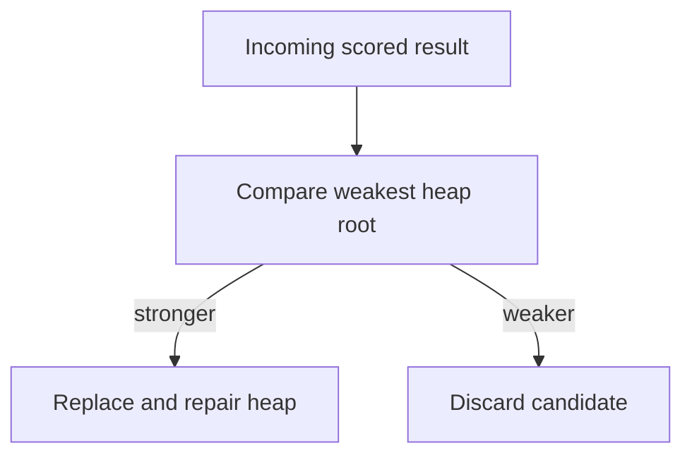

A **min-heap** is a partially ordered structure whose smallest key is always available at the root. Python's `heapq` stores that structure inside a list. The list isn't globally sorted: only the parent-child heap invariant is guaranteed, so inspecting an arbitrary list position doesn't reveal the complete ranking.

The smallest item can be inspected in constant time, while insertion or root removal typically requires logarithmic work in the number of stored entries. A bounded top-k selection heap keeps only the current best `k` results. Its smallest retained score is the weakest winner and is therefore the result a stronger incoming candidate can replace.

## State the tie-breaking rule

Heap entries can be tuples. Python compares tuple components from left to right, so `(score, -document_id)` makes higher scores preferable and uses a lower numeric document ID to break equal-score ties. Without an intentional rule, equal scores may produce results that don't match the product's documented ordering.



## Example

```python
import heapq

winners = [(1, 0), (2, -2)]
heapq.heapify(winners)
heapq.heapreplace(winners, (3, -3))
assert sorted(winners, reverse=True) == [(3, -3), (2, -2)]
```

The stronger candidate removes score 1. The heap never has to retain or fully sort all previously observed candidates.

## Why it matters here

Retrievers, schedulers, and inference queues frequently need only a few strongest or most urgent items. A bounded heap lowers selection memory and work, but it doesn't eliminate the cost of scoring every candidate upstream.

## Related terms

- [Heapq](glossary://heapq)
- [Top-k](glossary://top-k)
- [Priority scheduling](glossary://priority-scheduling)
- [Big-O notation](glossary://big-o-notation)
