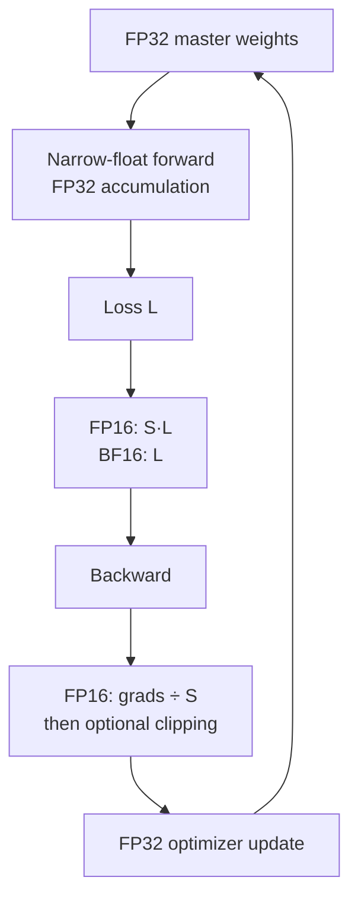

**Mixed precision** is the practice of running one training or inference workload in more than one floating-point format at once: large matmuls and bandwidth-heavy tensors in a narrow type such as [FP16](glossary://fp16) or [BF16](glossary://bf16), while master weights, accumulators, and sensitive reductions stay in FP32 (or another wider type) so accuracy does not collapse.

Reliable mixed-precision training combines narrow-format matmuls and storage with an FP32 master copy of weights, [loss scaling](glossary://loss-scaling) when the narrow type has limited range, and half-precision multiplies that **accumulate in FP32**. Micikevicius et al. (ICLR 2018, *Mixed Precision Training*) showed these safeguards can match FP32 task accuracy **without retuning hyperparameters**. Modern frameworks package the same idea as automatic mixed precision (AMP): PyTorch `torch.autocast` picks op dtypes; `torch.amp.GradScaler` implements dynamic loss scaling for FP16.

Mixed precision describes which floating-point formats different tensors and operations use. [Quantization](glossary://quantization) maps values to a restricted representation, often int8 or int4 with scales. The concepts can overlap: scaled FP8 quantization can be part of a mixed-precision workload.

## Intuition

Performance of a DNN step is limited by arithmetic throughput, memory bandwidth, or latency. Narrow floats attack the first two: half the bytes per element (16 vs 32) cut HBM traffic, and Tensor Cores / matrix units often deliver much higher throughput for FP16/BF16 GEMMs than for pure FP32.

The catch is that formats trade range against mantissa precision:

| Format | Exponent bits | Fraction bits | Approx. max finite | Role in mixed precision |
|---|---|---|---|---|
| FP32 | 8 | 23 | $\approx 3.4 \times 10^{38}$ | Master weights, optimizer math, safe reductions |
| BF16 | 8 | 7 | $\approx 3.4 \times 10^{38}$ | Common train/serve compute dtype on modern accelerators |
| FP16 | 5 | 10 | $65504$ | Classic half precision; needs loss scaling more often |

Matmuls dominate FLOPs and often tolerate coarser mantissas. Softmax, layer norm, loss, and long reductions care about range and accumulation error. Mixed precision assigns the cheap format where the hardware is strongest and the wide format where the math is brittle.

## How it works

Classic FP16 mixed-precision **training** step (Micikevicius et al.):

1. Keep **master weights** $W_{\mathrm{fp32}}$ (and usually [optimizer state](glossary://optimizer-state)) in FP32.
2. Cast a working copy $W_{\mathrm{fp16}} = \mathrm{cast}(W_{\mathrm{fp32}})$ for forward and backward.
3. Run GEMMs/convs in FP16 with **FP32 accumulate** inside the kernel; store activations/gradients as FP16 to save bandwidth.
4. Scale the scalar loss $L' = S \cdot L$, run backward, then unscale weight gradients by $1/S$ before clipping and the optimizer.
5. Update $W_{\mathrm{fp32}}$ with the unscaled gradients; repeat.

**Why master weights.** Learning-rate times gradient is often tiny. Two distinct failure modes matter:

1. **Absolute underflow / flush-to-zero.** FP16's smallest positive subnormal is $2^{-24}$ and its smallest positive normal is $2^{-14}$. Smaller magnitudes lose precision or round to zero; values slightly below $2^{-24}$ can round up to that smallest subnormal. Whether subnormals are preserved depends on the operation and hardware path, so do not assume a universal GPU floor at the minimum normal value.
2. **Relative / mantissa-alignment loss.** Even a representable update can vanish when added into a much larger weight (roughly weight scale $\times 2^{-10}$ for FP16).

FP32 masters keep those micro-updates against both modes.

**Why FP32 accumulate.** A long sum of FP16 products drifts if every partial sum is rounded back to 16 bits. Tensor Core style math multiplies narrow inputs and keeps a wider accumulator, then may cast the result when writing memory.

**Why loss scaling (FP16).** Activation gradients cluster at small magnitudes. FP16's representable window leaves much of that mass as zeros. Scaling $L$ by $S$ shifts all gradients by the chain rule; unscale before the update so learning rate and clip thresholds stay meaningful. BF16 usually skips this because its exponent matches FP32.

**Automatic mixed precision.** Instead of hand-casting every layer, autocast runs eligible ops (for example `linear`, `matmul`, convolutions) in the lower type and keeps range-sensitive ops (for example `softmax`, `layer_norm`, many losses) in FP32. Autocast should wrap the forward and loss; backward reuses the forward dtypes. For FP16, pair autocast with a GradScaler. For BF16 on supported hardware, autocast alone is the usual recipe.

**Inference.** Serving often stores weights and activations (and the [KV cache](glossary://kv-cache)) in FP16 or BF16 for memory and kernel throughput without an optimizer path. That is still mixed precision when some ops (norms, softmax, reductions) stay FP32 while matmuls run narrow. Treat dtype as part of the serve contract: a BF16-trained checkpoint cast silently to FP16 can shift evals.

## Formula

Loss scaling (training, mainly FP16):

$$
L' = S \cdot L,\qquad
\frac{\partial L'}{\partial w} = S \cdot \frac{\partial L}{\partial w},\qquad
\frac{\partial L}{\partial w} = \frac{1}{S}\,\frac{\partial L'}{\partial w}
$$

With correct unscale, plain SGD is unchanged:

$$
w \leftarrow w - \eta \cdot \frac{1}{S}\,\frac{\partial L'}{\partial w}
= w - \eta \cdot \frac{\partial L}{\partial w}
$$

Storage for one dense parameter tensor of $N$ elements (weights only, not optimizer or activations):

$$
\mathrm{bytes}_{\mathrm{fp32}} = 4N,\qquad
\mathrm{bytes}_{\mathrm{fp16/bf16}} = 2N
$$

Halving weight storage is only part of the win. Activations saved for backward, and KV cache at inference, often dominate; those also drop roughly $2\times$ when stored at 16 bits.

## Worked numbers

**Memory, 7B weights.** $N = 7 \times 10^9$:

| Storage | Bytes |
|---|---|
| FP32 weights | $28$ GB |
| FP16/BF16 weights | $14$ GB |

Adam-style mixed precision still often keeps FP32 masters and moments, so **training** memory is far larger than the checkpoint file (commonly cited on the order of $16+$ bytes per parameter before activations). Mixed precision still helps because activations and bandwidth-heavy temporaries shrink.

**Underflow without scaling.** True gradient $g = 1 \times 10^{-5}$:

| Format | Status of $g$ |
|---|---|
| FP32 / BF16 | Normal (min normal $\approx 1.18 \times 10^{-38}$) |
| FP16 | A representable subnormal below min normal ($\approx 6.1 \times 10^{-5}$), with reduced precision; an operation that flushes subnormals can lose it |

With $S = 1024$, the scaled gradient is $1.024 \times 10^{-2}$, a comfortable FP16 normal; unscale restores $10^{-5}$ for the optimizer.

**Paper-scale examples.** Multibox SSD needed $S = 8$ to train in FP16 (diverged without scaling). bigLSTM language modeling needed $S = 128$ (without it, perplexity diverged after about $300$K steps). Many ImageNet CNNs matched FP32 top-1 with master weights and FP32 accumulate but **without** loss scaling.

## Example

Fine-tune a causal LM on CUDA with **BF16** mixed precision when the hardware and selected kernels support it and quality checks pass. These are loop sketches assuming `torch` is imported, the model exposes `out.loss`, and every batch tensor has already been moved to CUDA. The [current PyTorch AMP documentation](https://docs.pytorch.org/docs/stable/amp.html), checked September 23, 2026, documents device-specific operator policies and scaler behavior.

```python
# Model and optimizer created in default (FP32) parameter dtype
model = model.cuda()
optimizer = torch.optim.AdamW(model.parameters(), lr=2e-5)

for batch in loader:
    optimizer.zero_grad(set_to_none=True)
    with torch.autocast(device_type="cuda", dtype=torch.bfloat16):
        out = model(**batch)
        loss = out.loss
    loss.backward()
    torch.nn.utils.clip_grad_norm_(model.parameters(), 1.0)
    optimizer.step()
```

Same loop in **FP16** AMP with dynamic loss scaling:

```python
scaler = torch.amp.GradScaler("cuda")  # init_scale=65536 by default
for batch in loader:
    optimizer.zero_grad(set_to_none=True)
    with torch.autocast(device_type="cuda", dtype=torch.float16):
        out = model(**batch)
        loss = out.loss
    scaler.scale(loss).backward()
    scaler.unscale_(optimizer)  # before clip or manual grad edits
    torch.nn.utils.clip_grad_norm_(model.parameters(), 1.0)
    scaler.step(optimizer)      # skips step if grads were non-finite
    scaler.update()             # grow or back off S
```

Do not call `.half()` / `.bfloat16()` on the whole model when using autocast; let the context pick op dtypes. Prefer `binary_cross_entropy_with_logits` over plain BCE under FP16 autocast (PyTorch errors on the unsafe path).

## Diagram



## Trade-offs

| Choice | Benefit | Cost / risk |
|---|---|---|
| FP16 AMP + GradScaler | Broad GPU support; Tensor Core speed; half activation/weight bandwidth | Range bugs, scaler skip storms, clip/unscale order mistakes |
| BF16 AMP | FP32-like range; usually no scaler; simpler loops | Needs hardware/kernels; coarser mantissa than FP16 |
| Pure FP32 | Numeric baseline | More memory, lower matmul throughput on modern GPUs |
| Aggressive "all tensors half, no masters" | Max memory cut | Tiny updates vanish; accuracy often fails |
| Inference FP16/BF16 weights | Fit larger models; faster bandwidth-bound steps | Silent dtype cast can shift logits; integer quantization uses a different numerical representation |

Speedups are largest when the step is arithmetic- or bandwidth-bound (large GEMMs, big batches). Latency-bound tiny layers gain less. Library support matters: an unsupported dtype falls back to slow emulation.

## Debug path

When mixed precision "makes training broken" or serve quality slips:

1. **Compare baselines.** Same seed, short run in FP32, BF16 (if available), and FP16+scaler. If only FP16 fails, range/scaling is the suspect.
2. **Log health.** Unscaled loss, global grad norm, current $S$, skipped-step count, and first appearance of `Inf`/`NaN`.
3. **Check order.** Scale $\to$ backward $\to$ unscale $\to$ clip $\to$ step $\to$ update scale. Clipping scaled gradients at threshold $c$ before unscale makes the effective unscaled threshold $c/S$, far tighter than intended.
4. **Match train and serve dtypes.** Do not assume a BF16 train exports cleanly as FP16 half without evals.
5. **Separate causes.** Loss scaling remaps backward gradients; diagnose bad learning rates, corrupt labels, and forward-pass activation overflow separately.
6. **Prefer BF16** on supported accelerators when quality matches: same 2-byte storage without the scaler control loop.

## Why it matters here

Almost every modern LLM train and many serve stacks use mixed precision by default. It is how you fit larger batches, longer contexts, and bigger models into HBM while keeping Tensor Cores busy. Engineers need to reason about AMP NaNs, choose FP16 vs BF16, and explain why optimizer state still sits in FP32. The durable skill is the three-part recipe: narrow compute where math is tolerant, wide storage where updates and reductions need it, and loss scaling when the format's range demands it.

## Related terms

- [FP16](glossary://fp16)
- [BF16](glossary://bf16)
- [amax](glossary://amax)
- [Loss scaling](glossary://loss-scaling)
- [Quantization](glossary://quantization)
- [Optimizer state](glossary://optimizer-state)
