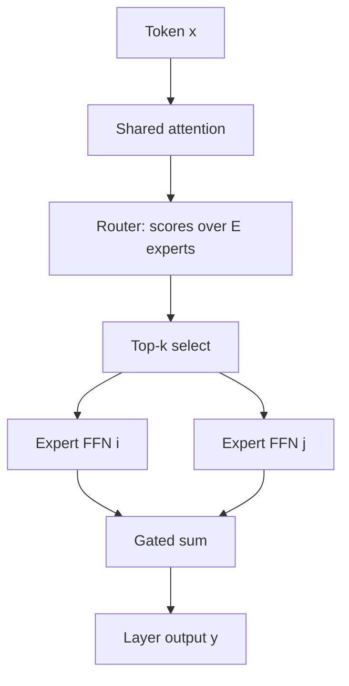

A mixture-of-experts (MoE) layer keeps many specialized feed-forward networks (experts) and a lightweight router that activates only a small top-$k$ subset per token. Total parameter count can be huge while per-token expert FLOPs stay closer to a much smaller dense MLP. In modern decoder LLMs, MoE usually replaces the dense FFN inside selected transformer blocks; attention, embeddings, and norms stay shared and dense.

## Intuition

A dense FFN is one shared workshop: every token pays the full matmul bill. An MoE layer is a floor of specialist workshops plus a triage desk. The router scores each expert for the current token, sends the token to the top-$k$ specialists, and blends their outputs. Adding more experts grows the menu of capacity; holding $k$ fixed keeps the work per token roughly constant.

That split is the whole product claim: **total parameters** buy memory and knowledge capacity, **active parameters** mostly drive expert FLOPs per token. Serving stores or streams the full expert pool and moves tokens to the devices that own selected experts, so sparse compute still carries memory and communication costs.

## Diagram



Skipped experts contribute no FFN FLOPs for that token. Their weights still occupy the checkpoint and must be reachable for other tokens that select them.

## Formula

One sparse gating form, used by Switch with $k=1$, starts with router logits for token $x$ and expert count $N$. The original Shazeer noisy top-$k$ gate instead applies softmax after masking to its selected logits, so full-softmax selected mass is not a universal classical MoE rule:

$$
h(x) = W_r x, \qquad p_i(x) = \frac{e^{h(x)_i}}{\sum_{j=1}^{N} e^{h(x)_j}}
$$

With selected index set $\mathcal{T} = \mathrm{TopK}(p(x))$ (Switch often uses $k=1$):

$$
y = \sum_{i \in \mathcal{T}} p_i(x)\, E_i(x)
$$

Mixtral (Jiang et al., 2024) writes gating as softmax over the top-$k$ logits only, then uses SwiGLU experts. With $n$ experts and $K=2$:

$$
G(x) := \mathrm{Softmax}\bigl(\mathrm{TopK}(x W_g)\bigr)
$$

where $(\mathrm{TopK}(\ell))_i = \ell_i$ for the $K$ largest coordinates and $-\infty$ otherwise, so

$$
y = \sum_{i=0}^{n-1} G(x)_i \cdot \mathrm{SwiGLU}_i(x)
$$

Both styles end at a sparse weighted sum of expert FFNs. Implementations differ on whether softmax runs before or after the top-$k$ mask; either way only $k$ experts run.

**Load balance (Switch auxiliary loss).** If experts starve or monopolize tokens, quality and hardware utilization collapse. With batch size $T$ tokens, fraction of tokens dispatched to expert $i$ ($f_i$), and mean router probability mass on $i$ ($P_i$), Switch adds:

$$
\mathcal{L}_{\mathrm{aux}} = \alpha \cdot N \sum_{i=1}^{N} f_i P_i
$$

with $\alpha=10^{-2}$ in the Switch experiments. Uniform routing gives $f_i=P_i=1/N$ and $\mathcal{L}_{\mathrm{aux}}=\alpha$; the loss encourages balancing, while actual expert work can remain uneven. DeepSeek-V3 pushes balance mainly with an **auxiliary-loss-free** bias on router scores (plus a small sequence-level term), reducing how much load control competes with the main cross-entropy gradient.

**Expert capacity.** Distributed MoE often sizes a fixed buffer per expert:

$$
\mathrm{capacity} \approx \left\lceil \frac{Tk}{N}\,c \right\rceil
$$

(with implementation-specific rounding or alignment; Switch uses tokens per batch divided by $N$ times capacity factor for $k=1$). Capacity factor $c>1$ leaves headroom for imperfect balance. When an expert is full, overflow assignments may skip the expert path, be dropped, or follow another overflow policy. The token's shared path can remain active after an expert assignment is dropped. Overflow policy trades quality and throughput.

## Example

**Mixtral 8x7B numbers.** Each transformer block's FFN is replaced by $n=8$ SwiGLU experts; the router picks $k=2$ per token. Open numbers from the Mixtral report: about **47B total** parameters and about **13B active** per token (not $8\times 7\mathrm{B}$, because attention and other shared weights are not replicated eight times). Per token you pay roughly two expert FFNs plus shared attention, while the checkpoint must still hold all eight experts at every MoE layer.

**Tiny routing walkthrough (Mixtral-style top-$k$-then-softmax renormalization).** Four experts, $k=2$, router logits $[-0.65, -1.77, -1.35, -3.00]$. Full-softmax probabilities over all experts are about $[0.52, 0.17, 0.26, 0.05]$. Top-2 are experts 1 and 3. Classical sum-of-gates can use those full-softmax $p_i$ (mass on selected experts may be $<1$); Mixtral-style routing instead renormalizes over the survivors so gates sum to 1:

$$
g_1 \approx \frac{0.52}{0.78} \approx 0.67, \qquad g_3 \approx \frac{0.26}{0.78} \approx 0.33
$$

Only $E_1$ and $E_3$ run; output is $0.67\,E_1(x) + 0.33\,E_3(x)$. Experts 2 and 4 add capacity for other tokens but zero FLOPs for this one.

```python
from math import exp

logits = [-0.65, -1.77, -1.35, -3.00]
probs = [exp(z) for z in logits]
s = sum(probs)
probs = [p / s for p in probs]
idx = sorted(range(len(probs)), key=probs.__getitem__, reverse=True)[:2]
w = [probs[i] for i in idx]
w = [v / sum(w) for v in w]
print([i + 1 for i in idx], [round(v, 2) for v in w])
# [1, 3] [0.67, 0.33]
```

**Capacity stress.** Batch of $T=4096$ tokens, $N=32$ experts, top-$k=2$, capacity factor $c=1.0$:

$$
\mathrm{capacity} = \frac{4096 \cdot 2}{32} \cdot 1.0 = 256
$$

If one hot expert is assigned 400 tokens, 144 assignments overflow. Quality impact depends on the overflow policy (skip, drop, reassign). Throughput impact shows up as stragglers on the hot device under expert parallelism.

## How it works in a stack

1. **Shared path.** Token residual goes through (usually dense) self-attention.
2. **Route.** Linear router maps $x \in \mathbb{R}^{d_{\mathrm{model}}}$ to $N$ scores; apply top-$k$ and gating weights.
3. **Dispatch.** Group tokens by selected expert; under expert parallelism, all-to-all (or equivalent) moves tokens to the GPUs that own those experts.
4. **Expert FFN.** Each selected expert runs its own SwiGLU/GELU MLP on its token subset.
5. **Combine.** Weighted sum with gate values, scatter results back to original token order, residual-add.

Variants you will see in open models:

| Pattern | Idea |
|---|---|
| Token-choice top-$k$ | Each token picks $k$ experts (Mixtral, classic Switch) |
| Expert-choice | Each expert picks a fixed token budget (easier load, coverage risk for tokens) |
| Shared + routed experts | Always-on shared FFNs plus sparse routed experts (DeepSeek-style) |
| Fine-grained experts | Many small experts instead of few large ones |

## Sizing: total vs active

Illustrative accounting (shared non-expert params $S$, per-expert params $P_e$, experts $N$, top-$k$):

$$
\theta_{\mathrm{total}} \approx S + N P_e, \qquad \theta_{\mathrm{active}} \approx S + k P_e
$$

Training step FLOPs for the expert path track $\theta_{\mathrm{active}}$ more than $\theta_{\mathrm{total}}$. Checkpoint size, HBM residency, and cold-start load track $\theta_{\mathrm{total}}$. Decode latency also pays routing, dispatch, and any all-to-all; at small batches those overheads can erase the sparse-FLOP advantage.

The published DeepSeek-V3 model has **671B total** parameters with roughly **37B activated** per token, using fine-grained routed experts, shared experts, and bias-based load control rather than a heavy Switch-style aux loss alone. Parameter counts and routing choices vary by model. Primary reports checked September 23, 2026: [Switch](https://arxiv.org/abs/2101.03961), [Mixtral](https://arxiv.org/abs/2401.04088), and [DeepSeek-V3](https://arxiv.org/abs/2412.19437).

## What fails in production

- **Router collapse / imbalance.** A few experts take most tokens; others never train or never fire. Watch per-expert histograms and the aux (or bias) terms alongside loss curves.
- **Capacity overflow.** Hot experts hit the buffer; tokens skip or drop and quality silently degrades under bursty traffic.
- **All-to-all tax.** Expert parallelism moves tokens every MoE layer. Weak interconnect turns sparse math into a communication-bound step.
- **Memory still dense.** Active FLOPs look like a 13B model; weights still look like a 47B (or larger) model. Quantization, expert placement, and multi-GPU residency matter more than the marketing "A3B" active count alone.
- **Batching shape.** MoE likes enough concurrent tokens to fill expert kernels. Tiny interactive batches can under-utilize experts and amplify routing overhead.
- **Training vs serving skew.** Load balance tuned on large training microbatches can look different on short decode batches or domain-shifted traffic.

Debug path: log expert load histograms, overflow/drop counts, dispatch/combine time, all-to-all volume, tokens per expert per step, and active vs total parameter assumptions in capacity plans.

## Why it matters here

MoE is how many frontier and open LLMs scale capacity without a matching dense FLOP bill: Switch-style sparsity, Mixtral-style top-2 SwiGLU experts, and DeepSeek-style fine-grained routing all share the same core idea. If you size GPUs from active parameters alone, ignore expert parallelism, or treat routing as a free softmax, production systems miss the real bottlenecks: weight memory, load balance, capacity, and cross-device dispatch.

## Related terms

- [MoE router](glossary://moe-router)
- [Feed-forward network](glossary://feed-forward-network)
- [Top-k](glossary://top-k)
- [Softmax](glossary://softmax)
- [Transformer](glossary://transformer)
- [Tensor parallelism](glossary://tensor-parallelism)
