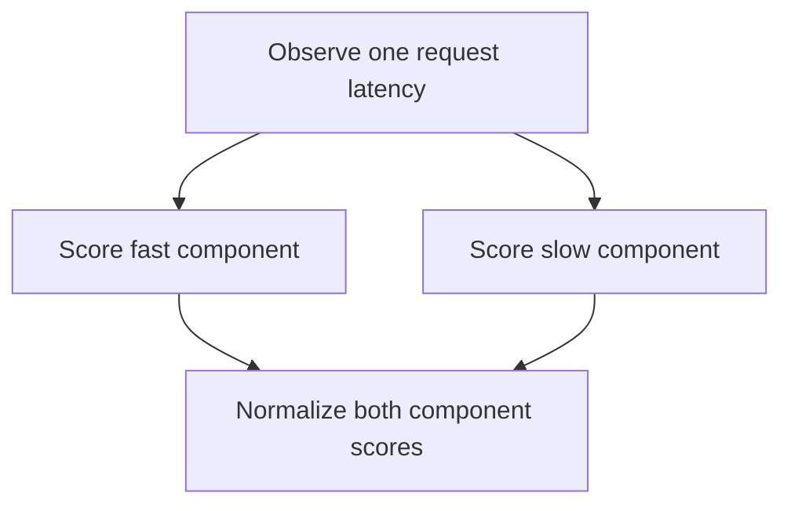

A mixture responsibility is the model-conditional probability that a particular latent component generated an observed example. In a Gaussian mixture, responsibility combines the component's mixture weight and how much probability density that component assigns to the observation. Responsibilities across all components sum to one, so ambiguous observations can belong fractionally to several possible groups.

## Normalize weighted component likelihoods

For nonnegative mixture weights $\pi_k$ summing to one and component densities $p_k(x)$, the responsibility is $r_{ik}=\pi_kp_k(x_i)/\sum_j\pi_jp_j(x_i)$ when the denominator is positive. Evaluate log-weighted densities and use log-sum-exp in numerical implementations to avoid underflow. This quantity is a posterior probability inside the assumed mixture model; identifying a real server, queue, customer segment, or physical cause requires external evidence.

## Example

Suppose equally weighted latency components have means 30 and 90 milliseconds and standard deviations of 20 milliseconds. A 50-millisecond request receives fast-component responsibility near 0.818 and slow-component responsibility near 0.182. It is closer to the fast component, but the actual infrastructure path was never observed. Changing component weights or variances can change both responsibilities.

## Why it matters here

Hard clustering can conceal uncertain examples precisely where serving regimes overlap. Responsibilities make that ambiguity visible, support weighted parameter updates in expectation-maximization, and discourage treating a statistical component label as verified causal attribution.

## Related terms

- [Gaussian mixture model](glossary://gaussian-mixture-model)
- [Expectation-maximization](glossary://expectation-maximization)
- [Latent variable](glossary://latent-variable)
- [Likelihood](glossary://likelihood)
