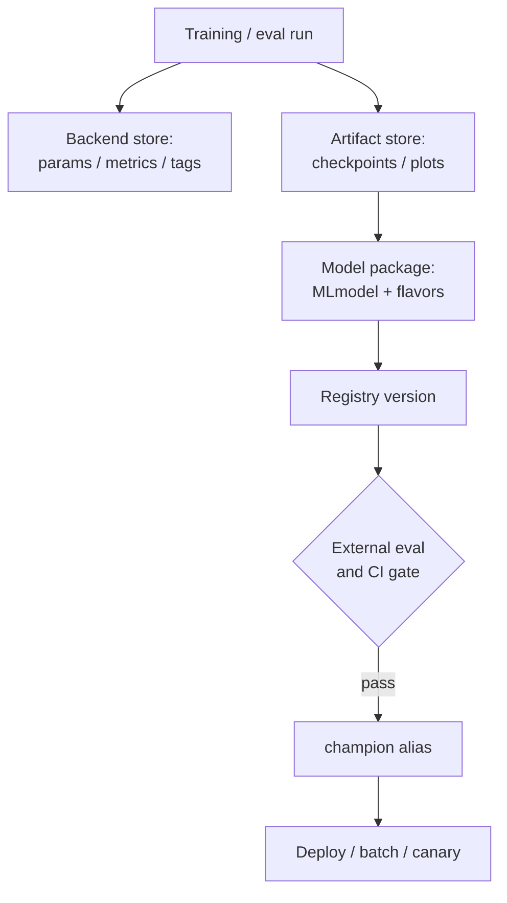

**MLflow** is an open-source platform for the machine learning lifecycle: experiment tracking, packaging models in a standard format, a model registry for versioned promotion, and (in current releases) GenAI surfaces for traces, evaluation, and prompt versions. Official docs organize classical work around **Tracking**, **Models**, **Model Registry**, and related serving tools, with a separate GenAI track for agents and LLM apps.

The unit of record for classical training is a **run**: one execution of training or evaluation code that logs parameters, metrics, tags, code version, and artifacts under an **experiment**. A score without that context is a rumor. MLflow is the shared log that turns "the good checkpoint from last Tuesday" into a queryable object with lineage to data, config, and eval definition.

## Intuition

Training and fine-tuning produce more than a weight file. Teammates need:

| Logged piece | Question it answers |
|---|---|
| Parameters | What knobs were set? |
| Metrics (with optional step) | How good, and when in training? |
| Artifacts | Where are weights, plots, eval dumps? |
| Tags / system metadata | Who ran it, which git commit, which env? |
| Model package | Can another tool load this the same way? |
| Registry version + alias | What is approved for staging or production? |

MLflow 3.7 changed the new local-store default to SQLite at `sqlite:///mlflow.db`. The [current migration guide](https://mlflow.org/docs/latest/self-hosting/migrate-from-file-store/), checked September 23, 2026, places file-based `./mlruns` in maintenance mode and requires `MLFLOW_ALLOW_FILE_STORE=true` to continue using it. Prefer an explicit database backend URI. MLflow 3.10+ provides `mlflow migrate-filestore`; its current target is SQLite and artifacts remain at their existing URIs. Teams usually combine a **tracking server**, database **backend store** for metadata, and object-storage **artifact store** for large files. Registry support depends on the configured backend; a database is the recommended production path rather than assuming file tracking cannot contain any registry metadata.

## How it works

1. **Experiment.** A named bucket for related runs (for example `support-sft` or `reranker-v3`). Set with `mlflow.set_experiment(...)` or the UI/API.
2. **Run.** `mlflow.start_run()` (often as a context manager) creates a run id. Log with `log_param` / `log_params`, `log_metric` / `log_metrics` (metrics may include a `step`), `log_artifact` / `log_artifacts`, tags, and dataset inputs (`log_input` / dataset APIs when you track data lineage).
3. **Query.** Search runs by metric or param filters; compare curves in the Tracking UI or via `MlflowClient` / `search_runs`. Prefer comparing runs only when base model, data version, eval suite, and metric definitions match.
4. **MLflow Model.** Flavor APIs (`mlflow.pytorch.log_model`, `mlflow.sklearn.log_model`, `mlflow.pyfunc.log_model`, …) write a directory with an `MLmodel` YAML, weights, dependency files (`requirements.txt`, `conda.yaml`, …), and optional signature / input example. Flavors let the same artifact load as a library-native object or as a generic Python function (`pyfunc`) for serving tools.
5. **Registry.** `register_model` (or `registered_model_name=` at log time) creates a **registered model** name and increments a **model version**. **Aliases** (for example `champion`, `challenger`) are mutable pointers used by deploy jobs via URIs like `models:/MyModel@champion`. Tags and descriptions document validation state; they do not replace external release gates.
6. **Load for eval or serve.** Historical runs use `runs:/<run_id>/<artifact_path>`. Registry versions use `models:/<name>/<version>` or `models:/<name>@<alias>`. Newer MLflow 3 paths also expose direct logged-model ids (`models:/<model_id>`) so checkpoints inside a long run can be ranked and loaded without guessing artifact paths.

For LLM and agent work, treat prompt template text, decoding config (temperature, top_p, max tokens), judge version, and suite ids as first-class params or artifacts. MLflow's GenAI stack adds OpenTelemetry-compatible **tracing**, eval/monitor APIs, and a **prompt registry** so prompts version like models; the same reproducibility rule applies: if it changes the score, log it.

## Diagram



## Example

Fine-tune a support bot with LoRA. This logging sketch assumes an authenticated tracking server and existing report files. Replace the illustrative revision/hash strings and metric values with complete immutable identifiers before recording a real run. Log the knobs that decide whether a later "better" run is actually comparable:

```python
import mlflow

mlflow.set_tracking_uri("https://mlflow.example.com")
mlflow.set_experiment("support-sft")

with mlflow.start_run(run_name="lora-r16-lr2e5") as run:
    mlflow.log_params({
        "base_model": "Qwen/Qwen2.5-7B-Instruct",
        "base_revision": "a1b2c3d",  # pin Hub revision
        "dataset": "support-sft-v7",
        "dataset_sha": "sha256:9f3c…",
        "lora_r": 16,
        "lora_alpha": 32,
        "lr": 2e-5,
        "epochs": 3,
        "seed": 42,
        "git_commit": "c0ffee1",
        "prompt_template": "support_v3",
        "max_new_tokens_eval": 256,
        "temperature_eval": 0.0,
    })
    mlflow.set_tags({
        "owner": "ml-platform",
        "task": "support-sft",
        "candidate": "true",
    })

    # ... train ...

    for step, val_loss in [(200, 1.12), (400, 0.91), (600, 0.84)]:
        mlflow.log_metric("val_loss", val_loss, step=step)

    mlflow.log_metrics({
        "eval_task_f1": 0.81,
        "eval_citation_rate": 0.94,
        "eval_safety_fail": 0.0,
        "p95_latency_ms": 420,
    })

    mlflow.log_artifact("reports/slice_metrics.json")
    mlflow.log_artifact("reports/failing_eval_ids.txt")

    # Package weights for registry / later load
    # mlflow.pytorch.log_model(model, name="adapter", registered_model_name="support-sft")
```

A week later, another engineer filters experiment `support-sft` where `params.dataset = "support-sft-v7"` and `params.base_revision` matches, sorts by `metrics.eval_task_f1`, and opens artifacts to see which customer slices moved. Promotion runs through CI: reload `models:/support-sft@challenger` (or a candidate version), run the pinned [offline evaluation](glossary://offline-evaluation) suite, then move the `champion` alias if the [eval gate](glossary://eval-gate) passes.

Minimal registry load for that gate:

```python
import mlflow

model = mlflow.pyfunc.load_model("models:/support-sft@challenger")
# score fixed golden rows, write metrics back to a new eval run
```

## What to log

Log every input that decides reproducibility:

- **Identity:** git commit, container or [dependency lockfile](glossary://dependency-lockfile) hash, hardware notes
- **Data:** dataset name, snapshot/query/manifest, checksum, train/val split policy
- **Model:** base checkpoint id and revision, adapter config, tokenizer revision, chat template id
- **Train knobs:** seed, learning rate, batch size, epochs, precision, distributed strategy
- **Eval schema:** suite version, slice definitions, judge model/version, decoding params that affect scored outputs
- **Artifacts:** best [model checkpoint](glossary://model-checkpoint), sample predictions, confusion or slice tables, promotion decision notes

If two runs disagree, diff those fields before debating architecture. Many "model improvements" are eval drift, data leakage, or a changed prompt template logged nowhere.

## Promotion perimeter

Tracking records experiment lineage and artifacts; automated release gates make promotion decisions. A run can win the leaderboard and still fail because it regresses one customer segment, costs too much, lacks rollback artifacts, or was scored on a different suite. Registry aliases and tags are deployment pointers and annotations. Record the go/no-go decision in automated gates and an [audit trail](glossary://audit-trail), with MLflow supplying the lineage and artifact URIs those gates consume.

## Trade-offs

**Strengths:** open source and self-hostable; library-agnostic logging; standard model packaging with flavors; registry lineage from experiment run to version; works from a laptop database up to a shared server; large ecosystem and managed hosts (for example Databricks-integrated MLflow).

**Limits in production:** empty or partial logging still looks like a successful run; file-store-only setups do not scale multi-user registry well; artifact and backend misconfiguration silently drops large files; metric names and units drift across teams unless you enforce a schema; registry clicks without CI gates create false confidence. Pair MLflow with feature stores, online metrics, and incident tooling as needed. Compared with commercial trackers, you own server uptime, auth, retention, and backup of metadata and object storage.

## Why it matters here

AI/ML work is multi-run by nature: base models, data versions, prompts, adapters, and eval suites change independently. MLflow connects those experiments to comparable metrics and to a versioned artifact path that release systems can pin, reload, and roll back. For curriculum and production alike, that turns training folklore into inspectable [lineage](glossary://provenance).

## Related terms

- [Model checkpoint](glossary://model-checkpoint)
- [Weights & Biases](glossary://weights-and-biases)
- [Offline evaluation](glossary://offline-evaluation)
- [Eval gate](glossary://eval-gate)
- [lineage](glossary://provenance)
