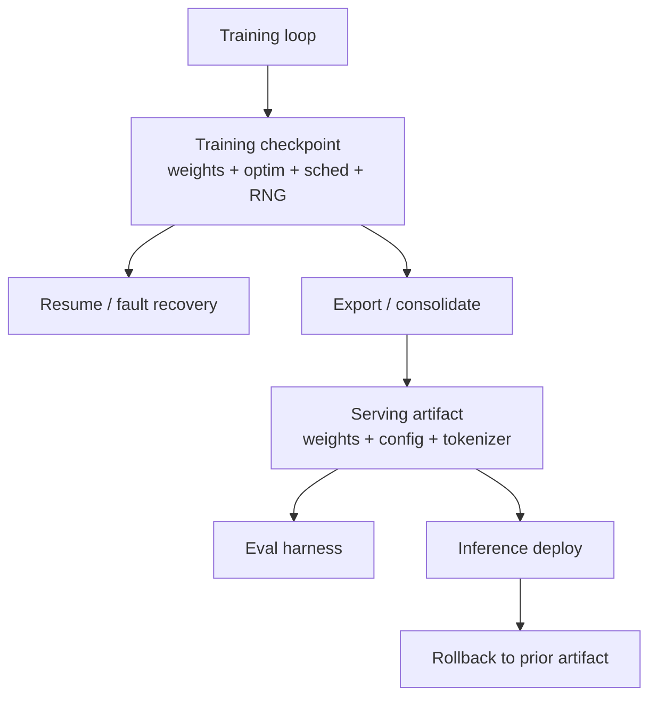

A **model checkpoint** is a versioned snapshot of a model’s parameters (and often the training or serving state that surrounds them) written so you can resume training, evaluate a fixed artifact, or deploy a known revision. In practice the word covers both a full **training checkpoint** (weights plus optimizer, scheduler, RNG, step metadata) and a leaner **export / release** (weights, architecture config, tokenizer, and generation defaults for inference).

[Activation checkpointing](glossary://activation-checkpointing), also called gradient checkpointing, discards activations during the forward pass and recomputes them in backward to save memory. Model checkpointing writes tensors and configs to durable storage.

## Intuition

Training is long, expensive, and interruptible. A checkpoint freezes a recoverable point in that process: the learned weights at step $t$, and usually enough surrounding state that “continue from here” is meaningful. Serving and eval need a **precise artifact identity**. Record the path, content hash, tokenizer revision, adapter merge state, and precision so names such as “the Llama we used last week” resolve to one artifact.

In frameworks such as PyTorch, a module's `state_dict` contains parameters and persistent buffers, such as batch-normalization running statistics. Saving that map plus required surrounding state is the core of checkpointing. A state-dictionary load requires a compatible architecture to be instantiated before its tensors are filled in; some higher-level APIs construct that architecture for you.

## How it works

A useful mental model is two tiers of artifact:

| Tier | Typical contents | Primary use |
| --- | --- | --- |
| **Training checkpoint** | Model `state_dict`, [optimizer state](glossary://optimizer-state), LR schedule, grad scaler, RNG, global step / epoch, optional data-loader cursor | Resume a run, fault tolerance |
| **Serving / eval export** | Weights (often sharded SafeTensors), `config.json`, tokenizer files, chat template, generation defaults; optionally merged adapters | Deploy, benchmark, compare, roll back |

**PyTorch general pattern** (official tutorial: save a dictionary with model and optimizer state):

```python
# Minimal model/optimizer/scheduler recovery sketch, at an optimizer-step boundary.
# Exact resume also needs RNG, scaler (if used), and data/accumulation state.
torch.save({
    "epoch": epoch,
    "global_step": step,
    "model_state_dict": model.state_dict(),
    "optimizer_state_dict": optimizer.state_dict(),
    "scheduler_state_dict": scheduler.state_dict(),
    "loss": loss,
}, "checkpoint_step_12000.pt")

# Resume (weights_only requires a weights-only-safe payload;
# full training dicts with unexpected Python objects may need an
# explicit allowlist or a trusted load path on some PyTorch versions)
ckpt = torch.load("checkpoint_step_12000.pt", map_location="cpu", weights_only=True)
model.load_state_dict(ckpt["model_state_dict"])
optimizer.load_state_dict(ckpt["optimizer_state_dict"])
scheduler.load_state_dict(ckpt["scheduler_state_dict"])
model.train()
```

**Hugging Face Transformers `Trainer`** usually writes folders such as `checkpoint-12000/` containing weight files (`model.safetensors` or sharded shards + index), `config.json`, `optimizer.pt`, `scheduler.pt`, `rng_state.pth`, `trainer_state.json`, and often `scaler.pt` under mixed precision. `trainer.train(resume_from_checkpoint=...)` reloads those pieces. For Hub distribution and inference you typically keep weights + config + tokenizer, not the multi-gigabyte optimizer blob.

**Formats you will see:**

- **`.pt` / `.pth` / pickle-based `torch.save`**: flexible; historically used for full training bundles. Classic pickle-based loads can execute code; prefer `weights_only=True` when loading untrusted files (requires a weights-only-safe payload; otherwise use an explicit allowlist or a trusted path), or use SafeTensors for weight-only artifacts.
- **SafeTensors**: tensor-only, mmap-friendly, designed so load does not run arbitrary code. Default weight packaging on modern Hugging Face hubs.
- **Sharded training state** ([FSDP](glossary://fsdp), [ZeRO](glossary://zero) / [DeepSpeed](glossary://deepspeed)): optimizer and parameters may be split across ranks. Resume often requires a compatible world size or a **universal / consolidated** export (for example DeepSpeed `zero_to_fp32` consolidation) before sharing a single `state_dict`.
- **Serving packages** such as [GGUF](glossary://gguf): inference-oriented containers derived from a training or Hub checkpoint, often after [quantization](glossary://quantization).

## Diagram



## Sizing

Rough weight size for $N$ parameters at $b$ bytes per parameter:

$$
\text{size}_{\text{weights}} \approx N \cdot b
$$

With $b = 2$ for BF16/FP16 and $b = 4$ for FP32. For Adam/AdamW, [optimizer state](glossary://optimizer-state) usually includes FP32 first and second moments, or $8N$ bytes on top of the model tensors. BF16 weights plus those moments therefore take about $10N$ bytes, **$5\times$ a BF16 weight-only export**. If the checkpoint also stores FP32 master weights, the total reaches about $14N$ bytes, or **$7\times$ the BF16 export**. The familiar $3\times$ ratio applies to FP32 weights plus two FP32 moments ($12N$ versus a $4N$ FP32 weight-only file), not to BF16 weight-only storage.

**Worked sketch for a 7B model** ($N \approx 7 \times 10^9$):

| Piece | Rough size |
| --- | --- |
| BF16 weights | $7 \times 10^9 \times 2 \approx 14$ GB |
| Adam moments $m$, $v$ (FP32) | $7 \times 10^9 \times 8 \approx 56$ GB |
| BF16 weights + Adam moments | $\approx 70$ GB ($5\times$ the BF16 export) |
| Add FP32 master weights when stored | $+28$ GB, for $\approx 98$ GB total ($7\times$) |
| Serving export (BF16 weights + config + tokenizer) | ~14 GB plus small metadata |
| 4-bit serving quant of the same model | often a few GB (container and type dependent) |

Policy implications: save full training state on a cadence you can afford to re-run from; keep only a few resume points (`save_total_limit`); promote weight-only exports for eval and deploy; never treat “checkpoint directory on disk” as free.

## Example

You fine-tune an instruct base for $12{,}000$ steps on 8 GPUs. Every $2{,}000$ steps the job writes:

```text
s3://models/run_42/checkpoint-12000/
  model-00001-of-00002.safetensors
  model-00002-of-00002.safetensors
  model.safetensors.index.json
  config.json
  optimizer.pt          # huge; needed only to resume
  scheduler.pt
  rng_state.pth
  trainer_state.json
  tokenizer.json
  tokenizer_config.json
  special_tokens_map.json
  chat_template.jinja   # if used
```

- **Resume after preemption:** load the full `checkpoint-12000` so optimizer moments and LR schedule continue. Restarting from weights alone often causes a visible loss jump because Adam moments reset.
- **Offline eval:** point the harness at the same weight files + tokenizer revision; record the content hash and `global_step` on the eval report.
- **Serve:** export a lean folder (or convert to GGUF/quant format). If you used [LoRA](glossary://lora), decide explicitly: ship **base + adapter** as a pair, or **merge** adapters into base weights and document the merge. Two teams saying they used “the same checkpoint” must agree on path, content hash, adapter merge state, precision, tokenizer revision, and generation defaults.

Minimal operational save/load for inference with Transformers:

```python
from transformers import AutoModelForCausalLM, AutoTokenizer

# After training: write serving-facing files
model.save_pretrained("export/run42-step12000")
tokenizer.save_pretrained("export/run42-step12000")

# Elsewhere: load that exact artifact
model = AutoModelForCausalLM.from_pretrained("export/run42-step12000")
tokenizer = AutoTokenizer.from_pretrained("export/run42-step12000")
model.eval()
```

## What must travel with the weights

| Always for loadability | For resume | For serving parity |
| --- | --- | --- |
| Architecture / `config` | Optimizer state | [Tokenizer artifact](glossary://tokenizer-artifact) + special tokens |
| Weight tensors (and shard index) | LR schedule + global step | Chat template / prompt contract |
| Matching code or library revision that builds the module | Grad scaler, RNG, (optional) data cursor | Dtype / quant method, generation defaults |
| | Parallelism layout or universal checkpoint | Adapter identity if not merged |

A checkpoint without its tokenizer is half an artifact. A serving load that silently swaps chat templates or pads is a form of [training-serving skew](glossary://training-serving-skew).

## Trade-offs

**Save often vs cost.** Frequent checkpoints reduce work lost to preemption and let you pick the best intermediate eval. They also burn I/O bandwidth, object-store bills, and engineer time cleaning old shards. Cap retained resume points; archive promotion candidates separately from ephemeral training dumps.

**Full state vs weights only.** Full state restores learning dynamics; weights only are smaller and safer to distribute. Do not ship optimizer files to production hosts.

**Sharded vs consolidated.** Sharded ZeRO/FSDP dumps can avoid gathering full tensors during multi-GPU saves. Portability depends on the save/load API: [PyTorch Distributed Checkpoint](https://docs.pytorch.org/docs/main/distributed.checkpoint.html), checked September 23, 2026, supports resharding model and optimizer state across supported layouts and trainer counts. A consolidated weight-only export supports inference sharing, but cannot by itself enable exact training resume because optimizer and other run state are missing.

**Pickle vs SafeTensors.** Pickle-style bundles are convenient for training state (Python objects). SafeTensors is the right default for weight distribution and untrusted downloads.

## Debug path

When “the checkpoint is wrong” in production or eval:

1. **Identity first.** Path, git or Hub revision, content hash of weight files, tokenizer hash, adapter IDs, quant type. Many apparent “model quality debates” turn out to compare different artifacts.
2. **Strict load.** Prefer `strict=True` (or inspect missing/unexpected keys). Silent partial loads after architecture renames produce garbage outputs that look like training bugs.
3. **Resume vs warm-start.** A loss spike after restarting from weights alone is expected when optimizer and schedule state were omitted. Check those missing states before diagnosing corruption.
4. **Tokenizer and template.** Compare token IDs for a few fixed strings; confirm chat template and special-token IDs match training.
5. **Precision and merge.** FP16 vs BF16 export, unmerged LoRA, or wrong base under an adapter often look like quality regressions.
6. **Sharded resume layout.** Wrong world size or incomplete rank files fail load or silently load partial shards; consolidate when moving outside the original cluster.
7. **Security.** Treat untrusted `.pt` / pickle checkpoints as code execution risk; load weights via SafeTensors or `weights_only=True` where applicable.

## Why it matters here

LeetLLM training, fine-tuning, eval, and deploy lessons all hang on **named, reproducible model artifacts**. Checkpoints make multi-day runs recoverable, give evaluation a concrete object to score, and give serving a rollback target when a new model regresses. Knowing what must live in a training dump versus a serving export, how large optimizer state really is, and how identity fails in production turns “save the model” into an engineering contract instead of a folder full of mystery tensors.

## Related terms

- [Optimizer state](glossary://optimizer-state)
- [Tokenizer artifact](glossary://tokenizer-artifact)
- [LoRA](glossary://lora)
- [Activation checkpointing](glossary://activation-checkpointing)
- [Quantization](glossary://quantization)
