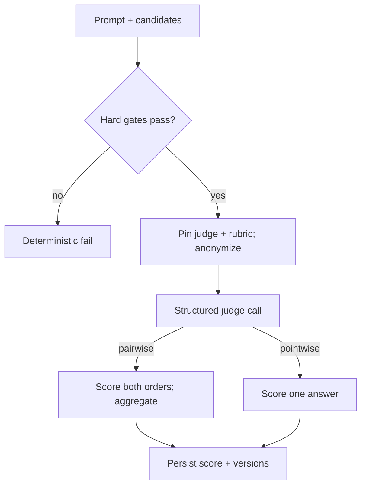
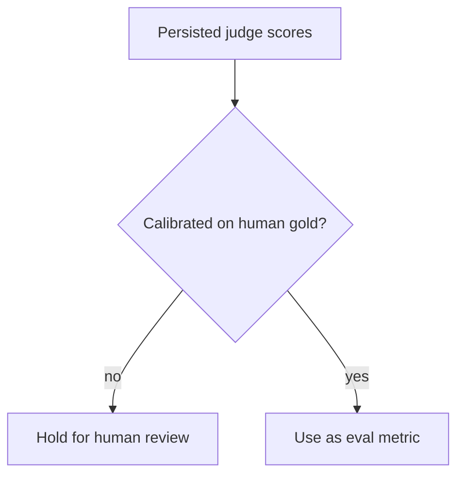

A **model judge** is a pinned LLM grader used to score or compare another system's outputs against a written rubric. It is the concrete artifact you version and call: model id, prompt template, rubric text, decoding settings, output schema, and aggregation rules. [LLM-as-a-judge](glossary://llm-as-judge) is the evaluation *method* and its known biases; the model judge is the *instance* of that method inside an [eval harness](glossary://eval-harness).

A judge turns soft criteria (clarity, actionability, grounded tone, preference between two eligible answers) into repeatable labels or scores. Its outputs can vary with bias, temperature, and prompt wording. Calibrate the judge against human ratings and run it after deterministic gates.

## Intuition

Hard graders answer closed questions: citation id match, JSON schema validity, unit tests, policy allowlists, abstention labels. A model judge answers open questions that have no exact oracle.

| Role | Owns |
| --- | --- |
| Deterministic grader | Evidence, policy, schema, tool outcomes |
| Model judge | Soft quality among already-eligible outputs |
| Human rater | Calibration gold, high-severity disputes, rubric design |
| [Reward model](glossary://reward-model) | Learned scalar preference used in some RLHF pipelines; DPO ordinarily trains directly from preference pairs without a separate explicit reward model |

If the judge can "save" an answer that hard gates already failed, the pipeline is wrong. Hard gates decide eligibility; the judge only ranks or scores eligible rows.

## How it works

A production model judge is a small, versioned grading subsystem with a defined rubric, inputs, and output contract:

1. **Pin the grader.** Record `judge_model_id`, provider route, temperature (often $0$ for discrete labels), max tokens, and seed if available.
2. **Pin the rubric.** Store rubric text or hash as `judge_rubric_version`. The rubric states criteria, evidence the judge may use, failure modes, and how ties or "insufficient information" resolve.
3. **Build an anonymized packet.** Case id, user prompt, validated context (if any), candidate text in neutral slots (`Answer A` / `Answer B`), never "our production model vs GPT-4".
4. **Call with structured output.** Prefer a fixed schema: winner or score, per-criterion notes, short rationale, optional confidence. Record parse failures as explicit evaluation outcomes so they remain in the denominator.
5. **Mitigate known biases.** For pairwise comparison, judge both slot orders and aggregate (win only if consistent; otherwise tie). For math or factual tasks, attach a reference solution when one exists (reference-guided grading from Zheng et al.).
6. **Persist audit fields** on each [eval row](glossary://eval-row): packet hash, judge model id, rubric version, raw response, parsed label, rationale, cost, latency.
7. **Calibrate before gating.** On a human [golden dataset](glossary://golden-dataset), measure agreement, order-swap consistency, verbosity and self-preference probes. Only then attach the metric to an [eval gate](glossary://eval-gate).

Common shapes for one judge instance:

| Shape | Input | Output | Best use |
| --- | --- | --- | --- |
| Pairwise | Prompt + $A$ + $B$ | Prefer $A$, $B$, or tie | Head-to-head of two candidates |
| Pointwise | Prompt + one answer | Score or category (e.g. $1$–$5$, pass/fail) | Large candidate sets, regression dashboards |
| Reference-guided | Above + validated reference | Same | Math, coding, fact-checked QA |

Zheng et al. (NeurIPS 2023) showed strong judges can match human preference at roughly human–human agreement levels (about $80\%$+ on non-tie comparisons in their MT-Bench / Arena setups), while documenting [position bias](glossary://position-bias), verbosity bias, self-enhancement risk, and weak math grading without references.

## Formula

**Order-swap consistency.** For $N$ pairs judged in both orders $(A,B)$ and $(B,A)$:

$$
\mathrm{consistency} = \frac{1}{N}\sum_{i=1}^{N}
\mathbf{1}\{\text{decision}_i(A,B)\ \text{agrees with}\ \text{decision}_i(B,A)\}
$$

Inconsistent pairs should usually count as ties for release metrics. A high flip rate disqualifies the judge from gating until the rubric or judge instability is addressed.

**Human agreement (non-tie).** On gold pairs with human winner $y$ and judge winner $\hat{y}$ after dual-order aggregation:

$$
\mathrm{agreement} = \frac{1}{N'}\sum_{i=1}^{N'} \mathbf{1}\{y_i = \hat{y}_i\}
$$

where $N'$ excludes human ties (or uses your declared tie policy). Also report chance-corrected agreement (e.g. Cohen's $\kappa$) when labels are multi-class.

**Optional continuous score (G-Eval style).** If the form allows scores $S=\{s_1,\ldots,s_n\}$ and the API returns token probabilities $p(s_i)$:

$$
\mathrm{score} = \sum_{i=1}^{n} p(s_i)\, s_i
$$

Here $p(s_i)$ must be normalized over the allowed scores; raw next-token probabilities may assign mass to tokens outside that restricted set. Multi-token score labels require sequence probabilities or a different scoring contract. [Liu et al.](https://arxiv.org/abs/2303.16634) (G-Eval, EMNLP 2023) used chain-of-thought steps plus probability-weighted scores and reported average Spearman correlation about $0.514$ with GPT-4 on SummEval in their setup. This historical result describes that judge and dataset; measure transfer on the judge and evaluation set you plan to use.

## Diagram



### Calibrate before use



## Example

Support bot eval. Hard gates already checked citation ids and policy action. Soft quality remains: clarity and actionability of *eligible* replies.

Pinned judge instance:

| Field | Value |
| --- | --- |
| `judge_model_id` | `gpt-4o-2024-08-06` |
| `judge_rubric_version` | `clarity-actionability@v3` |
| Temperature | $0$ |
| Output fields | `winner` enum (A, B, tie), `rationale` string |
| Aggregation | Dual-order; inconsistent $\rightarrow$ tie |

Illustrative probes on $80$ human-labeled pairs (golden set `support-soft@v6`, with 60 non-tie human labels):

| Probe | Result | Ready to gate? |
| --- | --- | --- |
| Human–judge agreement after aggregation (non-tie human labels) | $50/60\approx0.83$ | Screening evidence; inspect disagreements |
| Order-swap consistency | $62/80=0.775$ ($22.5\%$ inconsistent) | Hold release gating; keep dual-order + conservative ties |
| Verbosity pad attack | Padded answer wins $18\%$ of pairs | Tighten concision criterion; retest |
| Same-family self-preference | Candidate from judge family $+0.09$ win rate | Prefer a different judge family for release |

Operational dual-order aggregation:

```python
def pairwise_verdict(judge, case, a, b) -> str:
    r1 = judge.compare(case, first=a, second=b)  # "A" | "B" | "tie"
    r2 = judge.compare(case, first=b, second=a)
    id1 = {"A": "a", "B": "b", "tie": "tie"}[r1]
    id2 = {"A": "b", "B": "a", "tie": "tie"}[r2]
    if id1 == id2 and id1 != "tie":
        return id1
    return "tie"
```

With dual-order aggregation on that gold set, the more actionable template wins $48$ pairs, the terse one $12$, ties $20$, including all 18 inconsistent pairs. The observed preference supports further investigation, while the bias probes above require recalibration and held-out confirmation before using this judge to approve promotion. Rows that fail citation or policy gates never enter the judge.

## Trade-offs

- **Frontier judge vs specialized judge.** Strong general models track open-ended human preference better in published studies, but cost more, rate-limit harder, and may self-prefer their own style. A smaller or fine-tuned judge can be cheaper once validated on *your* gold set.
- **Pairwise vs pointwise instance.** Pairwise is cleaner for A/B of two systems; it doubles cost under order swap. Pointwise scales to many candidates but drifts more when you change judge model or rubric wording.
- **Strict dual-order vs random order.** Conservative dual-order reduces position bias at $2\times$ spend. Random single-order is cheaper at scale but injects noise; use only after measuring flip rates on gold.
- **Screening metric vs release authority.** A calibrated judge is excellent for offline regression and soft-quality gates behind hard checks. Ambiguous, high-severity, or low-confidence cases still need [human-in-the-loop](glossary://human-in-the-loop) review.

## What fails in production

- **Rubric drift.** Editing the prompt without bumping `judge_rubric_version` makes metric movement uninterpretable (product change vs judge change).
- **Ungated soft scores.** Letting the judge override citation, safety, or schema failures invents false passes.
- **Unmeasured position or verbosity bias.** Skipping order swap or length probes ships a leaderboard that rewards slot order and padding.
- **Judge model upgrade without recalibration.** A new snapshot can shift absolute scores and pairwise win rates even when the product is unchanged.
- **Missing artifacts.** Store the rationale, packet hash, and versions so teams can debug a red gate and audit its decision.

## Why it matters here

LeetLLM eval design treats the model judge as versioned measurement equipment: a specific grader you pin, calibrate on gold, and call after evidence and policy gates. Interview and production systems both fail when teams paste "score this 1-10" into a chat UI and treat the number as truth. Knowing what the instance pins, how dual-order consistency is measured, and when to refuse the gate is what makes soft quality metrics defensible.

## Related terms

- [LLM-as-a-judge](glossary://llm-as-judge)
- [Eval harness](glossary://eval-harness)
- [Golden dataset](glossary://golden-dataset)
- [Position bias](glossary://position-bias)
- [Reward model](glossary://reward-model)
