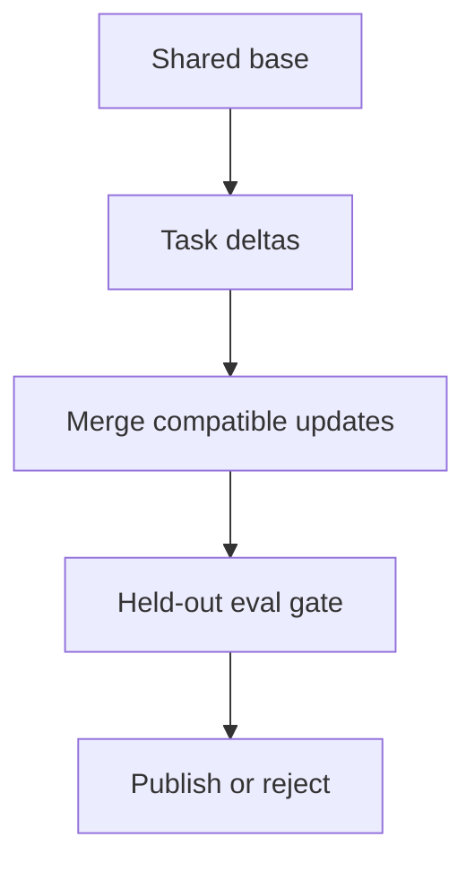

**Model merging** combines compatible trained checkpoints into a new set of model weights without running another full training procedure. Common methods include weighted averaging, task-vector addition, spherical interpolation, and conflict-aware combinations. A merge combines parameter values. Its success depends on whether corresponding weights represent compatible functions; output averaging is a separate method.

## Why matching shapes aren't enough

Two checkpoints can share an architecture and tensor shapes while differing in tokenizer, base revision, parameter permutation, normalization conventions, or special-token configuration. Naively averaging those weights can create a midpoint with worse loss than either endpoint.

Methods such as TIES reduce interference by trimming small task-vector updates, selecting a consistent sign, and combining updates that agree with that elected sign. Evaluate the merged result for safety, retrieval quality, and each source capability you need to preserve.

## Example

A code assistant has one fine-tune for secure API usage and another for concise debugging explanations. Both derive from the same immutable base checkpoint and tokenizer. Subtract the shared base from each, merge their deltas, and evaluate the combined candidate on secure-coding prompts, debugging prompts, ordinary language quality, and adversarial secret requests.

If aggregate quality improves but the secret-refusal slice regresses, reject the merge. Evaluate a weighted midpoint on required capability and safety slices before claiming that it preserves them.

## Why it matters here

Merging offers a low-compute way to explore combinations of existing adaptations, provided lineage, compatibility, and release evaluations are treated as first-class requirements.

## Related terms

- [Model checkpoint](glossary://model-checkpoint)
- [Supervised fine-tuning](glossary://supervised-fine-tuning)
- [Evaluation gate](glossary://eval-gate)
- [Vector](glossary://vector)
