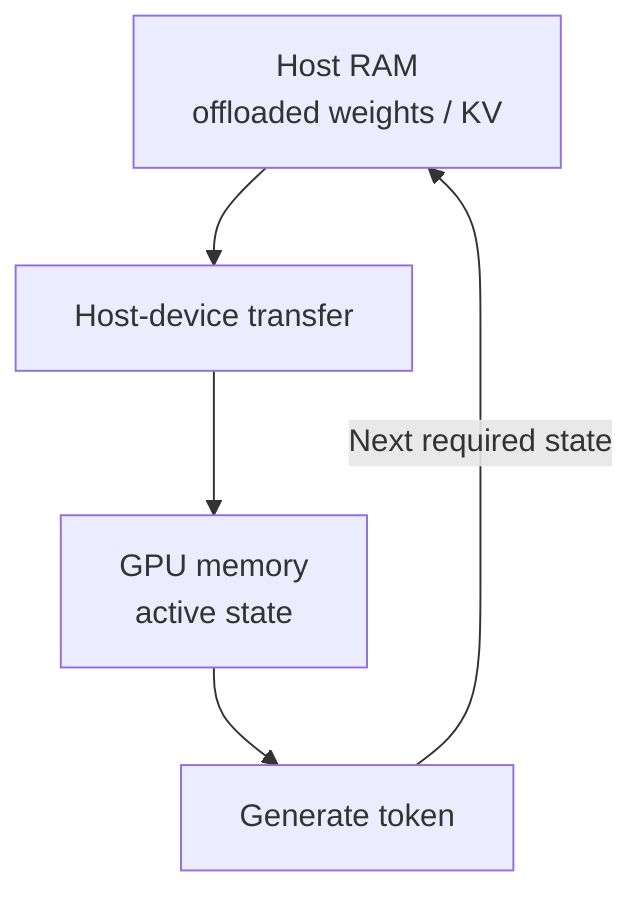

**Model offload** places some model state outside the fastest accelerator memory and moves or accesses it when execution needs it. Common arrangements keep selected transformer layers or KV-cache pages in host RAM while retaining other layers on a GPU. Offload can make a checkpoint fit on constrained hardware, but every host-device transfer introduces bandwidth, latency, and scheduling costs.

## Placement determines the transfer bill

Local runtimes may expose a GPU-layer count that keeps the first or last set of model layers on the accelerator while running the remainder on the CPU. Other systems page individual tensors, spill cache blocks, or use unified-memory mechanisms. These designs aren't equivalent: running a layer on the CPU differs from moving its weights to the GPU for every generated token, and both differ from swapping an inactive sequence's KV cache.

The slowest interconnect can dominate decode. A 10 GB tensor crossing a sustained 20 GB/s connection needs at least 0.5 seconds for the transfer before computation or synchronization.

## Example

A quantized checkpoint needs 18 GB of weights, while the available GPU has 12 GB of usable memory after runtime reservations. A local engine can keep some layers in host RAM and place the remainder on the GPU. The model may now load successfully, but generated-token throughput depends on which layers cross the bus, whether CPU execution overlaps GPU work, and how much KV cache also resides off device. Benchmark several layer placements at the target prompt length to find the best offload count.

## Why it matters here

Local inference and quantization articles distinguish model fit from useful interactive speed. Offload explains why a configuration can avoid an out-of-memory error yet still miss latency objectives when repeated host-device movement overwhelms the memory savings.

## Related terms

- [llama.cpp](glossary://llama-cpp)
- [KV cache](glossary://kv-cache)
- [GPU](glossary://gpu)
- [Quantization](glossary://quantization)
