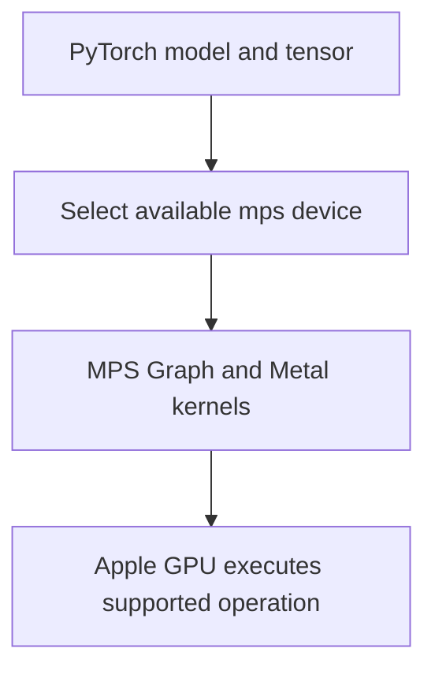

The MPS backend is PyTorch's route for executing supported tensor operations on Apple GPUs through Metal Performance Shaders and Metal-based runtime components. A tensor or model placed on `torch.device("mps")` can use Apple GPU acceleration instead of CPU execution. MPS is a distinct backend from CUDA: CUDA kernels, NCCL collectives, NVIDIA-specific precision paths, and architecture-specific GPU libraries do not automatically become available on a Mac.

## Device placement and operator coverage

Check backend availability before selecting the device, then move both the model and its input tensors to `mps`. A model on MPS cannot safely consume an unrelated CPU tensor without an explicit supported transfer. Some operators or dtypes may be unsupported or behave differently from their CUDA equivalents, so fallback policy and small numerical checks belong in the development workflow.

Apple silicon can provide a unified physical memory architecture, but that does not eliminate device-placement rules or make unlimited memory available. Allocator watermarks, other applications, model size, intermediate activations, and operator fallbacks still constrain a real training run. Treat backend availability and operator coverage as separate questions.

## Example

First verify `torch.backends.mps.is_available()`. Then create a small tensor using `torch.ones(5, device="mps")`, move the model with `model.to("mps")`, and run one forward pass. This confirms basic backend availability; test each fused attention implementation, distributed-training stack, and custom extension against the machine and device separately.

## Why it matters here

Learners often develop on macOS before moving training or serving workloads to NVIDIA infrastructure. The MPS backend gives them a practical accelerated path while keeping platform boundaries honest. It explains why a local PyTorch lab can succeed on Apple silicon while DeepGEMM, NCCL, or a CUDA-only FlashAttention package still requires different hardware and deployment validation.

## Related terms

- [PyTorch](glossary://pytorch)
- [GPU](glossary://gpu)
- [CUDA](glossary://cuda)
- [Unified memory](glossary://unified-memory)
