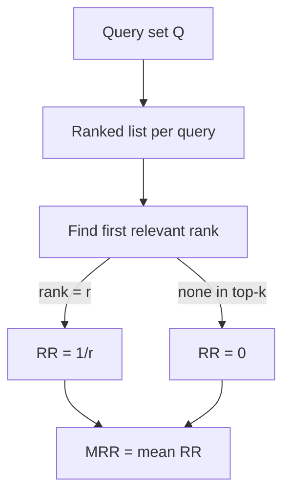

Mean reciprocal rank (MRR) is a ranking metric that averages how early the *first* relevant result appears across a set of queries. For each query you take the reciprocal of the 1-based rank of the first correct hit ($1$, $1/2$, $1/3$, ...), then average those scores. If nothing relevant appears in the evaluated list, that query contributes $0$.

Ellen Voorhees used this form as the primary score for the TREC-8 Question Answering track (1999): systems returned a short ranked list of answer strings, and a question scored $1/\mathrm{rank}$ of the first correct response (or $0$ if none of the returned answers was correct). That setup still matches the jobs where MRR is sharp: factoid QA, known-item lookup, FAQ search, and any retrieval step where one good hit unlocks most of the value.

## Intuition

Reciprocal rank scores only the position of the first relevant result. Rank $1$ scores $1$, rank $2$ scores $1/2$, and rank $10$ scores $1/10$. Later relevant documents do not affect that query's score.

That is a feature when the product promise is "get me *one* right answer fast." It is a blind spot when the product needs several supporting passages, graded relevance, or a full evidence set for multi-hop synthesis.

## Formula

For a query set $Q$, with $\mathrm{rank}_q$ the 1-based position of the first relevant item for query $q$:

$$
\mathrm{MRR}=\frac{1}{|Q|}\sum_{q\in Q}\frac{1}{\mathrm{rank}_q}
$$

where $1/\mathrm{rank}_q=0$ when no relevant item appears (treat $\mathrm{rank}_q=\infty$). The score always lies in $[0,1]$. A perfect system that places a relevant item at rank $1$ for every query scores $1.0$.

When you only inspect the top $k$ results (the usual offline cut for search and RAG), use $\mathrm{MRR@}k$: if the first relevant hit is beyond $k$, that query contributes $0$. Always report $k$ with the number so evals stay comparable.

## Worked numbers

Four support-search queries, first relevant ranks $1$, $3$, $6$, and $2$:

| Query | First relevant rank | Reciprocal rank |
|-------|---------------------|-----------------|
| $q_1$ | $1$ | $1$ |
| $q_2$ | $3$ | $1/3\approx 0.333$ |
| $q_3$ | $6$ | $1/6\approx 0.167$ |
| $q_4$ | $2$ | $1/2=0.5$ |

$$
\mathrm{MRR}=\frac{1+1/3+1/6+1/2}{4}=\frac{2}{4}=0.5
$$

So on average the first useful hit sits around rank $2$ (the harmonic mean of the finite ranks is $1/\mathrm{MRR}=2$ when every query has a hit). If you evaluate $\mathrm{MRR@}5$, query $q_3$ becomes $0$ and MRR falls to $(1+0.333+0+0.5)/4\approx 0.458$.

```python
def mrr_at_k(ranked_ids: list[list[str]], relevant: list[set[str]], k: int) -> float:
    if k <= 0:
        raise ValueError("k must be positive")
    if not ranked_ids or len(ranked_ids) != len(relevant):
        raise ValueError("provide a nonempty query set with one gold set per ranking")
    scores = []
    for ranking, gold in zip(ranked_ids, relevant):
        rr = 0.0
        for rank, doc_id in enumerate(ranking[:k], start=1):
            if doc_id in gold:
                rr = 1.0 / rank
                break
        scores.append(rr)
    return sum(scores) / len(scores)
```

## Example

A RAG retriever is scored on three policy questions. Gold is binary (chunk answers the question or not):

1. First relevant chunk at rank $1$ $\rightarrow$ RR $=1.0$
2. First relevant at rank $2$ $\rightarrow$ RR $=0.5$
3. First relevant at rank $10$ $\rightarrow$ RR $=0.1$

$$
\mathrm{MRR}=(1+0.5+0.1)/3\approx 0.533
$$

A reranker that always lifts one FAQ-style answer to rank $1$ can push MRR near $1.0$ while burying the second and third passages a multi-hop answer needs. The generator then looks "confident" on single-hop FAQ slices and fails synthesis slices. Pair MRR with [recall@k](glossary://recall-at-k) (what fraction of the needed evidence entered the candidate set?) and [NDCG](glossary://ndcg) (is the *whole* graded list ordered well?) before you call the retriever fixed.

## Diagram



## Trade-offs

| Need | Prefer |
|------|--------|
| One correct answer early (FAQ, known-item, factoid QA) | MRR / $\mathrm{MRR@}k$ |
| All relevant evidence inside a budget | [Recall@k](glossary://recall-at-k) |
| Graded relevance and full-list order | [NDCG](glossary://ndcg) |

**What fails in production:** incomplete gold labels make a correct first hit look like a miss ($0$ RR). Binary labels hide partially useful chunks. Macro MRR can look healthy while one hard [evaluation slice](glossary://evaluation-slice) (multi-hop, long docs, ACL-filtered corpora) collapses. Optimizing only MRR can train systems that park a single easy match at rank $1$ and ignore diversity of evidence the LLM context needs.

## Why it matters here

Retrieval and RAG lessons use MRR as the "first good hit" probe after candidate generation and [reranking](glossary://reranker). Match the metric to the product goal: use MRR for "first useful answer fast" and recall@k with NDCG when the system needs a complete evidence set. Break scores by slice so a strong FAQ average cannot hide multi-hop failure.

## Related terms

- [Recall@k](glossary://recall-at-k)
- [NDCG](glossary://ndcg)
- [Reranker](glossary://reranker)
- [Evaluation slice](glossary://evaluation-slice)
- [Offline evaluation](glossary://offline-evaluation)
