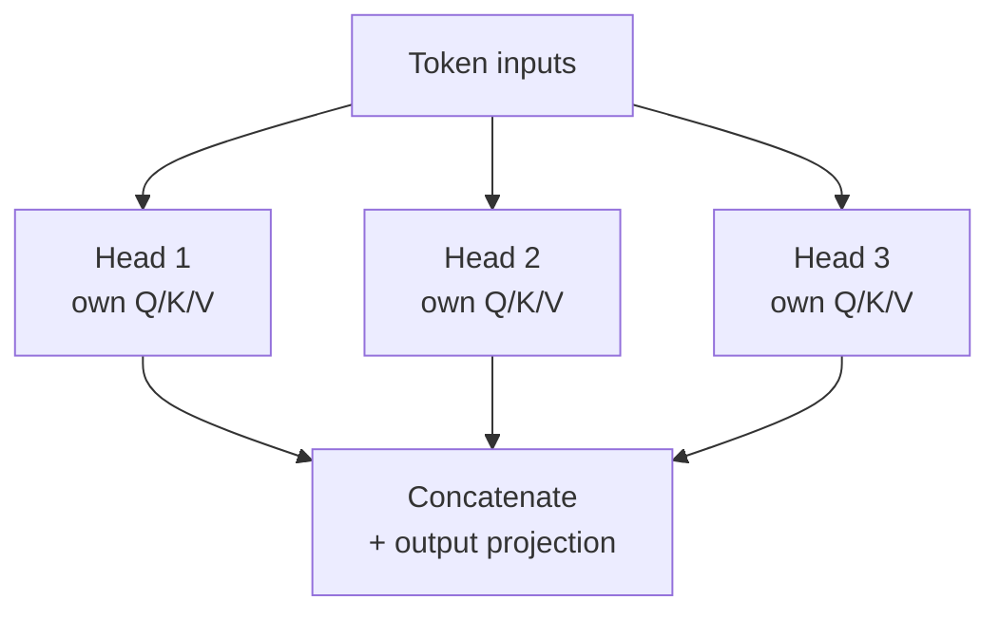

**Multi-head attention** runs several attention computations in parallel, giving each head its own learned query, key, and value projections. Different heads can emphasize different relationships between tokens. Their outputs are concatenated and projected back into the model's residual stream. In standard decoder self-attention, the number of key-value heads matches the number of query heads.

## Head geometry and cache cost

For head $i$, attention computes:

$$
\operatorname{head}_i = \operatorname{softmax}\left(\frac{Q_iK_i^\top}{\sqrt{d_h}}\right)V_i
$$

Here, $Q_i$, $K_i$, and $V_i$ are that head's projected queries, keys, and values, and $d_h$ is its head dimension. During autoregressive decoding, past keys and values must remain available for every head. Cache storage therefore scales with the key-value head count, sequence length, layer count, and numeric precision.

## Example

A model with 32 query heads and 32 key-value heads keeps a distinct key and value history for each head. If a grouped-query variant keeps the same 32 query heads but uses eight shared key-value heads, its KV-cache tensors require about one quarter as many values for the same layers, context length, head dimension, and precision. The query heads still produce distinct attention distributions; only the stored key-value histories are shared.

## Why it matters here

Inference lessons use multi-head attention as the baseline for multi-query attention, grouped-query attention, and latent-attention variants. Understanding which heads remain independent prevents the common mistake of assuming fewer KV heads means fewer query heads or proportionally fewer total model parameters.

## Related terms

- [Attention head](glossary://attention-head)
- [Grouped-query attention](glossary://grouped-query-attention)
- [Multi-query attention](glossary://multi-query-attention)
- [KV cache](glossary://kv-cache)
