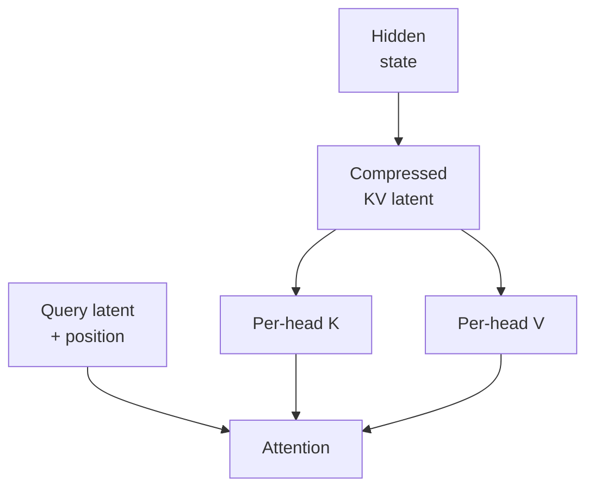

**Multi-head latent attention (MLA)** compresses information used for attention into smaller latent vectors before reconstructing the head-specific query, key, or value representations needed by attention kernels. Its main serving advantage is reducing the persistent state associated with past tokens compared with storing full per-head K/V tensors.

MLA changes how attention state is parameterized and cached while retaining attention over the context. A separate sparse-attention mechanism can select which positions to read.

## Compression path

A conventional multi-head attention cache stores K and V for every KV head and position. MLA first projects hidden states into a compact latent, then applies learned projections around that latent. Positional components such as RoPE may follow a separate path so position information remains usable.

The diagram shows the mathematical reconstruction path. An optimized decode implementation can absorb the key up-projection into the query projection and the value up-projection into the output projection, avoiding materializing full head-specific K/V histories. Query compression can save training activations; it does not itself reduce the cache of past tokens.

## Diagram

## Example

GLM-5.3 uses a 512-dimensional KV latent while its model hidden size is 6,144. At long context, retaining a compact latent per position can save substantial cache memory versus a full conventional K/V representation. Estimate cache bytes from positional components, dtype, and the engine's actual storage layout as well as latent width.

## Why it matters here

MLA addresses what the model stores for past context. DSA addresses which past positions it attends to. Keeping those two jobs separate makes long-context performance analysis much clearer.

## Related terms

- [KV cache](glossary://kv-cache)
- [DeepSeek Sparse Attention](glossary://deepseek-sparse-attention)
- [Attention head](glossary://attention-head)
- [RoPE](glossary://rope)
- [Prefill](glossary://prefill)
