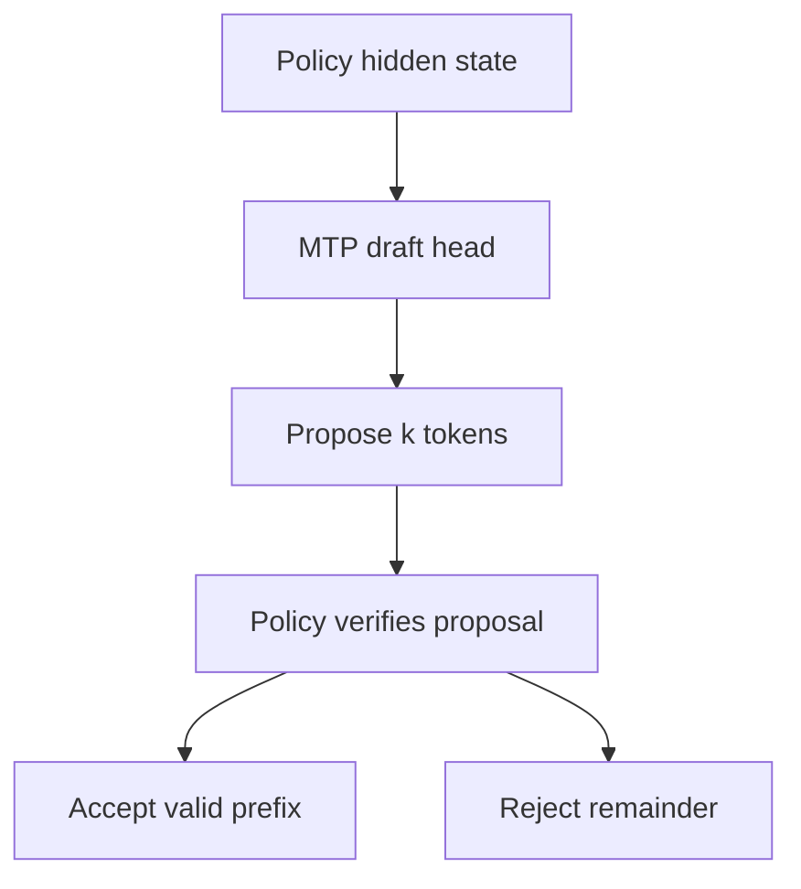

**Multi-token prediction (MTP)** adds one or more auxiliary modules that predict future tokens beyond the ordinary next-token target. During inference, an MTP head can act as a speculative drafter: propose several tokens cheaply, then let the main policy verify them together.

Three counts must stay separate: number of MTP heads in the checkpoint, speculative draft depth, and number of accepted draft tokens. A single head can sometimes be reused autoregressively to propose more than one token, but acceptance often falls with depth.

## Training and serving roles

An MTP module may be pretrained with the base model, frozen, trained with an auxiliary loss, or updated through a decoupled draft loss. Speculative decoding preserves the target policy distribution when verification uses a correct acceptance-and-resampling procedure. Discarding rejected tokens without resampling changes the output distribution.

## Diagram

## Example

GLM-5.3's configuration contains one decoder-style MTP block in addition to its 78 main layers. An engine that supports autoregressive reuse can use that block at draft depth three. Draft depth and useful speedup depend on the engine's reuse path and measured acceptance length.

## Why it matters here

The GLM-5.3 masterclass keeps speculation disabled in its initial candidate configuration. Before enabling MTP, verify checkpoint-conversion parity, packed-sequence compatibility, weight synchronization for the block, and acceptance metrics in the target engine.

## Related terms

- [Speculative decoding](glossary://speculative-decoding)
- [IndexShare](glossary://indexshare)
- [Model checkpoint](glossary://model-checkpoint)
- [vLLM](glossary://vllm)
- [SkyRL](glossary://skyrl)
