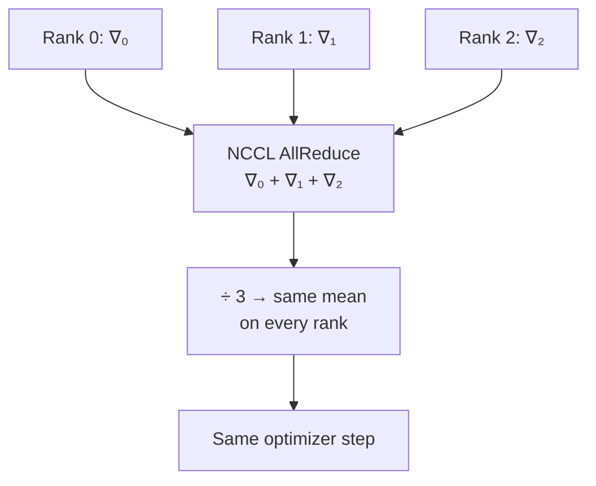

**NCCL** (NVIDIA Collective Communications Library, pronounced "nickel") is NVIDIA's library of topology-aware **inter-GPU collective and point-to-point primitives**. It supplies the communication layer used by parallel programs, with operations that multi-GPU training and serving need: all-reduce, reduce-scatter, all-gather, broadcast, reduce, all-to-all, and send/recv over PCIe, NVLink, InfiniBand, and IP sockets.

In deep learning frameworks (PyTorch DDP/FSDP, DeepSpeed, Megatron, multi-GPU vLLM/TGI shards), NCCL is usually the backend behind `torch.distributed` when the process group is `nccl`. Each participating GPU is a **rank** in a **communicator**. Every rank must enter the same collective with matching counts, dtypes, and op order. Device kernels move data and (for reductions) combine values on the GPU path, avoiding a host-side copy-and-reduce loop.

For a sum all-reduce of $k$ ranks, rank $r$ supplies buffer $\mathbf{x}^{(r)}$ of length $N$ and every rank receives the same

$$
\mathbf{y}_i = \sum_{r=0}^{k-1} \mathbf{x}^{(r)}_i
\quad (i = 0,\ldots,N-1).
$$

Data-parallel training then divides by $k$ (or uses a mean reduction) so every replica applies one shared gradient update.

## Intuition

NCCL handles GPU communication while model code runs matmul and attention in CUDA kernels on local [HBM](glossary://hbm). Between those kernels, ranks must agree on gradients, gather a weight shard, or exchange partial activations. NCCL builds a graph of best paths from the machine topology, then runs collectives that saturate those paths.

Two algorithms dominate all-reduce:

| Algorithm | Strength | Cost shape |
| --- | --- | --- |
| **Ring** | Near-peak bandwidth for large messages | Latency grows roughly with rank count |
| **Tree** (double binary tree and variants) | Low latency for small/medium messages | Logarithmic depth; slightly lower peak bus utilization |

NCCL also picks **protocols** (Simple, LL, LL128) that trade payload layout and latency for bandwidth. For large gradient buckets you usually want high bus bandwidth; for frequent tiny tensor-parallel exchanges, latency matters more. You rarely force these by hand; you measure whether step time is compute-bound or collective-bound.

## How it works

1. **Communicator.** Ranks get a shared unique id (bootstrap over sockets/MPI/etc.), call `ncclCommInitRank` (or the framework does), and bind one CUDA device per rank in that communicator. Reusing the same device as two ranks of one communicator is unsupported and can hang.
2. **Topology discovery.** NCCL probes NVLink, PCIe, NIC reachability, and multi-node paths, then plans rings/trees that prefer the fastest links.
3. **Enqueue on a CUDA stream.** Collectives take a stream argument so they order with other GPU work and can overlap compute when the framework pipelines correctly.
4. **Device kernels.** The communicator schedules GPU work for data movement and local reductions.
5. **Framework hooks.** DDP buckets ready gradients into all-reduces; FSDP/ZeRO issue all-gather of parameters and reduce-scatter of gradients; Megatron-style tensor parallel issues all-reduce/all-gather inside each layer.

Official collective semantics (same count and dtype on every rank, or undefined behavior: hang, crash, or corruption):

| Collective | Result |
| --- | --- |
| **AllReduce** | Elementwise reduce; full result on every rank |
| **Reduce** | Same reduce; full result only on root |
| **Broadcast** | Root's buffer copied to all ranks |
| **AllGather** | Concatenate per-rank chunks; full concat on every rank |
| **ReduceScatter** | Reduce, then each rank keeps one equal chunk of the result |
| **AlltoAll** | Each rank sends a distinct chunk to every other rank |
| **Send / Recv** | Point-to-point building blocks for custom patterns |

Note from the NCCL docs: **ReduceScatter then AllGather is equivalent to AllReduce**; a ring all-reduce is essentially that pipeline fused for bandwidth.

## Diagram



Ring all-reduce geometry (large messages): ranks form a cycle; each step a rank sends one chunk of size $S/k$ to its neighbor while receiving another. After $k-1$ reduce-scatter steps each rank holds one reduced chunk; after $k-1$ all-gather steps every rank holds the full reduced buffer.

## Formula

**All-reduce (sum).** For buffers $\mathbf{x}^{(0)},\ldots,\mathbf{x}^{(k-1)}$ of length $N$:

$$
\mathbf{y} = \sum_{r=0}^{k-1} \mathbf{x}^{(r)},
$$

with $\mathbf{y}$ written to every rank's output (in-place or out-of-place depending on the call).

**Ring volume (bandwidth-optimal large-message model).** Let message size be $S$ bytes and bandwidth of the bottleneck link be $B$ (bytes/s). In a classic ring, each rank transfers

$$
V = 2\cdot\frac{k-1}{k}\,S
$$

bytes (reduce-scatter plus all-gather). Ignoring latency and assuming perfect pipeline use of the link:

$$
T_{\mathrm{ring}} \approx \frac{V}{B} = \frac{2(k-1)}{k}\,\frac{S}{B}.
$$

As $k$ grows, $V \to 2S$. Here $V$ counts bytes sent per rank (and the same amount is received), not the sum of sends and receives. The bounded per-rank send volume is why the ring is bandwidth-efficient for large $S$; latency still grows with the number of ring steps.

**NCCL tests bus bandwidth.** Algorithmic bandwidth is $\mathrm{algbw} = S / T$. For all-reduce, reported **bus bandwidth** is scaled so it can be compared to raw link rates:

$$
\mathrm{busbw} = \mathrm{algbw}\cdot\frac{2(k-1)}{k}.
$$

When large-message all-reduce is healthy, $\mathrm{busbw}$ should approach the effective NVLink or IB bandwidth you expect on that fabric.

**Latency-oriented bound (sketch).** Tree-style all-reduce reduces hop count to $O(\log k)$ at the cost of uneven link load and often slightly lower peak $\mathrm{busbw}$. Small gradient buckets and small TP exchanges sit in the latency regime; giant full-model buckets sit in the bandwidth regime.

## Example

**Data-parallel gradient sync.** Eight ranks train a ~7B-parameter model with BF16 gradients. One full gradient tensor is

$$
S \approx 7\times 10^9 \times 2 = 1.4\times 10^{10}\ \text{bytes} \approx 14\ \text{GB}.
$$

With $k=8$, ring volume per rank is

$$
V = 2\cdot\frac{7}{8}\cdot 14\ \text{GB} = 24.5\ \text{GB}.
$$

If effective bus bandwidth is $300$ GB/s (order-of-magnitude NVLink-class ballpark on a fat node; measure yours with `nccl-tests`):

$$
T_{\mathrm{comm}} \approx \frac{2\cdot 7}{8}\cdot\frac{14}{300}\ \text{s} \approx 82\ \text{ms}
$$

per full all-reduce if nothing is overlapped. DDP often buckets layers so earlier gradients reduce while later layers still backprop; good overlap can bring wall step time below $T_{\mathrm{comm}} + T_{\mathrm{compute}}$. Across nodes with an effective $B \approx 10$ GB/s, this model predicts about 2.45 seconds of unoverlapped communication. Gradient accumulation can reduce synchronization frequency; compression can reduce bytes; sharding changes the collective pattern. Smaller buckets can improve overlap but do not reduce the total gradient payload by themselves.

Conceptual PyTorch path (framework owns the NCCL communicator):

```python
import torch
import torch.distributed as dist

dist.init_process_group(backend="nccl")  # one process per GPU
# Manual gradient synchronization for a non-DDP model after backward.
# Do not repeat this on gradients DDP has already synchronized.
grad = param.grad  # same shape/dtype on every rank
dist.all_reduce(grad, op=dist.ReduceOp.SUM)
grad.mul_(1.0 / dist.get_world_size())
```

**FSDP / ZeRO pattern.** Instead of one dense all-reduce of all grads, ranks **reduce-scatter** gradients (each keeps a shard) and **all-gather** parameters before a module's forward/backward. Same NCCL primitives; different memory layout and more frequent, smaller collectives.

**Tensor parallel pattern.** Inside a layer, partial GEMM outputs are all-reduced or all-gathered so the next op sees a full activation. Interconnect quality and collective latency show up *every layer*, not once per step.

| Parallelism | Typical NCCL ops | What moves |
| --- | --- | --- |
| Data parallel (DDP) | all-reduce | Gradients |
| ZeRO / FSDP | reduce-scatter, all-gather | Sharded grads / params / state |
| Tensor parallel | all-reduce, all-gather | Partial activations / outputs |
| Pipeline parallel | send/recv (P2P) | Activations and gradients across stages |
| Expert / MoE | all-to-all | Tokens or expert payloads between ranks |

## Trade-offs

| Choice | Win | Cost |
| --- | --- | --- |
| More data-parallel ranks | Higher global batch / tokens per step | Larger collectives; stragglers stall everyone |
| FSDP full sharding | Lower steady-state memory | More all-gather traffic per layer |
| Larger TP degree | Fit wide layers / more compute per layer | Collectives in the critical path each layer |
| Bucket / overlap comm | Hide NCCL behind compute | Harder to debug; need enough independent work |
| Force Ring vs Tree / protocol env vars | Sometimes fixes a bad auto-tune | Can freeze a suboptimal choice as NCCL versions change |

NCCL removes the need to hand-tune memcpy graphs per machine, but it cannot invent bandwidth that the cabling or NICs do not provide. Profile before forcing `NCCL_ALGO` or protocol overrides; keep temporary debug env vars out of production once the root cause is fixed.

## Debug path

Collectives are **ordered agreements**. If rank 0 enters all-reduce while rank 1 enters broadcast, or one worker OOMs / deadlocks before the call, the others wait until timeout or forever. Production symptoms: all ranks stuck in NCCL, step time cliffs after scale-out, or `busbw` far below link specs.

1. **Confirm membership.** Same world size and a unique global rank for every participant; verify each process's `CUDA_VISIBLE_DEVICES` and local-device mapping. Each rank in a communicator must use a distinct GPU.
2. **Match the collective.** Identical op, count, dtype, and root (where applicable) on every rank; no rank-dependent control flow that skips a collective.
3. **Shape and dtype.** Mismatched tensor sizes are a classic hang/corruption source under incorrect application usage.
4. **Network path.** Wrong `NCCL_SOCKET_IFNAME`, firewall on bootstrap ports, IB vs RoCE misconfig, or Docker `/dev/shm` too small for multi-GPU single-node jobs.
5. **Topology.** Expect NVLink-class `busbw` inside a node and IB/RoCE across nodes; PCIe-only multi-GPU is much slower. Run [NCCL tests](https://github.com/NVIDIA/nccl-tests) all-reduce and compare `busbw` to hardware.
6. **Logs.** `NCCL_DEBUG=WARN` (or `INFO` when needed) prints human-readable failures; pair with process-group timeouts and PyTorch's `TORCH_NCCL_ASYNC_ERROR_HANDLING` so one dead rank does not hang the fleet silently.
7. **Overlap vs stall.** Nsight Systems or framework profiler: is NCCL idle under compute, or is the GPU waiting on the collective? One slow rank (data loader, thermal throttle, noisy neighbor) holds the entire barrier.

Fatal communicator errors generally require abort and recreate of the communicator; a hung collective is almost always an application-level mismatch or a fabric/process failure, not "NCCL being random."

## Why it matters here

LLM training and multi-GPU inference are joint programs of math kernels and collectives. Reading a trace without NCCL literacy means you cannot tell whether to optimize FlashAttention, raise microbatch, change FSDP wrap policy, cut tensor-parallel width, or fix the network. Gradient all-reduce, FSDP all-gather/reduce-scatter, Megatron TP, and sharded serving all sit on this library. When scale-out fails to speed up, the bottleneck is often NCCL path quality or collective pattern, not peak FLOPs.

## Related terms

- [Data parallelism](glossary://data-parallelism)
- [Tensor parallelism](glossary://tensor-parallelism)
- [FSDP](glossary://fsdp)
- [DeepSpeed](glossary://deepspeed)
- [NVIDIA Megatron](glossary://nvidia-megatron)
- [CUDA](glossary://cuda)
- [GPU](glossary://gpu)
