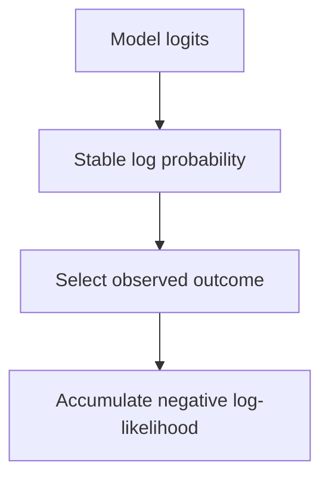

Negative log-likelihood (NLL) measures how much surprise a probabilistic model assigns to an observed outcome. For an event given probability $p$, its contribution is $-\log p$. High-probability observed events have small loss, while confidently assigning a near-zero probability to an event that actually occurs creates a large penalty.

## Log base and stable aggregation

For observed tokens $x_1,\ldots,x_N$, sequence NLL is $-\sum_i\log p_\theta(x_i\mid x_{<i})$. Natural logarithms produce units called nats; base-two logarithms produce bits. Average NLL divides by the number of scored targets. Causal-language-model perplexity is the exponential of average NLL when natural logarithms are used. Compute log probabilities with stable log-softmax rather than exponentiating large logits and taking logarithms afterward.

## Example

Suppose the observed next token is an HTTP status code. A model assigns probability 0.6 to `500`, 0.25 to `200`, and 0.001 to `volcano`. If the real token is `500`, NLL is $-\ln(0.6)\approx0.511$ nats. If the real token were `volcano`, NLL would instead be $-\ln(0.001)\approx6.908$ nats. The metric scores the outcome that occurred, not whichever alternative sounded reasonable to a human.

## Why it matters here

Regression-free language-model evaluation, classifier log loss, supervised fine-tuning, and perplexity reporting all depend on likelihood aggregation. Correct target masking, tokenizer units, context windows, and clean held-out data determine whether the reported NLL answers a meaningful question.

## Related terms

- [Cross-entropy](glossary://cross-entropy)
- [Perplexity](glossary://perplexity)
- [Logits](glossary://logits)
