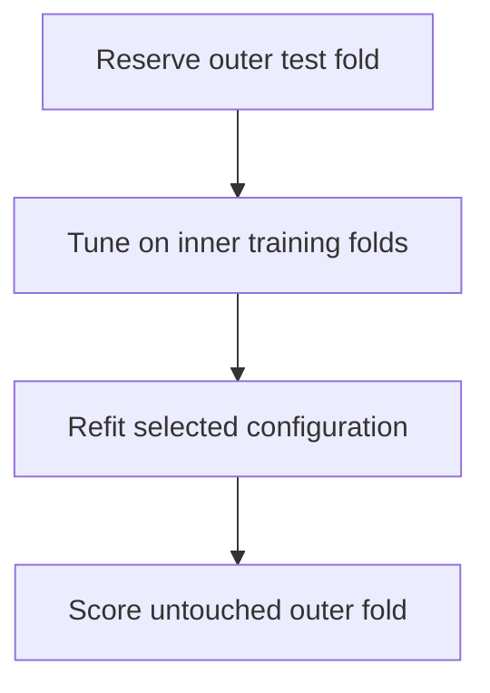

Nested cross-validation uses separate inner and outer validation loops. The inner loop selects hyperparameters or other model choices using only the current outer training partition. The outer loop evaluates the entire selection procedure on examples that were not used to make those choices. This reduces the optimistic bias produced by tuning and scoring on the same folds.

## Two distinct evaluation boundaries

For each outer split, reserve its validation fold before running an independent inner search over the remaining rows. Fit preprocessing, feature selection, and candidate models within each inner training fold. Choose the best inner configuration, refit it on the complete outer training partition, and score it on the untouched outer fold. Finally report the outer scores, not the best inner score.

## Example

An access-review classifier tries five regularization strengths and three feature sets. Selecting whichever configuration achieves the best five-fold score and reporting that same score favors chance winners. Nested evaluation first reserves one account-group fold, compares fifteen configurations using inner folds from the remaining accounts, refits the selected configuration, and evaluates it on the reserved accounts. Repeating that process across outer folds estimates the quality of the model-selection recipe rather than the luckiest candidate.

## Why it matters here

Thresholds, feature definitions, boosted-tree depth, and prompt settings are all choices that can overfit evaluation data. Nested cross-validation teaches the ownership boundary needed to claim generalization honestly when repeated tuning would otherwise recycle the evidence used for reporting.

## Related terms

- [Cross-validation](glossary://cross-validation)
- [Data leakage](glossary://data-leakage)
- [Train, validation, and test split](glossary://train-validation-test-split)
