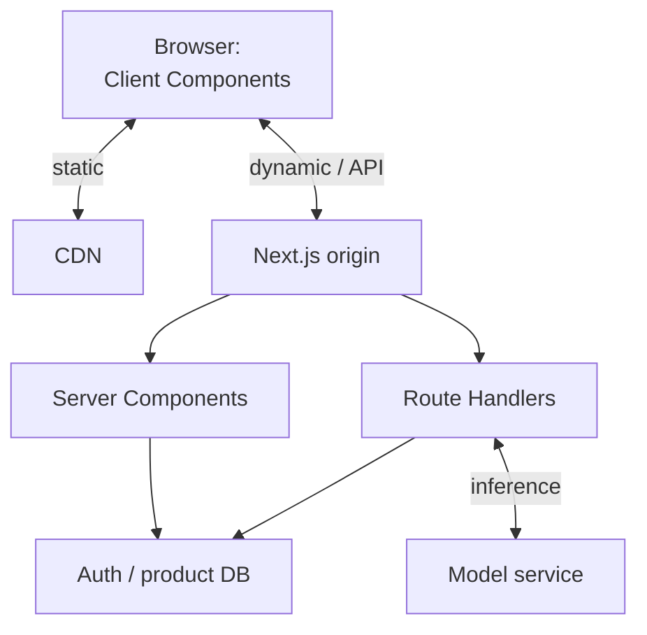

**Next.js** is a React framework for full-stack web apps: file-system routing, server and client rendering, [static generation](glossary://static-generation), caching, and HTTP **route handlers**. It is maintained by Vercel and builds on React, including [React Server Components](https://react.dev/reference/rsc/server-components) (RSC). In the App Router (the modern default under `app/`), layouts and pages are Server Components unless you opt into the client with `"use client"`.

Next.js is the **product shell** around AI features: URLs, HTML for SEO, auth-aware UI, server-side secret handling, and streaming responses that carry tokens or UI chunks to the browser. GPU token batching belongs to the model inference runtime.

## Intuition

An AI product request is usually more than a model call. The user hits a URL, the app decides what can be prerendered versus personalized, a server route may call a provider or [FastAPI](glossary://fastapi) backend with a key that must never ship to the client, and the UI streams partial text so [TTFT](glossary://ttft) feels short even when decode is long.

Next.js is a common place those concerns meet:

| Concern | Typical Next.js surface |
|---|---|
| Public lesson / docs HTML | Server Component page + static generation / CDN |
| Interactive chat composer | Client Component (`"use client"`) |
| Provider keys, ACL, tool side effects | Server Component data loaders or `app/**/route.ts` handlers |
| Token / SSE body | Route Handler returning a Web `ReadableStream` / `Response` stream |
| Auth callback, webhooks | Route Handler (Web `Request` / `Response` APIs) |

Keep the split sharp: the browser gets rendered UI and allowed results; secrets, unrestricted retrieval, and irreversible writes stay on trusted server code.

## How it works

### App Router file conventions

Routes come from the filesystem under `app/`:

- `page.tsx`: UI for a URL segment
- `layout.tsx`: shared chrome that wraps nested pages
- `loading.tsx`: automatic Suspense fallback for the segment
- `error.tsx`: error UI (Client Component)
- `route.ts`: non-UI HTTP handler for that path (no `page` at the same segment level)
- Dynamic segments such as `app/learn/[slug]/page.tsx` bind URL params (since Next.js 15, `params` is a `Promise` you `await`)

### Server Components vs Client Components

By default, pages and layouts are **Server Components**. They can fetch data close to the source, use server-only env vars, and shrink the client JS bundle. They render to an **RSC payload** (a compact representation of the server tree) plus prerendered HTML for the first paint.

Use **Client Components** when you need React state, event handlers, `useEffect`, or browser APIs (`window`, `localStorage`). Mark the boundary with `"use client"` at the top of the module; imports under that module graph ship to the client.

On first load the browser roughly:

1. Shows server-rendered HTML quickly
2. Reconciles with the RSC payload
3. Hydrates Client Components so they become interactive

By default, `NEXT_PUBLIC_` environment variables are inlined into the client bundle; unprefixed variables stay server-side unless application code exposes them. Rendered props, responses, and explicit configuration can all reveal secrets, so use `server-only` on modules that must never be imported from Client Components and return only data the client may see.

### Rendering modes (product-relevant)

Next.js can prerender at build time, render on each request, or mix both (static shell + streamed dynamic islands):

- **Static generation**: known routes (for example every lesson slug via `generateStaticParams`) produce HTML/RSC at build; CDN-friendly
- **Server rendering**: HTML produced per request when data is request-specific
- **Streaming**: send a static shell and Suspense fallbacks first; fill in async Server Components as they resolve; or stream raw bytes from a Route Handler for LLM tokens
- **Client navigation**: subsequent in-app navigations often fetch RSC payload rather than full HTML

### Route Handlers

A `route.ts` exports HTTP method functions (`GET`, `POST`, …) using the Web `Request` / `Response` APIs (often typed as `NextRequest`). This is the App Router replacement for Pages Router API routes. Typical AI uses: chat completion proxies, progress APIs, webhooks, auth callbacks. Handlers can return `Response.json(...)` or a streaming `new Response(readableStream)`.

## Diagram



The origin sends client JavaScript to the browser. Route Handlers stream provider tokens back to the browser; Server Components execute at the origin. The CDN serves cached static HTML and JavaScript.

## Example

**Hybrid curriculum + chat proxy.** Lesson pages are statically generated for speed and SEO. A chat Route Handler holds the provider key and streams tokens; a thin Client Component appends chunks to the transcript.

```tsx
// app/learn/[slug]/page.tsx  (Server Component by default)
import { getLesson, getLessonSlugs } from "@/lib/content";
import { ChatComposer } from "@/components/chat-composer";

export async function generateStaticParams() {
  return (await getLessonSlugs()).map((slug) => ({ slug }));
}

export default async function LessonPage({
  params,
}: {
  params: Promise<{ slug: string }>;
}) {
  const { slug } = await params;
  const lesson = await getLesson(slug); // filesystem / CMS on the server
  return (
    <article>
      <h1>{lesson.title}</h1>
      {/* Markdown HTML, illustrations, related links */}
      <ChatComposer lessonId={lesson.id} />
    </article>
  );
}
```

```tsx
// components/chat-composer.tsx
"use client";

import { useState } from "react";

export function ChatComposer({ lessonId }: { lessonId: string }) {
  const [text, setText] = useState("");

  async function onSend(prompt: string) {
    setText("");
    const res = await fetch("/api/chat", {
      method: "POST",
      headers: { "Content-Type": "application/json" },
      body: JSON.stringify({ lessonId, prompt }),
    });
    if (!res.ok || !res.body) throw new Error("chat failed");
    const reader = res.body.getReader();
    const decoder = new TextDecoder();
    while (true) {
      const { done, value } = await reader.read();
      if (done) break;
      setText((t) => t + decoder.decode(value, { stream: true }));
    }
    const tail = decoder.decode(); // flush any buffered UTF-8 bytes
    if (tail) setText((t) => t + tail);
  }

  return (
    <div>
      <pre>{text}</pre>
      <button type="button" onClick={() => onSend("Summarize this lesson")}>
        Ask
      </button>
    </div>
  );
}
```

```ts
// app/api/chat/route.ts
import { requireUser } from "@/lib/auth";

export async function POST(req: Request) {
  const user = await requireUser(req); // cookie / session on the server
  if (!user) return new Response("Unauthorized", { status: 401 });

  const body = await req.json();
  // Validate size, rate limit, tenant, and lesson ACL here before spending tokens
  // Assume a backend that streams plain UTF-8 token text (not OpenAI SSE frames).
  // For provider SSE, parse events server-side or use an SDK, then write text chunks.
  const upstream = await fetch("https://api.example.com/v1/stream", {
    method: "POST",
    headers: {
      Authorization: `Bearer ${process.env.MODEL_API_KEY}`, // never NEXT_PUBLIC_
      "Content-Type": "application/json",
    },
    body: JSON.stringify({
      prompt: String(body.prompt ?? ""),
      lessonId: body.lessonId,
    }),
  });

  if (!upstream.ok || !upstream.body) {
    return new Response("Upstream error", { status: 502 });
  }

  // Pipe bytes only after auth/ACL succeeded; status is fixed once the stream starts
  return new Response(upstream.body, {
    headers: {
      "Content-Type": "text/plain; charset=utf-8",
      "Cache-Control": "no-store",
    },
  });
}
```

What this split demonstrates (the validation, ACL, rate-limit and cancellation hooks still need real implementations):

- Lesson HTML can be cached at the edge after build
- The model key never enters the client bundle
- Auth runs before token spend; ACL and request validation belong at the marked server-side boundary
- Tokens reach the UI as a stream so perceived latency tracks [TTFT](glossary://ttft), not full completion time

Official Next.js docs show the same Route Handler + Web Streams pattern for LLM streaming (including with helper SDKs that parse provider event formats). The security and product rules stay yours either way.

## Production failure modes

| Failure | What you see | Fix direction |
|---|---|---|
| Secret in Client Component or `NEXT_PUBLIC_*` | Key scraped from bundle / network | Server-only modules; unprefixed env; Route Handlers or Server Components for provider calls |
| Trusting client-sent tenant / user id | Cross-tenant reads or writes | Bind identity from verified session/JWT on the server; [fail closed](glossary://fail-closed) |
| Long generation without timeout / disconnect handling | Hung workers, stuck streams, billable runaway | Deadlines, cancel on client abort, max tokens, concurrency caps |
| Proxy or CDN buffers the body | Stream arrives as one late blob | Disable response buffering where needed (`X-Accel-Buffering: no` on some reverse proxies); confirm platform streaming support |
| Everything marked `"use client"` | Huge JS, secrets harder to fence, worse FCP | Keep interactive islands small; load content in Server Components |
| Public pages rendered dynamic by accident | High origin cost, slow TTFB, weak SEO | Prefer static generation for public curriculum; reserve dynamic for auth and APIs |
| Stale static HTML after content deploy | Readers see old lessons | Rebuild or revalidate; purge CDN ([Cloudflare](glossary://cloudflare)) after cutover |

Streaming also commits HTTP status early: once the first chunk (or Suspense fallback) is sent, you cannot turn a `200` into a real `404` mid-stream. Resolve hard errors before opening the stream when status codes matter for clients or crawlers.

## Trade-offs

| Choice | Gain | Cost |
|---|---|---|
| Next.js as AI product shell | One codebase for UI, SSR/SSG, and BFF-style handlers | GPU inference stays in a model-serving service; Python ML jobs need their own worker stack |
| App Router + RSC | Smaller client bundles; secrets stay server-side | Mental model and caching rules to learn; debug "server vs client" import errors |
| Route Handler as model proxy | Simple BFF; one origin for cookies and CORS | Long streams need timeouts, backpressure awareness, and careful concurrency on the host ([Cloud Run](glossary://google-cloud-run), Node server, etc.) |
| Static public content + dynamic APIs | Fast cacheable lessons; flexible product state | Two freshness clocks: build/CDN for HTML, live for user data and model output |
| Edge runtime for some routes | Low latency near users | Runtime limits can exclude Node APIs and long-lived connection patterns; check support before moving a route |

## Why it matters here

LeetLLM is a Next.js App Router app: curriculum and glossary routes load Markdown-backed content, interactive pieces stay in Client Components, auth and progress hit server routes and [Supabase](glossary://supabase), and the container runs on Cloud Run behind Cloudflare. That is the same pattern many AI learning and product surfaces use: **static or server-rendered knowledge pages**, **dynamic product state**, and **server-mediated model I/O**. Understanding Next.js means understanding how React syntax, model APIs, the browser, the CDN, and the trust boundary fit together.

## Related terms

- [Static generation](glossary://static-generation)
- [API contract](glossary://api-contract)
- [Request path](glossary://request-path)
- [Google Cloud Run](glossary://google-cloud-run)
- [FastAPI](glossary://fastapi)
