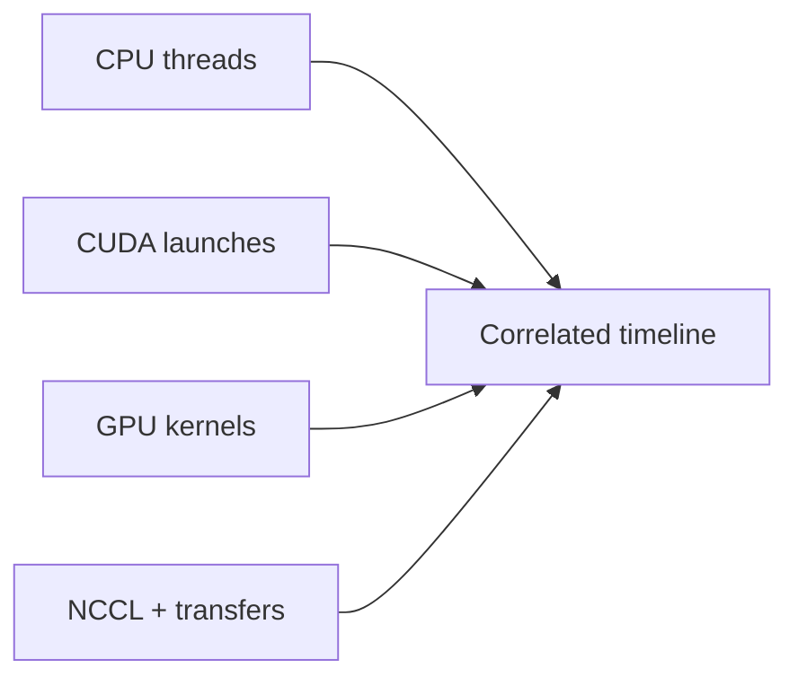

**Nsight Systems** is NVIDIA system-wide profiler for CPU threads, CUDA API calls, GPU kernels, memory copies, NCCL activity, and timeline correlation.

Use it to answer where wall time goes: Python gap, kernel execution, collective, transfer, barrier, or idle queue. Keep capture window narrow because distributed traces become large and profiler overhead can distort long runs.

Nsight Systems locates slow region. Nsight Compute explains one kernel in depth.

## Capture strategy

Mark application phases with NVTX ranges and profile few steady-state steps. Include representative ranks: one controller-adjacent rank, one ordinary rank, and any observed straggler. Capture CUDA and NCCL without maximal backtraces first. Export trace and summary beside resolved config. Long unbounded capture can fill disk, perturb synchronization, and make review harder than original failure.

## Diagram

## Example

A hypothetical ten-update capture shows a 22-second CPU/storage gap at updates five and ten, followed by normal GPU work. Compare those timestamps with checkpoint and export ranges to determine whether I/O or checkpoint cadence caused the gaps.

## Why it matters here

GLM training spans CPU orchestration, GPU kernels, collectives, offload, and I/O. System timeline assigns wall time to right owner before configuration changes.

## Related terms

- [Nsight Compute](glossary://nsight-compute)
- [CUDA](glossary://cuda)
- [NCCL](glossary://nccl)
