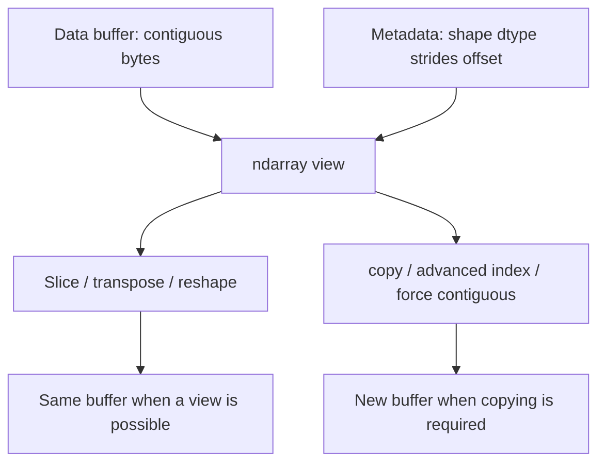

A **NumPy array** (`numpy.ndarray`) is a fixed-size, homogeneous block of memory plus metadata that turns that block into an $N$-dimensional grid of same-typed items. The type of each item is the **dtype**; the sizes of the axes are the **shape**; the byte steps between neighbors along each axis are the **strides**. Arithmetic and reductions run in compiled code over that layout, which is why NumPy is the default numeric bridge between Python lists, [DataFrames](glossary://dataframe), eval scripts, and [tensors](glossary://tensor) in PyTorch or JAX.

Unlike a nested Python list, an `ndarray` stores values densely (one dtype for every element), exposes shape and layout explicitly, and can share the same buffer across many **views** (slices, transposes, reshapes) without copying.

## Intuition

Think of two layers:

1. **Data buffer:** a 1D slab of bytes (owned by this array, or borrowed from another array / buffer).
2. **Metadata:** how to interpret those bytes as a multidimensional table: shape, dtype, item size, offset into the buffer, and strides.

Changing metadata can re-label the same bytes as a different shape or axis order. That is how a transpose can be free (swap strides and shape) and how a slice can be a view (new offset and strides into the same base buffer). It is also how two arrays that look independent can still mutate each other: write through a view and the base changes.

## Formula

An $N$-dimensional index $(n_0, n_1, \ldots, n_{N-1})$ maps to a byte offset from the array's data pointer (the address of element $(0,\ldots,0)$):

$$
\mathrm{byte\_offset} = \sum_{k=0}^{N-1} s_k\, n_k
$$

where $s_k$ is `strides[k]` in **bytes** (not elements). Strides can be negative (for example after a reverse slice); the same sum still holds. For a C-contiguous (row-major) array with shape $(d_0, \ldots, d_{N-1})$ and element size $b$ (`itemsize`):

$$
s_k^{\mathrm{row}} = b \prod_{j=k+1}^{N-1} d_j
$$

so the last axis has stride $b$ and moves fastest in memory (the empty product for $k=N-1$ is $1$). Fortran (column-major) order flips which axis is contiguous. Broadcasting does not change this formula; it only decides when shapes of two operands can be treated as if they matched for elementwise ops.

**Broadcasting rules** (official NumPy rule, applied from the trailing axis leftward): two dimensions are compatible if they are equal, or one of them is $1$. Missing leading dimensions act like size $1$. A singleton axis takes the other operand's size, including zero for an empty axis; incompatible shapes raise `ValueError`.

## How it works

| Piece | What it answers |
| --- | --- |
| `shape` | How many items along each axis |
| `dtype` / `itemsize` | How each item is encoded (e.g. `float32` is 4 bytes) |
| `strides` | How many bytes to jump for `+1` on that axis |
| `flags` | C/F-contiguous, writeable, aligned, and related layout facts |
| `base` | Whether this array owns the buffer or is a view of another |
| `ndim` / `size` / `nbytes` | Rank, element count, and payload byte size |

Common production operations:

- **Create:** `np.array`, `np.zeros`, `np.empty`, `np.arange`, plus readers that return arrays (`to_numpy()`, image loaders, parquet/Arrow bridges).
- **View-ish layout ops:** basic slicing, `transpose` / `.T`, many `reshape` calls, `ravel` when contiguous. These change shape/strides (and maybe offset), not the element values in a new buffer.
- **Copy-ish ops:** `copy()`, advanced integer indexing, and any path where the library cannot express the result as a strided view of the same bytes. `np.ascontiguousarray` copies when required but can return an already C-contiguous input unchanged.
- **Compute:** ufuncs (`+`, `*`, `exp`, …), reductions (`sum`, `mean` with an `axis=`), and `@` / `matmul` for linear algebra.

## Example

Embeddings and a linear projection in float32, with an explicit shape contract:

```python
import numpy as np

# batch of 4 vectors, each dim=128
x = np.zeros((4, 128), dtype=np.float32)
w = np.zeros((128, 64), dtype=np.float32)  # projects 128 -> 64
y = x @ w
assert y.shape == (4, 64)
assert y.dtype == np.float32
assert x.flags["C_CONTIGUOUS"]

# axis meaning: L2 over features (axis=1), keep batch
norms = np.linalg.norm(x, axis=1)  # shape (4,)
assert norms.shape == (4,)
```

A view that still shares memory:

```python
a = np.arange(6, dtype=np.int32).reshape(2, 3)
col = a[:, 1]          # view of the middle column
col[0] = 99
assert a[0, 1] == 99   # base array changed
assert np.shares_memory(col, a)
```

## Worked numbers (shape and strides)

Take a C-order float32 matrix with shape $(3, 4)$:

$$
b = 4\ \text{bytes},\quad
s_1 = 4,\quad
s_0 = 4 \times 4 = 16
$$

so `strides == (16, 4)`. Index $(i, j)$ sits at byte offset $16i + 4j$. After `.T`, shape becomes $(4, 3)$ and strides become $(4, 16)$: same buffer, different walk order. That transposed array is often **not** C-contiguous; libraries that need a single contiguous segment may copy silently when you pass it into BLAS, serialization, or a C extension that only accepts `C_CONTIGUOUS` input.

Broadcasting example with shapes:

```text
logits   (B, C) = (8, 10)
bias     (C,)   = (10,)
result   (B, C) = (8, 10)   # bias stretches over batch
```

But `(8, 10)` and `(8,)` do **not** align on the trailing axis and fail to broadcast. A common silent-wrong case is reducing with the wrong `axis`, then broadcasting a length-$B$ vector against a length-$C$ axis because both happen to share a numeric size in a toy test.

## Diagram



## Debug path

When an array pipeline misbehaves, print or assert at boundaries:

1. `arr.shape`, `arr.dtype`, `arr.strides`, and contiguity flags
2. Whether the object is a view (`arr.base is not None`) before in-place writes
3. Result shape after every `reshape`, `transpose`, `squeeze`, `expand_dims`, and broadcasted op
4. Axis meaning in comments: `batch`, `seq`, `dim`, `height`, `width`, `channels`
5. Unexpected copies under a profiler (`np.shares_memory`, or sudden RSS jumps after transpose + BLAS)

**Production failure patterns:** wrong axis on a reduction (metrics over features instead of batch); broadcast that "works" but pairs the wrong axes; accidental `float64` from untyped `np.array([...])` doubling memory and changing numeric noise; non-contiguous inputs thrashing cache or forcing hidden copies in C extensions; mutating a slice that still aliases training data or a shared cache buffer.

## Why it matters here

Almost every offline ML and LLM engineering path still touches NumPy: feature matrices, embedding batches, eval scores, token-id tables, padding masks, and the last step before `torch.from_numpy` / DLPack handoff. Shape, dtype, strides, and view-vs-copy are the same mental model as framework [tensors](glossary://tensor); learning them in NumPy makes [tensor shape](glossary://tensor-shape) bugs and layout costs legible before GPU code enters the picture.

## Related terms

- [Tensor](glossary://tensor)
- [Tensor shape](glossary://tensor-shape)
- [Matrix](glossary://matrix)
- [Padding](glossary://padding)
- [PyTorch](glossary://pytorch)
