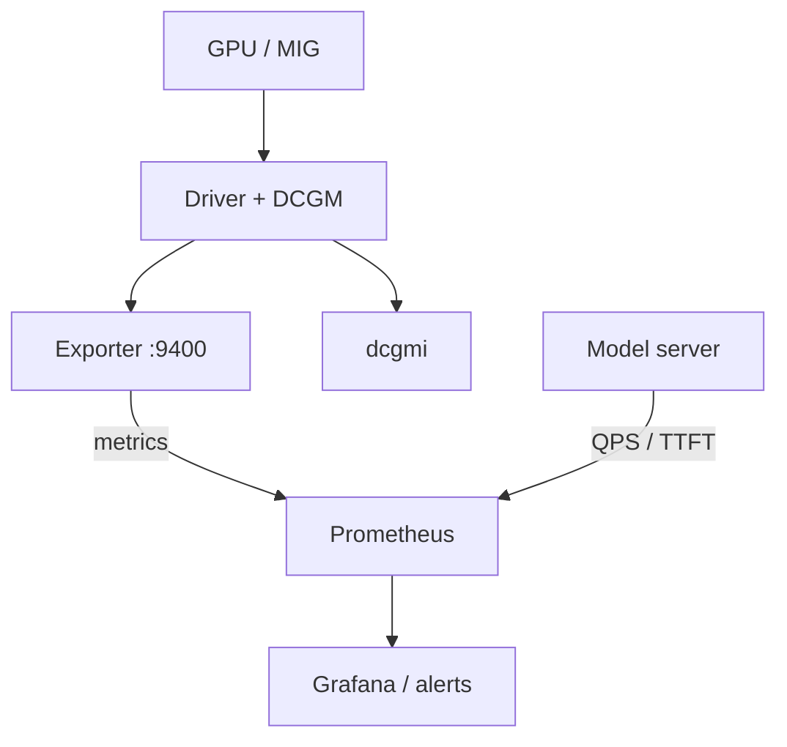

**NVIDIA Data Center GPU Manager (DCGM)** is NVIDIA's suite for monitoring, diagnosing, configuring, and governing data-center GPUs in cluster environments. For LLM engineers it's the standard way to see whether accelerators are busy, healthy, thermally limited, or failing while model servers run, and to export those signals into [Prometheus](glossary://prometheus)-style telemetry stacks (often via **DCGM-Exporter** on Kubernetes).

DCGM is more than a prettier `nvidia-smi`. It's a host-side agent and library stack (`nv-hostengine` / `libdcgm`) with a CLI (`dcgmi`), C/Python/Go APIs, job-level stats, policy hooks, passive health watches, and invasive diagnostics. The open-core libraries and exporter integrate with cluster managers; some diagnostic payloads remain proprietary NVIDIA code.

## Intuition

User-facing metrics (queue depth, [TTFT](glossary://ttft), tokens/s, error rate) answer *what users feel*. DCGM answers *what the silicon did*:

- Did work actually reach the [GPU](glossary://gpu)?
- Was the SM / Tensor Core path active, or was the device stalled on [HBM](glossary://hbm) / interconnect?
- Was the device healthy (ECC, PCIe/NVLink, InfoROM, driver XIDs), or throttled (power, thermal)?
- Which process or MIG instance holds memory while the rest of the node looks idle?

Without that layer, a latency spike is an unfalsifiable "model problem." With it, many incidents become routing, dead workers, KV pressure, throttle, or hardware before anyone rewrites kernels.

## How it works

Typical production shape:

1. **Driver + GPU** expose hardware counters and management interfaces.
2. **`nv-hostengine`** (standalone service or embedded in a client) holds group state, field watches, policies, and health systems.
3. **Clients** talk to the host engine:
   - **`dcgmi`**: interactive ops (discovery, groups, `dmon`, health, diag, stats, topology).
   - **DCGM-Exporter**: scrapes selected DCGM fields and serves Prometheus text on HTTP (commonly port `9400`).
   - **GPU Operator / custom agents**: embed or remote-connect the same stack on every GPU node.
4. **Collectors** (Prometheus, cloud monitoring) scrape exporter metrics; Grafana dashboards (for example the community NVIDIA DCGM dashboard) plot them next to request SLIs.

DCGM organizes devices into **groups** (all GPUs on a node, or the subset belonging to one job). Most operations (config, health, stats) target a group so schedulers can reason about "this job's GPUs" as one resource.

Four collection modes matter for LLM serving:

| Mode | What it does | When to use |
| --- | --- | --- |
| **Device / field watches** | Continuous gauges and counters (util, memory, power, temp, ECC, clocks, XID) | Always-on dashboards and alerts |
| **Profiling metrics (DCP)** | Hardware-counter ratios such as graphics-engine active, Tensor pipe active, DRAM active | Explaining *how* the GPU is busy (compute-bound vs memory-bound) under real load |
| **Background health** | Non-invasive watches for PCIe, memory, thermal/power, NVLink, driver, InfoROM issues while jobs run | Fleet reliability without draining traffic |
| **Active diagnostics** | Readiness and stress tests (`dcgmi diag`, levels 1–4); GPU stress tests need drained hardware | Node intake and post-failure triage; does not replace vendor field diagnostics or the RMA process |

Profiling fields are ratios over a sampling window, not "percent of marketing peak FLOPs." Use the exact field names and IDs supported by your installed DCGM/exporter configuration. Device GPU utilization is a percentage, while the profiling activity fields below are ratios. Rough reading:

- High **`DCGM_FI_PROF_GR_ENGINE_ACTIVE`** (field 1001; graphics/compute engine busy) with low Tensor activity: general compute path busy, matrix engines not saturated.
- High **`DCGM_FI_PROF_PIPE_TENSOR_ACTIVE`** (field 1004): Tensor Cores are firing (dense matmul-friendly work such as large prefill batches).
- High **`DCGM_FI_PROF_DRAM_ACTIVE`** (field 1005) with modest engine activity: memory interface busy; classic low-batch decode / KV-heavy pattern.
- Low engine activity while request queue is deep: work isn't reaching the device (scheduler, dead worker, CPU bottleneck, wrong GPU binding).

On [MIG](glossary://gpu-partitioning) partitions, include GPU instance profile/id in exporter labels so metrics attach to the slice a pod holds. Full-GPU averages hide a noisy neighbor on another instance.

## Diagram



Pair the two scrape paths: request metrics explain the product SLO; DCGM explains the accelerator.

## Example

Eight H100s run a [vLLM](glossary://vllm) deployment. p95 latency rises and aggregate tokens/s falls, but CPU and network look fine.

On the node (or in Grafana via DCGM-Exporter) you see:

| Signal | GPU 0–6 | GPU 7 |
| --- | --- | --- |
| Request queue (server) | high | high |
| GR engine active ratio | ~0.7–0.9 | ~0.05 |
| FB used (device memory) | steady | near capacity, flat |
| Clocks event / thermal | none | thermal throttle flag |
| Correctable ECC count | 0 | rising |

In this hypothetical incident, GPU 7's thermal flag and low activity warrant checking clocks, cooling, worker logs, and synchronization before diagnosing a model-kernel issue. Check allocated memory alongside worker progress, utilization, logs, and synchronization when investigating a stall. Track correctable ECC and follow vendor guidance; drain or replace hardware when severity and incident evidence call for it.

A second common pattern: queue depth high, **all** GPUs near zero util and free memory. That's not a slow kernel; it's routing, crash-looping workers, or a deadlock above CUDA. DCGM confirms the devices are idle so the search moves up the stack.

Operational sketch (host with DCGM installed):

```bash
# List GPUs DCGM can see
dcgmi discovery -l

# Stream selected fields (IDs from DCGM field docs / exporter CSV)
dcgmi dmon -e 203,252,155,150   # GPU util, FB used, power (W), GPU temp (°C)

# Optional profiling set (needs DCP-capable stack; higher overhead)
# dcgmi dmon -e 1001,1004,1005   # GR engine, Tensor, DRAM activity ratios

# Passive health for a group (after groups are configured)
dcgmi health -g 1 -s a    # enable all watch systems
dcgmi health -g 1 -c      # current health report

# Invasive long diagnostic only on drained nodes; runtime varies by GPU count
dcgmi diag -r 3
```

Kubernetes path is usually the NVIDIA GPU Operator or Helm chart for **dcgm-exporter**, scrapable as Prometheus gauges such as `DCGM_FI_DEV_FB_USED`, `DCGM_FI_DEV_POWER_USAGE` (alias of board power Watts), `DCGM_FI_PROF_PIPE_TENSOR_ACTIVE`, labeled by GPU UUID (and MIG instance when applicable).

## Metrics that matter for LLM serving

Prefer a small joint panel: product SLIs + DCGM. Useful DCGM-side fields (names as exposed by exporter / field IDs; exact set is version and CSV config dependent):

| Concern | Typical DCGM signals | Reading tip |
| --- | --- | --- |
| Compute occupancy | GPU util, `PROF_GR_ENGINE_ACTIVE`, SM occupancy | Pair utilization with Tensor-Core activity and achieved throughput to assess Tensor use |
| Matmul path | `PROF_PIPE_TENSOR_ACTIVE` | Prefill/training should light this up; tiny-batch decode may not |
| Memory pressure | FB used/free, `PROF_DRAM_ACTIVE` | KV growth and weight streaming show up here |
| Throttle | Power usage vs limit, GPU/memory temp, clocks event thermal/power | Latency rises while "util" stays high or drops with lower clocks |
| Fabric | NVLink error/bandwidth counters, PCIe replay | Multi-GPU TP/PP and NCCL-heavy jobs |
| RAS / death | ECC SBE/DBE, retired pages, XID, fallen-off-bus | Interpret severity: correctable events may need monitoring; fatal faults can require isolation/reset |

**Incident pairing table** (request metrics × DCGM):

| Symptom | Likely direction |
| --- | --- |
| High queue + idle GPUs | Dead worker, bad device binding, CPU/scheduler stall |
| High util + rising latency | Saturation; raise capacity or tighten batch/SLO |
| High DRAM active + modest Tensor active | Memory-bound decode / KV; batch, quantize, or shrink context |
| ECC / XID / NVLink critical | Device or interconnect health issue |
| Thermal/power clocks events | Cooling, power cap, dense packing; expect throughput cliffs |

## Diagnostics depth

Background health is for live fleets. Active diagnostics are for drained hardware:

| Level (`dcgmi diag -r`) | Duration (NVIDIA order of magnitude) | Focus |
| --- | --- | --- |
| 1 Short | Seconds | Deployment / software readiness |
| 2 Medium | Minutes | Deeper integration and stress |
| 3 Long | Tens of minutes on some multi-GPU systems | Hardware, memory, PCIe, stress |
| 4 Extra Long | Can exceed an hour on multi-GPU systems | Additional memory and power-transient tests |

NVIDIA documents that online diagnostics run in the current OS environment and can be influenced by non-GPU factors; full offline vendor diagnostics remain the bar for some RMA paths. Don't run level-2/3 diags on GPUs still serving traffic.
Level 4 also requires drained hardware. Duration and supported tests vary by GPU, GPU count, release and test parameters; current Hopper documentation reports different bounds for four- and eight-GPU systems rather than one universal 15-minute level-3 runtime.

## Trade-offs

- **Exporter interval vs noise.** Default collection often sits at multi-second periods (exporter default is 30s / 30000 ms unless reconfigured). Fine for capacity and health; coarse for sub-second prefill spikes. Shorten carefully; profiling counters add overhead and host load.
- **Embedded vs remote hostengine.** Exporter can embed `nv-hostengine` or connect to an existing one (DGX images, standalone DCGM container). Client library version should be ≥ hostengine version to avoid protocol mismatches.
- **Util isn't quality.** A GPU can be 100% utilized on inefficient kernels or thrashing memory traffic. Always read engine, Tensor, and DRAM activity together with tokens/s and latency.
- **MIG and multi-tenant.** Metrics and power may be full-GPU or per-instance depending on field and stack. Alert on the UUID/instance your pod owns.
- **Config governance.** DCGM can enforce ECC mode, compute mode, power limits, and clocks for a group across resets. That's operational power; wrong caps create mysterious throughput regressions.

## Why it matters here

LLM production work sits on expensive multi-GPU nodes where software bugs, scheduler mistakes, and silicon faults all present as "slow inference." DCGM is the observability and health layer that connects [SLO](glossary://slo)-facing request metrics to accelerator state, so capacity planning, incident response, and hardware lifecycle (throttle, ECC, diag, replace) use the same shared language as the model server.

## Related terms

- [Observability](glossary://observability)
- [GPU](glossary://gpu)
- [Prometheus](glossary://prometheus)
- [vLLM](glossary://vllm)
- [GPU partitioning](glossary://gpu-partitioning)
