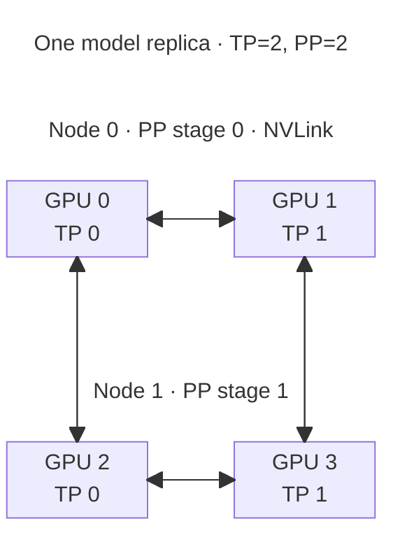

**NVIDIA Megatron** is NVIDIA's open-source stack for training large [transformer](glossary://transformer) models on multi-GPU clusters. The public repository ships two layers: **Megatron Core**, a composable library of GPU-optimized transformer blocks and distributed primitives, and **Megatron-LM**, reference training scripts built on that library. In industry talk, "Megatron-style" usually means the column/row [tensor parallelism](glossary://tensor-parallelism) pattern from the 2019 Megatron-LM paper, often composed with [pipeline parallelism](glossary://pipeline-parallelism) and [data parallelism](glossary://data-parallelism).

The original Megatron-LM work (Shoeybi et al., 2019) showed how to train multi-billion-parameter language models with *intra-layer* model parallelism implemented as a few native PyTorch collectives, without a new compiler. Follow-on work (Narayanan et al., 2021) composed tensor, pipeline, and data parallelism (PTD-P), introduced an interleaved pipeline schedule, and scaled to trillion-parameter-class layouts on thousands of GPUs. Today's Megatron Core extends that foundation with sequence and context parallelism, expert parallelism for [MoE](glossary://mixture-of-experts), distributed optimizers, mixed precision (including FP8/FP4 paths via [Transformer Engine](glossary://transformer-engine)), and integrations such as Megatron Bridge for Hugging Face checkpoint conversion.

Megatron is a *training systems* reference for large-model runs that need explicit control over how ranks split weights, activations, and optimizer state. Use it when the model, sequence length, or batch exceeds a single-process or pure-DDP [PyTorch](glossary://pytorch) setup.

## Intuition

A full GPT-style model has three resource problems at once:

1. **Parameters and optimizer state** may not fit one GPU (or even one node).
2. **Activations** grow with batch size, depth, and sequence length.
3. **Wall-clock** for pretraining is limited by how well compute overlaps with communication.

Megatron answers each with a different cut of the work:

| Cut | Name | What is split |
|-----|------|----------------|
| Batch | Data parallelism (DP) | Different microbatches on model replicas or sharded replicas |
| Layer math | Tensor parallelism (TP) | Columns/rows of weights *inside* a layer |
| Depth | Pipeline parallelism (PP) | Contiguous (or interleaved) layer ranges across stages |
| Sequence (with TP) | Sequence parallelism (SP) | Sequence dim for LayerNorm/Dropout-style regions under TP |
| Sequence (all layers) | Context parallelism (CP) | Sequence dim for long contexts across ranks |
| Experts | Expert parallelism (EP) | MoE expert modules across ranks |

These dimensions do not all multiply as independent axes. For dense attention layers, a common world-size factorization is:

$$
W = \mathrm{TP} \times \mathrm{CP} \times \mathrm{DP} \times \mathrm{PP}
$$

Traditional MoE layouts make expert parallelism a subgroup of data parallelism, so multiplying both EP and DP again would overcount ranks. Megatron Core's **MoE parallel folding** can instead use a separate factorization for expert layers:

$$
W = \mathrm{ETP} \times \mathrm{EP} \times \mathrm{EDP} \times \mathrm{PP}
$$

Here ETP and EDP are expert-layer tensor and data parallel degrees. Attention and expert layouts must each map onto the same $W$, but can use different group shapes. Choosing those factorizations is the main configuration problem: keep high-bandwidth collectives (especially TP) on NVLink within a node, put PP and DP across nodes more often, and turn on SP/CP when activation memory from sequence length dominates.

## How it works

### Tensor parallelism (Megatron column/row pattern)

For a feed-forward block $Y = \mathrm{GeLU}(X A)\, B$ (or SwiGLU variants with the same split idea), Megatron shards $A$ by **columns** and $B$ by **rows** so each TP rank holds a slice of the hidden dimension:

$$
A = [A_1 \mid A_2 \mid \cdots \mid A_t], \qquad
B = \begin{bmatrix} B_1 \\ \vdots \\ B_t \end{bmatrix}
$$

Rank $i$ computes $Y_i = \mathrm{GeLU}(X A_i)\, B_i$. Because of the row-parallel second matmul, a **reduce** (all-reduce of partial $Y_i$) rebuilds the full output before the next residual path that needs a full vector. Self-attention projects $Q$, $K$, $V$ in a column-parallel way across heads (or head shards) and uses a row-parallel output projection, again inserting collectives so mathematically the layer matches the non-sharded model.

The design goal from the 2019 paper: insert a small number of collectives in PyTorch, keep GEMMs large enough to stay efficient, and stay orthogonal to pipeline depth splits.

### Pipeline parallelism

PP assigns consecutive layer blocks to stages. Microbatches stream through stages like an assembly line. Idle **bubble** time appears while the pipeline fills and drains. With $p$ pipeline stages and $m$ microbatches in a simple 1F1B-style schedule, bubble fraction scales roughly like:

$$
\frac{\text{bubble time}}{\text{ideal steady time}} \approx \frac{p - 1}{m}
$$

More microbatches shrink the relative bubble. Activation memory depends on the schedule: unlike fill-then-drain, a steady-state 1F1B schedule can bound outstanding activations by pipeline depth rather than total microbatch count. Interleaved (virtual) pipeline parallelism assigns each stage multiple non-contiguous model chunks so stages stay busier, with additional communication and scheduling costs.

### Data parallelism and distributed optimizer

DP splits the global batch across replicas. Megatron's **distributed optimizer** shards optimizer state (and often master weights) across data-parallel ranks, similar in spirit to ZeRO-1: reduce-scatter gradients, update local shards, all-gather parameters. That cuts optimizer HBM so large Adam runs fit without full ZeRO-3-style parameter gather on every layer (though Megatron also offers Megatron-FSDP-style sharding when you need deeper state partitioning).

### Sequence and context parallelism

**Sequence parallelism** (with TP) shards the sequence dimension in regions that TP would otherwise keep replicated (for example LayerNorm and dropout), cutting activation memory without adding communication volume beyond reformulating all-reduces as reduce-scatter + all-gather pairs.

**Context parallelism** partitions the *full* sequence across ranks for long-context training (often 8K+ tokens). Each rank stores and computes on a sequence shard; attention needs ring-style or p2p exchange of K/V segments so every token can attend correctly. CP is the usual knob when sequence length, not hidden size alone, blows activation memory.

### Expert parallelism

For MoE layers, **EP** places different experts on different ranks. Tokens are routed with all-to-all (or optimized dispatchers), and only the sparse expert path is EP-sharded; attention and other dense blocks keep the TP/PP/DP map. EP degree should divide the expert count.

## Diagram



Horizontal links carry TP collectives within a pipeline stage. Vertical links carry forward activations and backward gradients between stages. A second data-parallel replica repeats this whole grid; DP synchronizes corresponding parameters across replicas, and a distributed optimizer can shard its state across those DP ranks.

Typical layout rule of thumb: **TP inside a node**, **PP across nodes**, **DP** to fill remaining GPUs and grow global batch, **CP/SP** when sequences are long, **EP** for MoE.

## Example

Train a LLaMA-3-class **70B** dense model on **64 GPUs** with 8K context, following Megatron Core's documented shape (TP=4, PP=4, CP=2, DP=2). Dense world size in order $\mathrm{TP}\times\mathrm{PP}\times\mathrm{CP}\times\mathrm{DP}$:

$$
4 \times 4 \times 2 \times 2 = 64
$$

The parallelism flags below illustrate that layout, not a complete LLaMA-3 training recipe. Data/tokenizer paths, model-specific GQA/SwiGLU/RoPE settings, optimizer and checkpoint configuration are omitted. Launch on eight eight-GPU nodes with the same rendezvous endpoint and a unique node rank:

```bash
torchrun --nnodes=8 --nproc_per_node=8 \
  --node_rank="$NODE_RANK" --master_addr="$MASTER_ADDR" --master_port=29500 \
  pretrain_gpt.py \
  --tensor-model-parallel-size 4 \
  --pipeline-model-parallel-size 4 \
  --context-parallel-size 2 \
  --sequence-parallel \
  --use-distributed-optimizer \
  --num-layers 80 \
  --hidden-size 8192 \
  --num-attention-heads 64 \
  --seq-length 8192 \
  --micro-batch-size 1 \
  --global-batch-size 512 \
  --bf16 \
  --overlap-grad-reduce \
  --tp-comm-overlap
```

What each flag buys you:

- **TP=4 + sequence parallel**: each layer's large GEMMs and much of the activation footprint are split four ways; keep those four ranks on one NVLink domain.
- **PP=4**: depth is cut into four stages so no single rank holds all 80 layers.
- **CP=2**: the 8K sequence is split for attention activations.
- **DP=2 + global batch 512**: two data-parallel replicas; with micro-batch 1, gradient accumulation is implied by how many microbatches make up the global batch under this parallel map.
- **Distributed optimizer + BF16**: Adam moments are sharded; matmuls run in BF16 for throughput.

If the same model were closer to **8B** on one 8-GPU node, you might drop to DP-only or TP=2 with no PP. If you moved to Mixtral-style MoE, you would raise **EP** and often keep TP small (1-2), because expert count, not dense hidden size, is the main partition axis.

## Sizing and trade-offs

| Knob | Helps | Costs / failure mode |
|------|--------|----------------------|
| Higher TP | Fit wide layers; cut per-GPU activation for sharded GEMMs | Collectives every layer; dies on slow cross-node links |
| Higher PP | Fit deep models; cross-node friendlier than TP | Pipeline bubble; stage imbalance; more microbatch tuning |
| Higher DP | Throughput and global batch | Replicated (or sharded) state; large-batch optimization effects |
| SP (with TP) | Activation memory | Requires TP > 1; correctness depends on paired collectives |
| Higher CP | Long sequences | Attention K/V exchange; load imbalance on variable lengths |
| Higher EP | MoE capacity | All-to-all routing; expert load imbalance |
| Distributed optimizer / FSDP-style shard | Optimizer / param HBM | Extra reduce-scatter and gather; harder checkpoints |
| Activation checkpointing | Activation HBM | Extra recompute FLOPs |

Narayanan et al. emphasized measuring end-to-end tokens/sec (or model FLOP utilization) alongside theoretical FLOPs. Megatron Core public benchmarks report strong and weak scaling on large H100 clusters (for example multi-hundred-billion dense models across thousands of GPUs); always re-measure on *your* interconnect, batch, and precision.

## What fails in production

- **Topology mismatch.** TP groups straddling Ethernet or weak IB turn every layer into a network stall. MFU collapses while the job still "runs."
- **Silent math drift.** Wrong TP/PP/CP product vs world size, mis-set sequence parallel, or broken gradient accumulation changes the *effective* global batch and learning-rate story. Throughput can look fine while validation loss diverges from a known-good run.
- **Pipeline bubbles and stragglers.** Too few microbatches, uneven stage FLOPs (embedding or LM head heavy stages), or one slow rank in a collective idles the whole group.
- **Checkpoint and export breakage.** Sharded Megatron checkpoints are not a Hugging Face `state_dict`. Tensor splits, layer names, rotary metadata, and tokenizer files must be converted (Megatron Bridge and similar tools exist for this). Serving stacks fail in subtle ways if TP merge is wrong.
- **MoE routing imbalance.** EP without capacity factors / load-balancing can hotspot a few experts and OOM or slow ranks unpredictably.
- **Activation vs parameter confusion.** OOM after raising sequence length is often activation pressure (fix SP/CP/checkpointing), not a need for more TP.

When debugging, inspect: parallel degrees and world-size factorization, microbatch and global batch, sequence length, precision and loss scaling, NCCL topology, overlap flags, per-stage timers, tokens/sec *and* validation curves, and a save/restore/export path before multi-day pretraining.

## Why it matters here

LeetLLM teaches large-model training as systems engineering, including architecture, GPU collectives, and the operational choices that shape a run. Megatron is the canonical open reference for how production research stacks combine TP, PP, DP, and later SP/CP/EP. Reading a Megatron (or NeMo / Megatron Bridge) config connects curriculum ideas about parallelism, [NCCL](glossary://nccl), [mixed precision](glossary://mixed-precision), and [pretraining](glossary://pretraining) to the knobs that decide whether a 70B-class run fits and finishes.

## Related terms

- [Tensor parallelism](glossary://tensor-parallelism)
- [Pipeline parallelism](glossary://pipeline-parallelism)
- [Data parallelism](glossary://data-parallelism)
- [DeepSpeed](glossary://deepspeed)
- [NCCL](glossary://nccl)
